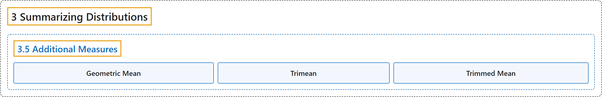

# 3.5 Additional Measures

## Classification

## Glossary

| Term | Definition | 中文翻译 | Source |
|---|---|---|---|
| **3.5 Additional Measures** 其他度量 | (No definition) | （无定义） | [Online Statistics Education, n.d., section 3.5](https://onlinestatbook.com/2/summarizing_distributions/additional_measures.html) |
| **Geometric Mean** 几何平均数 | "The **geometric mean** is a measure of central tendency. The geometric mean of $n$ numbers is obtained by **multiplying all of them together, and then taking the nth root of them**. For example, for the numbers 1, 10, and 100, the product of all the numbers is: $1 \times 10 \times 100 = 1,000$. Since there are three numbers, we take the cubed root of the product (1,000) which is equal to 10." | **几何平均数**是集中趋势的一种度量。$n$ 个数的几何平均数是**将它们全部相乘，然后取其 n 次方根**得到的。例如，对于数 1、10 和 100，所有数的乘积为：$1 \times 10 \times 100 = 1,000$。由于有三个数，我们取乘积（1,000）的立方根，结果等于 10。 | [Online Statistics Education, n.d., glossary](https://onlinestatbook.com/2/glossary/geometric_mean.html) |
| **Trimean** 三均值 | "The **trimean** is a robust measure of central tendency ; it is a **weighted average of the 25th, 50th, and 75th percentiles**. Specifically it is computed as follows:" | **三均值**是集中趋势的稳健度量；它是**第 25、第 50 和第 75 百分位数的加权平均数**。具体计算如下： | [Online Statistics Education, n.d., glossary](https://onlinestatbook.com/2/glossary/trimean.html) |
| **Trimmed Mean** 截尾均值 | "The **trimmed mean** is a robust measure of central tendency generally falling between the mean and the median. As in the computation of the median, all observations are ordered. Next, **the highest and lowest $\alpha$ percent of the data are removed**, where $\alpha$ ranges from 0 to 50. Finally, the mean of the remaining observations is taken. The trimmed mean has advantages over both the mean and median, but is analytically more intractable." | **截尾均值**是一种稳健的集中趋势度量，通常介于均值与中位数之间。与计算中位数时一样，先将所有观测值排序。接着，**去掉数据中最高和最低的 $\alpha$ 百分比**，其中 $\alpha$ 的取值范围为 0 到 50。最后，取其余观测值的均值。截尾均值相对于均值和中位数都有优势，但在分析上更难处理。 | [Online Statistics Education, n.d., glossary](https://onlinestatbook.com/2/glossary/trimmed_mean.html) |

## References

*Online statistics education: An interactive multimedia course of study*. (n.d.). Rice University, University of Houston Clear Lake, and Tufts University. Retrieved October 29, 2026, from <https://onlinestatbook.com/2/>
