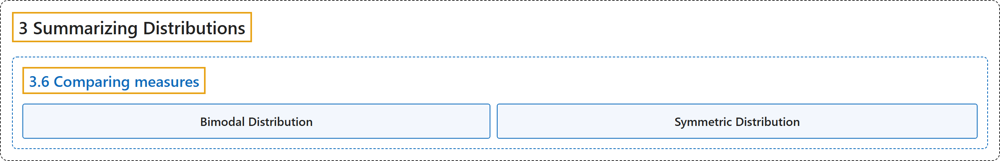

# 3.6 Comparing measures

## Classification

## Glossary

| Term | Definition | 中文翻译 | Source |
|---|---|---|---|
| **3.6 Comparing measures** 度量的比较 | (No definition) | （无定义） | [Online Statistics Education, n.d., section 3.6](https://onlinestatbook.com/2/summarizing_distributions/comparing_measures.html) |
| **Bimodal Distribution** 双峰分布 | "A **distribution with two distinct peaks**. An example is shown below." | 具有两个明显峰值的**分布**。示例如下。 | [Online Statistics Education, n.d., glossary](https://onlinestatbook.com/2/glossary/Bimodal_Distribution.html) |
| **Symmetric Distribution** 对称分布 | "In a **symmetric distribution**, the upper and lower halves of the distribution are mirror images of each other. For example, in the distribution shown below, the portions above and below 50 are mirror images of each other. In a symmetric distribution, the mean is equal to the median. Antonym: skewed distribution." | 在**对称分布**中，分布的上半部分和下半部分互为镜像。例如，在下面所示的分布中，50 以上和 50 以下的部分互为镜像。在对称分布中，均值等于中位数。反义词：偏态分布。 | [Online Statistics Education, n.d., glossary](https://onlinestatbook.com/2/glossary/symmetric_distribution.html) |

## References

*Online statistics education: An interactive multimedia course of study*. (n.d.). Rice University, University of Houston Clear Lake, and Tufts University. Retrieved October 29, 2026, from <https://onlinestatbook.com/2/>
