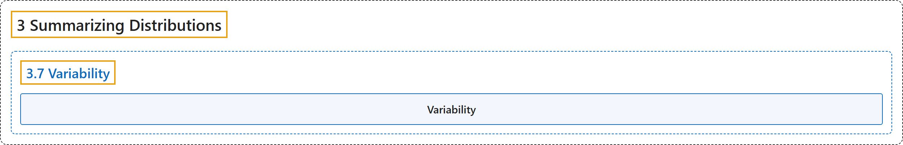

# 3.7 Variability

## Classification

## Glossary

| Term | Definition | 中文翻译 | Source |
|---|---|---|---|
| **3.7 Variability** 变异性 | (No definition) | （无定义） | [Online Statistics Education, n.d., section 3.7](https://onlinestatbook.com/2/summarizing_distributions/variability_ov.html) |
| **Variability** 变异性 | "**Variability** refers to **the extent to which values differ from one another**. That is, how much they vary. Variability can also be thought of as how spread out a distribution is. The standard deviation and the semi-interquartile range are measures of variability." | **变异性**指**各值彼此相异的程度**。也就是说，它们变化有多大。变异性也可以看作分布的分散程度。标准差和半四分位距是变异性的度量。 | [Online Statistics Education, n.d., glossary](https://onlinestatbook.com/2/glossary/variability.html) |

## References

*Online statistics education: An interactive multimedia course of study*. (n.d.). Rice University, University of Houston Clear Lake, and Tufts University. Retrieved October 29, 2026, from <https://onlinestatbook.com/2/>
