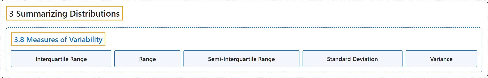

# 3.8 Measures of Variability

## Classification

## Glossary

| Term | Definition | 中文翻译 | Source |
|---|---|---|---|
| **3.8 Measures of Variability** 变异性的度量 | (No definition) | （无定义） | [Online Statistics Education, n.d., section 3.8](https://onlinestatbook.com/2/summarizing_distributions/variability.html) |
| **Interquartile Range** 四分位距 | "The **Interquartile Range** (IQR) is the (75th percentile – 25th percentile). It is a robust measure of variability." | **四分位距**（IQR）是（第 75 百分位数 – 第 25 百分位数）。它是变异性的稳健度量。 | [Online Statistics Education, n.d., glossary](https://onlinestatbook.com/2/glossary/interquartile_range.html) |
| **Range** 极差 | "The **difference between the maximum and minimum values** of a variable or distribution. The range is the simplest measure of variability." | 变量或分布的**最大值与最小值之差**。极差是最简单的变异性度量。 | [Online Statistics Education, n.d., glossary](https://onlinestatbook.com/2/glossary/range.html) |
| **Semi-Interquartile Range** 半四分位距 | "The **semi interquartile range** is the **interquartile range divided by 2**. It is a robust measure of variability. The Interquartile Range is the (75th percentile – 25th percentile)." | **半四分位距**是**四分位距除以 2**。它是变异性的一种稳健度量。四分位距是（第 75 百分位数 – 第 25 百分位数）。 | [Online Statistics Education, n.d., glossary](https://onlinestatbook.com/2/glossary/semi-interquartile_range.html) |
| **Standard Deviation** 标准差 | "The **standard deviation** is a widely used measure of variability. It is computed by taking the square root of the variance. An important attribute of the standard deviation as a measure of variability is that if the mean and standard deviation of a normal distribution are known, it is possible to compute the percentile rank associated with any given score." | **标准差**是一种广泛使用的变异性度量。它通过对方差取平方根计算得到。标准差作为变异性度量的一个重要特性是：如果已知正态分布的均值和标准差，就可以计算与任一给定得分相对应的百分位等级。 | [Online Statistics Education, n.d., glossary](https://onlinestatbook.com/2/glossary/standard_deviation.html) |
| **Variance** 方差 | "The **variance** is a widely used measure of variability. It is defined as **the mean squared deviation of scores from the mean**. The formula for variance computed in an entire population is" | **方差**是一种广泛使用的变异性度量。它被定义为**分数与均值的离差平方的均值**。在整个总体中计算方差的公式为 | [Online Statistics Education, n.d., glossary](https://onlinestatbook.com/2/glossary/variance.html) |

## References

*Online statistics education: An interactive multimedia course of study*. (n.d.). Rice University, University of Houston Clear Lake, and Tufts University. Retrieved October 29, 2026, from <https://onlinestatbook.com/2/>
