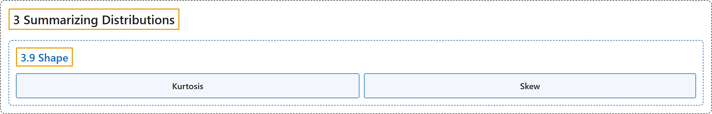

# 3.9 Shape

## Classification

## Glossary

| Term | Definition | 中文翻译 | Source |
|---|---|---|---|
| **3.9 Shape** 形状 | (No definition) | （无定义） | [Online Statistics Education, n.d., section 3.9](https://onlinestatbook.com/2/summarizing_distributions/shapes.html) |
| **Kurtosis** 峰度 | "**Kurtosis** measures how fat or thin the tails of a distribution are relative to a normal distribution. It is commonly defined as:" | **峰度**衡量分布的尾部相对于正态分布是厚还是薄。它通常定义为： | [Online Statistics Education, n.d., glossary](https://onlinestatbook.com/2/glossary/kurtosis.html) |
| **Skew** 偏态 | "A distribution is **skewed** if one tail extends out further than the other. A distribution has positive skew (is skewed to the right) if the tail to the right is longer. See the graph below for an example." | 如果分布的一条尾部比另一条延伸得更远，则该分布是**偏态**的。如果右侧的尾部更长，则分布具有正偏态（向右偏）。示例见下图。 | [Online Statistics Education, n.d., glossary](https://onlinestatbook.com/2/glossary/skew.html) |

## References

*Online statistics education: An interactive multimedia course of study*. (n.d.). Rice University, University of Houston Clear Lake, and Tufts University. Retrieved October 29, 2026, from <https://onlinestatbook.com/2/>
