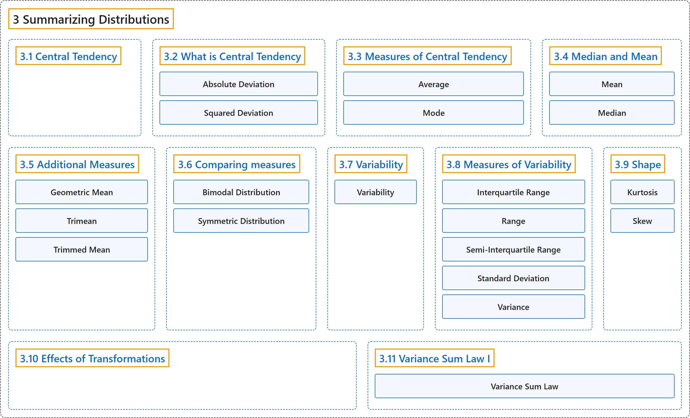

# 3 Summarizing Distributions

## Classification

## Glossary

| Term | Definition | 中文翻译 | Source |
|---|---|---|---|
| **3 Summarizing Distributions** 分布的概括 | (No definition) | （无定义） | [Online Statistics Education, n.d., chapter 3](https://onlinestatbook.com/2/summarizing_distributions/summarizing_distributions.html) |
| **[3.1 Central Tendency](3-1-central-tendency.md)** 集中趋势 | (No definition) | （无定义） | [Online Statistics Education, n.d., section 3.1](https://onlinestatbook.com/2/summarizing_distributions/central_tendency.html) |
| **[3.2 What is Central Tendency](3-2-what-is-central-tendency.md)** 什么是集中趋势 | (No definition) | （无定义） | [Online Statistics Education, n.d., section 3.2](https://onlinestatbook.com/2/summarizing_distributions/what_is_ct.html) |
| **[3.3 Measures of Central Tendency](3-3-measures-of-central-tendency.md)** 集中趋势的度量 | (No definition) | （无定义） | [Online Statistics Education, n.d., section 3.3](https://onlinestatbook.com/2/summarizing_distributions/measures.html) |
| **[3.4 Median and Mean](3-4-median-and-mean.md)** 中位数与均值 | (No definition) | （无定义） | [Online Statistics Education, n.d., section 3.4](https://onlinestatbook.com/2/summarizing_distributions/mean_median_def.html) |
| **[3.5 Additional Measures](3-5-additional-measures.md)** 其他度量 | (No definition) | （无定义） | [Online Statistics Education, n.d., section 3.5](https://onlinestatbook.com/2/summarizing_distributions/additional_measures.html) |
| **[3.6 Comparing measures](3-6-comparing-measures.md)** 度量的比较 | (No definition) | （无定义） | [Online Statistics Education, n.d., section 3.6](https://onlinestatbook.com/2/summarizing_distributions/comparing_measures.html) |
| **[3.7 Variability](3-7-variability.md)** 变异性 | (No definition) | （无定义） | [Online Statistics Education, n.d., section 3.7](https://onlinestatbook.com/2/summarizing_distributions/variability_ov.html) |
| **[3.8 Measures of Variability](3-8-measures-of-variability.md)** 变异性的度量 | (No definition) | （无定义） | [Online Statistics Education, n.d., section 3.8](https://onlinestatbook.com/2/summarizing_distributions/variability.html) |
| **[3.9 Shape](3-9-shape.md)** 形状 | (No definition) | （无定义） | [Online Statistics Education, n.d., section 3.9](https://onlinestatbook.com/2/summarizing_distributions/shapes.html) |
| **[3.10 Effects of Transformations](3-10-effects-of-transformations.md)** 变换的影响 | (No definition) | （无定义） | [Online Statistics Education, n.d., section 3.10](https://onlinestatbook.com/2/summarizing_distributions/transformations.html) |
| **[3.11 Variance Sum Law I](3-11-variance-sum-law-i.md)** 方差和定律 I | (No definition) | （无定义） | [Online Statistics Education, n.d., section 3.11](https://onlinestatbook.com/2/summarizing_distributions/variance_sum_law.html) |

## References

*Online statistics education: An interactive multimedia course of study*. (n.d.). Rice University, University of Houston Clear Lake, and Tufts University. Retrieved October 29, 2026, from <https://onlinestatbook.com/2/>
