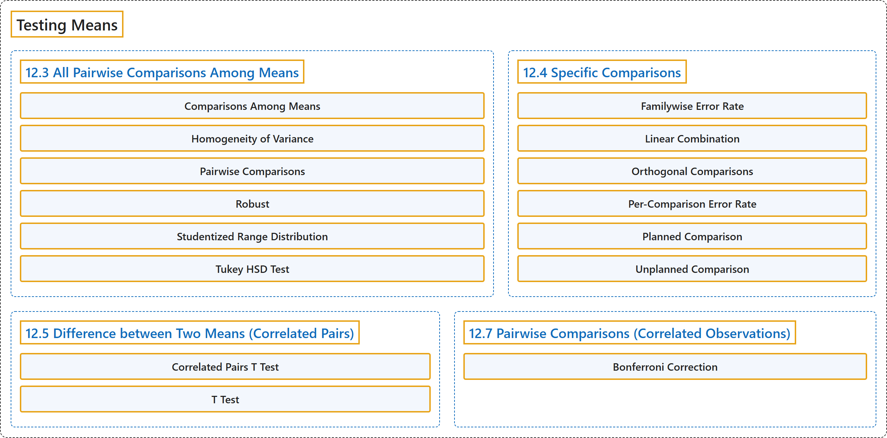

# 12 Testing Means

## Classification

## Glossary

| Term | Definition | 中文翻译 | Source |
|---|---|---|---|
| **12 Testing Means** 均值检验 | (No definition) | （无定义） | [Online Statistics Education, n.d., chapter 12](https://onlinestatbook.com/2/tests_of_means/testing_means.html) |
| **12.3 All Pairwise Comparisons Among Means** 均值间的所有两两比较 | (No definition) | （无定义） | [Online Statistics Education, n.d., section 12.3](https://onlinestatbook.com/2/tests_of_means/pairwise.html) |
| **Comparisons Among Means** 均值间比较 | "A method for **testing differences among means** for significance. For example, one might test whether the difference betwen Mean 1 and the average of Means 2 and 3 is significantly different. See also: Planned Comparions and Orthogonal Comparisons" | 一种检验**均值之间差异**是否显著的方法。例如，可以检验均值 1 与均值 2 和均值 3 的平均值之差是否显著不同。另见：计划比较与正交比较 | [Online Statistics Education, n.d., glossary](https://onlinestatbook.com/2/glossary/comparisons.html) |
| **Homogeneity of Variance** 方差齐性 | "The assumption that the **variances of all the populations are equal**." | 假定**所有总体的方差相等**。 | [Online Statistics Education, n.d., glossary](https://onlinestatbook.com/2/glossary/homogeneity_of_variance.html) |
| **Pairwise Comparisons** 两两比较 | "**Pairwise comparisons** are **comparisons between pairs of means**." | **两两比较**是**成对均值之间的比较**。 | [Online Statistics Education, n.d., glossary](https://onlinestatbook.com/2/glossary/pairwise.html) |
| **Robust** 稳健 | "Something is **robust** if it **holds up well in the face of adversity**. A measure of central tendency or variability is considered robust if it is not greatly affected by a few extreme scores. A statistical test is considered robust if it works well in spite of moderate violations of the assumptions on which it is based." | 某事物如果**在逆境中表现良好**，则是**稳健**的。如果一种集中趋势或变异性的度量不受少数极端分数的很大影响，则认为它是稳健的。如果一种统计检验在其所依据的假设受到适度违背时仍能良好运作，则认为它是稳健的。 | [Online Statistics Education, n.d., glossary](https://onlinestatbook.com/2/glossary/robust.html) |
| **Studentized Range Distribution** 学生化极差分布 | "The **studentized range distribution** is used to test the difference between the largest and smallest means. It is similar to the $t$ distribution which is used when there are only two means." | **学生化极差分布**用于检验最大均值与最小均值之间的差异。它类似于仅有两个均值时使用的 $t$ 分布。 | [Online Statistics Education, n.d., glossary](https://onlinestatbook.com/2/glossary/studentized_range.html) |
| **Tukey HSD Test** 图基 HSD 检验 | "The "Honestly Significantly Different" (HSD) test developed by the statistician John Tukey to **test all pairwise comparisons among means**. The test is based on the " studentized range distribution."" | 由统计学家 John Tukey 提出的“真实显著差异”（HSD）检验，用于**检验均值之间所有的两两比较**。该检验基于“ 学生化极差分布”。 | [Online Statistics Education, n.d., glossary](https://onlinestatbook.com/2/glossary/tukey_hsd.html) |
| **12.4 Specific Comparisons** 特定比较 | (No definition) | （无定义） | [Online Statistics Education, n.d., section 12.4](https://onlinestatbook.com/2/tests_of_means/specific_comparisons.html) |
| **Familywise Error Rate** 族错误率 | "When a series of significance tests is conducted, the **familywise error rate** (FER) is the **probability that one or more of the significance tests results in a Type I error**." | 当进行一系列显著性检验时，**族错误率**（FER）是**其中一个或多个显著性检验导致第一类错误的概率**。 | [Online Statistics Education, n.d., glossary](https://onlinestatbook.com/2/glossary/familywise.html) |
| **Linear Combination** 线性组合 | "A **linear combination** of variables is a way of creating a new variable by combining other variables. A linear combination is one in which each variable is multiplied by a coefficient and the are products summed. For example, if $Y = 3X_1 + 2X_2 + .5X_3$ then $Y$ is a linear combination of the variables $X_1$, $X_2$, and $X_3$." | 变量的**线性组合**是通过组合其他变量来创建新变量的一种方式。线性组合是指每个变量乘以一个系数后再将这些乘积求和。例如，如果 $Y = 3X_1 + 2X_2 + .5X_3$，则 $Y$ 是变量 $X_1$、$X_2$ 和 $X_3$ 的线性组合。 | [Online Statistics Education, n.d., glossary](https://onlinestatbook.com/2/glossary/linear_combination.html) |
| **Orthogonal Comparisons** 正交比较 | "When comparisons among means provide **completely independent information**, the comparisons are called "**orthogonal**." If an experiment with four groups were conducted, then a comparison of Groups 1 and 2 would be orthogonal to a comparison of Groups 3 and 4 since there is nothing in the comparison of Groups 1 and 2 that provides information about the comparison of Groups 3 and 4." | 当均值之间的比较提供**完全独立的信息**时，这些比较称为“**正交**”的。如果进行一项有四个组的实验，那么第 1 组与第 2 组的比较与第 3 组与第 4 组的比较是正交的，因为第 1 组与第 2 组的比较中没有任何内容能提供关于第 3 组与第 4 组比较的信息。 | [Online Statistics Education, n.d., glossary](https://onlinestatbook.com/2/glossary/orthogonal.html) |
| **Per-Comparison Error Rate** 单次比较错误率 | "The **per-comparison error rate** refers to the Type I error rate of any one significance test conducted as part of a series of significance tests. Thus, if 10 significance tests were each conducted at 0.05 significance level, then the per-comparison error rate would be 0.05. Compare with the familywise error rate." | **单次比较错误率**指作为一系列显著性检验的一部分所进行的任何一次显著性检验的第一类错误率。因此，如果 10 次显著性检验各自在 0.05 显著性水平下进行，则单次比较错误率为 0.05。与族错误率相比较。 | [Online Statistics Education, n.d., glossary](https://onlinestatbook.com/2/glossary/per-comparison.html) |
| **Planned Comparison** 计划比较 | "A **comparison that is planned before conducting the experiment** or at least before the data are examined. Also called an a priori comparison." | **在进行实验之前**或至少在检查数据之前**就已计划好的比较**。也称先验比较。 | [Online Statistics Education, n.d., glossary](https://onlinestatbook.com/2/glossary/planned_comparison.html) |
| **Unplanned Comparison** 非计划比较 | "When the comparison among means is decided on after viewing the data, the comparison is called an "**unplanned comparison**" or a post-hoc comparison. Different statistical tests are required for unplanned comparisons than for planned comparisons." | 当均值之间的比较是在查看数据之后才决定时，该比较称为“**非计划比较**”或事后比较。非计划比较所需的统计检验不同于计划比较。 | [Online Statistics Education, n.d., glossary](https://onlinestatbook.com/2/glossary/unplanned.html) |
| **12.5 Difference between Two Means (Correlated Pairs)** 两个均值之差（相关配对） | (No definition) | （无定义） | [Online Statistics Education, n.d., section 12.5](https://onlinestatbook.com/2/tests_of_means/correlated.html) |
| **Correlated Pairs T Test** 配对样本 t 检验 | "A **test of the difference between means of two conditions when there are pairs of scores**. Typically, each pair of scores is from a different subject." | 一种**在存在成对分数时检验两种条件下均值之差的检验**。通常，每一对分数来自不同的被试。 | [Online Statistics Education, n.d., glossary](https://onlinestatbook.com/2/glossary/correlated_pairs.html) |
| **T Test** t 检验 | "Most commonly, a significance test of the difference between means based on the $t$ distribution. Other applications include (a) testing the significance of the difference between a sample mean and a hypothesized value of the mean and (b) testing a specific contrast among means." | 最常见的是基于 $t$ 分布的、对均值之间差异的**显著性检验**。其他应用包括：（a）检验样本均值与均值假设值之间差异的显著性；（b）检验均值之间的特定对比。 | [Online Statistics Education, n.d., glossary](https://onlinestatbook.com/2/glossary/t_test.html) |
| **12.7 Pairwise Comparisons (Correlated Observations)** 两两比较（相关观测） | (No definition) | （无定义） | [Online Statistics Education, n.d., section 12.7](https://onlinestatbook.com/2/tests_of_means/pairwise_correlated.html) |
| **Bonferroni Correction** 邦费罗尼校正 | "In general, to **keep the familywise error rate (FER) at or below**.05, the per-comparison error rate (PCER) should be: $\text{PCER} =.05/c$ where $c$ is the number of comparisons. More generally, to insure that the FER is less than or equal to $\alpha$, use $\text{PCER} = \alpha/c$." | 一般而言，为使**族系误差率（FER）保持在** .05 **或以下**，每次比较误差率（PCER）应为：$\text{PCER} =.05/c$，其中 $c$ 为比较的次数。更一般地，为确保 FER 小于或等于 $\alpha$，使用 $\text{PCER} = \alpha/c$。 | [Online Statistics Education, n.d., glossary](https://onlinestatbook.com/2/glossary/bonferroni.html) |

## References

*Online statistics education: An interactive multimedia course of study*. (n.d.). Rice University, University of Houston Clear Lake, and Tufts University. Retrieved October 29, 2026, from <https://onlinestatbook.com/2/>
