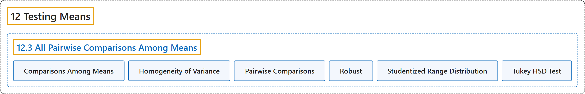

# 12.3 All Pairwise Comparisons Among Means

## Classification

## Glossary

| Term | Definition | 中文翻译 | Source |
|---|---|---|---|
| **12.3 All Pairwise Comparisons Among Means** 均值间的所有两两比较 | (No definition) | （无定义） | [Online Statistics Education, n.d., section 12.3](https://onlinestatbook.com/2/tests_of_means/pairwise.html) |
| **Comparisons Among Means** 均值间比较 | "A method for **testing differences among means** for significance. For example, one might test whether the difference betwen Mean 1 and the average of Means 2 and 3 is significantly different. See also: Planned Comparions and Orthogonal Comparisons" | 一种检验**均值之间差异**是否显著的方法。例如，可以检验均值 1 与均值 2 和均值 3 的平均值之差是否显著不同。另见：计划比较与正交比较 | [Online Statistics Education, n.d., glossary](https://onlinestatbook.com/2/glossary/comparisons.html) |
| **Homogeneity of Variance** 方差齐性 | "The assumption that the **variances of all the populations are equal**." | 假定**所有总体的方差相等**。 | [Online Statistics Education, n.d., glossary](https://onlinestatbook.com/2/glossary/homogeneity_of_variance.html) |
| **Pairwise Comparisons** 两两比较 | "**Pairwise comparisons** are **comparisons between pairs of means**." | **两两比较**是**成对均值之间的比较**。 | [Online Statistics Education, n.d., glossary](https://onlinestatbook.com/2/glossary/pairwise.html) |
| **Robust** 稳健 | "Something is **robust** if it **holds up well in the face of adversity**. A measure of central tendency or variability is considered robust if it is not greatly affected by a few extreme scores. A statistical test is considered robust if it works well in spite of moderate violations of the assumptions on which it is based." | 某事物如果**在逆境中表现良好**，则是**稳健**的。如果一种集中趋势或变异性的度量不受少数极端分数的很大影响，则认为它是稳健的。如果一种统计检验在其所依据的假设受到适度违背时仍能良好运作，则认为它是稳健的。 | [Online Statistics Education, n.d., glossary](https://onlinestatbook.com/2/glossary/robust.html) |
| **Studentized Range Distribution** 学生化极差分布 | "The **studentized range distribution** is used to test the difference between the largest and smallest means. It is similar to the $t$ distribution which is used when there are only two means." | **学生化极差分布**用于检验最大均值与最小均值之间的差异。它类似于仅有两个均值时使用的 $t$ 分布。 | [Online Statistics Education, n.d., glossary](https://onlinestatbook.com/2/glossary/studentized_range.html) |
| **Tukey HSD Test** 图基 HSD 检验 | "The "Honestly Significantly Different" (HSD) test developed by the statistician John Tukey to **test all pairwise comparisons among means**. The test is based on the " studentized range distribution."" | 由统计学家 John Tukey 提出的“真实显著差异”（HSD）检验，用于**检验均值之间所有的两两比较**。该检验基于“ 学生化极差分布”。 | [Online Statistics Education, n.d., glossary](https://onlinestatbook.com/2/glossary/tukey_hsd.html) |

## References

*Online statistics education: An interactive multimedia course of study*. (n.d.). Rice University, University of Houston Clear Lake, and Tufts University. Retrieved October 29, 2026, from <https://onlinestatbook.com/2/>
