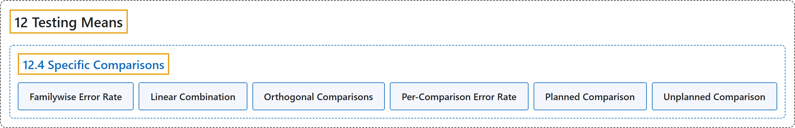

# 12.4 Specific Comparisons

## Classification

## Glossary

| Term | Definition | 中文翻译 | Source |
|---|---|---|---|
| **12.4 Specific Comparisons** 特定比较 | (No definition) | （无定义） | [Online Statistics Education, n.d., section 12.4](https://onlinestatbook.com/2/tests_of_means/specific_comparisons.html) |
| **Familywise Error Rate** 族错误率 | "When a series of significance tests is conducted, the **familywise error rate** (FER) is the **probability that one or more of the significance tests results in a Type I error**." | 当进行一系列显著性检验时，**族错误率**（FER）是**其中一个或多个显著性检验导致第一类错误的概率**。 | [Online Statistics Education, n.d., glossary](https://onlinestatbook.com/2/glossary/familywise.html) |
| **Linear Combination** 线性组合 | "A **linear combination** of variables is a way of creating a new variable by combining other variables. A linear combination is one in which each variable is multiplied by a coefficient and the are products summed. For example, if $Y = 3X_1 + 2X_2 + .5X_3$ then $Y$ is a linear combination of the variables $X_1$, $X_2$, and $X_3$." | 变量的**线性组合**是通过组合其他变量来创建新变量的一种方式。线性组合是指每个变量乘以一个系数后再将这些乘积求和。例如，如果 $Y = 3X_1 + 2X_2 + .5X_3$，则 $Y$ 是变量 $X_1$、$X_2$ 和 $X_3$ 的线性组合。 | [Online Statistics Education, n.d., glossary](https://onlinestatbook.com/2/glossary/linear_combination.html) |
| **Orthogonal Comparisons** 正交比较 | "When comparisons among means provide **completely independent information**, the comparisons are called "**orthogonal**." If an experiment with four groups were conducted, then a comparison of Groups 1 and 2 would be orthogonal to a comparison of Groups 3 and 4 since there is nothing in the comparison of Groups 1 and 2 that provides information about the comparison of Groups 3 and 4." | 当均值之间的比较提供**完全独立的信息**时，这些比较称为“**正交**”的。如果进行一项有四个组的实验，那么第 1 组与第 2 组的比较与第 3 组与第 4 组的比较是正交的，因为第 1 组与第 2 组的比较中没有任何内容能提供关于第 3 组与第 4 组比较的信息。 | [Online Statistics Education, n.d., glossary](https://onlinestatbook.com/2/glossary/orthogonal.html) |
| **Per-Comparison Error Rate** 单次比较错误率 | "The **per-comparison error rate** refers to the Type I error rate of any one significance test conducted as part of a series of significance tests. Thus, if 10 significance tests were each conducted at 0.05 significance level, then the per-comparison error rate would be 0.05. Compare with the familywise error rate." | **单次比较错误率**指作为一系列显著性检验的一部分所进行的任何一次显著性检验的第一类错误率。因此，如果 10 次显著性检验各自在 0.05 显著性水平下进行，则单次比较错误率为 0.05。与族错误率相比较。 | [Online Statistics Education, n.d., glossary](https://onlinestatbook.com/2/glossary/per-comparison.html) |
| **Planned Comparison** 计划比较 | "A **comparison that is planned before conducting the experiment** or at least before the data are examined. Also called an a priori comparison." | **在进行实验之前**或至少在检查数据之前**就已计划好的比较**。也称先验比较。 | [Online Statistics Education, n.d., glossary](https://onlinestatbook.com/2/glossary/planned_comparison.html) |
| **Unplanned Comparison** 非计划比较 | "When the comparison among means is decided on after viewing the data, the comparison is called an "**unplanned comparison**" or a post-hoc comparison. Different statistical tests are required for unplanned comparisons than for planned comparisons." | 当均值之间的比较是在查看数据之后才决定时，该比较称为“**非计划比较**”或事后比较。非计划比较所需的统计检验不同于计划比较。 | [Online Statistics Education, n.d., glossary](https://onlinestatbook.com/2/glossary/unplanned.html) |

## References

*Online statistics education: An interactive multimedia course of study*. (n.d.). Rice University, University of Houston Clear Lake, and Tufts University. Retrieved October 29, 2026, from <https://onlinestatbook.com/2/>
