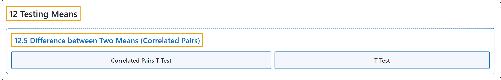

# 12.5 Difference between Two Means (Correlated Pairs)

## Classification

## Glossary

| Term | Definition | 中文翻译 | Source |
|---|---|---|---|
| **12.5 Difference between Two Means (Correlated Pairs)** 两个均值之差（相关配对） | (No definition) | （无定义） | [Online Statistics Education, n.d., section 12.5](https://onlinestatbook.com/2/tests_of_means/correlated.html) |
| **Correlated Pairs T Test** 配对样本 t 检验 | "A **test of the difference between means of two conditions when there are pairs of scores**. Typically, each pair of scores is from a different subject." | 一种**在存在成对分数时检验两种条件下均值之差的检验**。通常，每一对分数来自不同的被试。 | [Online Statistics Education, n.d., glossary](https://onlinestatbook.com/2/glossary/correlated_pairs.html) |
| **T Test** t 检验 | "Most commonly, a significance test of the difference between means based on the $t$ distribution. Other applications include (a) testing the significance of the difference between a sample mean and a hypothesized value of the mean and (b) testing a specific contrast among means." | 最常见的是基于 $t$ 分布的、对均值之间差异的**显著性检验**。其他应用包括：（a）检验样本均值与均值假设值之间差异的显著性；（b）检验均值之间的特定对比。 | [Online Statistics Education, n.d., glossary](https://onlinestatbook.com/2/glossary/t_test.html) |

## References

*Online statistics education: An interactive multimedia course of study*. (n.d.). Rice University, University of Houston Clear Lake, and Tufts University. Retrieved October 29, 2026, from <https://onlinestatbook.com/2/>
