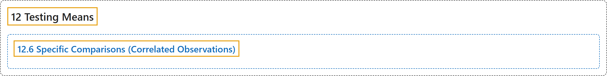

# 12.6 Specific Comparisons (Correlated Observations)

## Classification

## Glossary

| Term | Definition | 中文翻译 | Source |
|---|---|---|---|
| **12.6 Specific Comparisons (Correlated Observations)** 具体比较（相关观测） | (No definition) | （无定义） | [Online Statistics Education, n.d., section 12.6](https://onlinestatbook.com/2/tests_of_means/specific_related.html) |

## References

*Online statistics education: An interactive multimedia course of study*. (n.d.). Rice University, University of Houston Clear Lake, and Tufts University. Retrieved October 29, 2026, from <https://onlinestatbook.com/2/>
