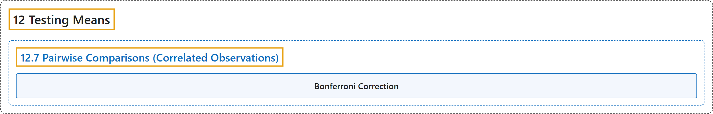

# 12.7 Pairwise Comparisons (Correlated Observations)

## Classification

## Glossary

| Term | Definition | 中文翻译 | Source |
|---|---|---|---|
| **12.7 Pairwise Comparisons (Correlated Observations)** 两两比较（相关观测） | (No definition) | （无定义） | [Online Statistics Education, n.d., section 12.7](https://onlinestatbook.com/2/tests_of_means/pairwise_correlated.html) |
| **Bonferroni Correction** 邦费罗尼校正 | "In general, to **keep the familywise error rate (FER) at or below**.05, the per-comparison error rate (PCER) should be: $\text{PCER} =.05/c$ where $c$ is the number of comparisons. More generally, to insure that the FER is less than or equal to $\alpha$, use $\text{PCER} = \alpha/c$." | 一般而言，为使**族系误差率（FER）保持在** .05 **或以下**，每次比较误差率（PCER）应为：$\text{PCER} =.05/c$，其中 $c$ 为比较的次数。更一般地，为确保 FER 小于或等于 $\alpha$，使用 $\text{PCER} = \alpha/c$。 | [Online Statistics Education, n.d., glossary](https://onlinestatbook.com/2/glossary/bonferroni.html) |

## References

*Online statistics education: An interactive multimedia course of study*. (n.d.). Rice University, University of Houston Clear Lake, and Tufts University. Retrieved October 29, 2026, from <https://onlinestatbook.com/2/>
