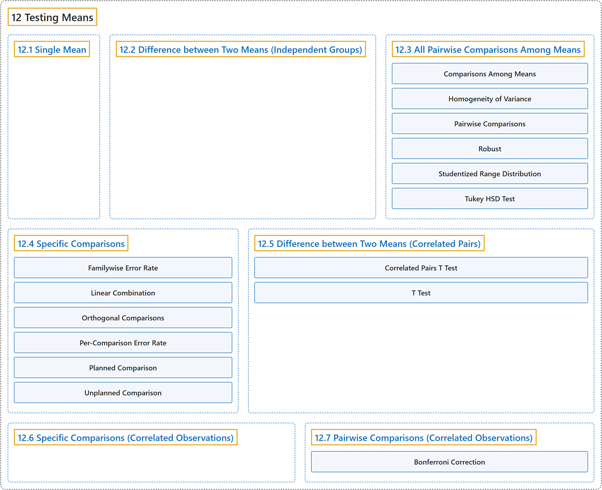

# 12 Testing Means

## Classification

## Glossary

| Term | Definition | 中文翻译 | Source |
|---|---|---|---|
| **12 Testing Means** 均值检验 | (No definition) | （无定义） | [Online Statistics Education, n.d., chapter 12](https://onlinestatbook.com/2/tests_of_means/testing_means.html) |
| **[12.1 Single Mean](12-1-single-mean.md)** 单个均值 | (No definition) | （无定义） | [Online Statistics Education, n.d., section 12.1](https://onlinestatbook.com/2/tests_of_means/single_mean.html) |
| **[12.2 Difference between Two Means (Independent Groups)](12-2-difference-between-two-means-independent-groups.md)** 两个均值之差（独立组） | (No definition) | （无定义） | [Online Statistics Education, n.d., section 12.2](https://onlinestatbook.com/2/tests_of_means/difference_means.html) |
| **[12.3 All Pairwise Comparisons Among Means](12-3-all-pairwise-comparisons-among-means.md)** 均值间的所有两两比较 | (No definition) | （无定义） | [Online Statistics Education, n.d., section 12.3](https://onlinestatbook.com/2/tests_of_means/pairwise.html) |
| **[12.4 Specific Comparisons](12-4-specific-comparisons.md)** 特定比较 | (No definition) | （无定义） | [Online Statistics Education, n.d., section 12.4](https://onlinestatbook.com/2/tests_of_means/specific_comparisons.html) |
| **[12.5 Difference between Two Means (Correlated Pairs)](12-5-difference-between-two-means-correlated-pairs.md)** 两个均值之差（相关配对） | (No definition) | （无定义） | [Online Statistics Education, n.d., section 12.5](https://onlinestatbook.com/2/tests_of_means/correlated.html) |
| **[12.6 Specific Comparisons (Correlated Observations)](12-6-specific-comparisons-correlated-observations.md)** 具体比较（相关观测） | (No definition) | （无定义） | [Online Statistics Education, n.d., section 12.6](https://onlinestatbook.com/2/tests_of_means/specific_related.html) |
| **[12.7 Pairwise Comparisons (Correlated Observations)](12-7-pairwise-comparisons-correlated-observations.md)** 两两比较（相关观测） | (No definition) | （无定义） | [Online Statistics Education, n.d., section 12.7](https://onlinestatbook.com/2/tests_of_means/pairwise_correlated.html) |

## References

*Online statistics education: An interactive multimedia course of study*. (n.d.). Rice University, University of Houston Clear Lake, and Tufts University. Retrieved October 29, 2026, from <https://onlinestatbook.com/2/>
