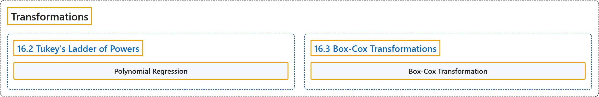

# 16 Transformations

## Classification

## Glossary

| Term | Definition | 中文翻译 | Source |
|---|---|---|---|
| **16 Transformations** 变换 | (No definition) | （无定义） | [Online Statistics Education, n.d., chapter 16](https://onlinestatbook.com/2/transformations/contents.html) |
| **16.2 Tukey's Ladder of Powers** 图基幂阶梯 | (No definition) | （无定义） | [Online Statistics Education, n.d., section 16.2](https://onlinestatbook.com/2/transformations/tukey.html) |
| **Polynomial Regression** 多项式回归 | "**Polynomial regression** is a form of multiple regression in which **powers of a predictor variable instead of other predictor variables are used**. In the following example, the criterion ($Y$) is predicted by $X$, $X^2$ and, $X^3$. $Y = b_1X + b_2X^2 + b_3X^3 + A$" | **多项式回归**是多元回归的一种形式，其中**使用的是一个预测变量的幂，而不是其他预测变量**。在下面的例子中，效标（$Y$）由 $X$、$X^2$ 和 $X^3$ 预测。$Y = b_1X + b_2X^2 + b_3X^3 + A$ | [Online Statistics Education, n.d., glossary](https://onlinestatbook.com/2/glossary/polynomial_regression.html) |
| **16.3 Box-Cox Transformations** Box-Cox 变换 | (No definition) | （无定义） | [Online Statistics Education, n.d., section 16.3](https://onlinestatbook.com/2/transformations/box-cox.html) |
| **Box-Cox Transformation** Box-Cox 变换 | "The **Box-Cox transformation** of the variable $x$ is also indexed by $\lambda$, and is defined as …" | 变量 $x$ 的 **Box-Cox 变换**同样以 $\lambda$ 为指标，定义为 … | [Online Statistics Education, n.d., section 16.3](https://onlinestatbook.com/2/transformations/box-cox.html) |

## References

*Online statistics education: An interactive multimedia course of study*. (n.d.). Rice University, University of Houston Clear Lake, and Tufts University. Retrieved October 29, 2026, from <https://onlinestatbook.com/2/>
