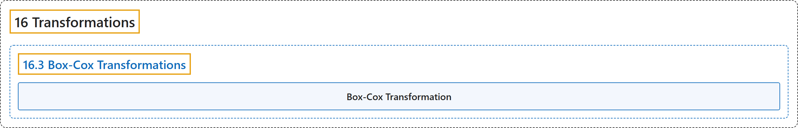

# 16.3 Box-Cox Transformations

## Classification

## Glossary

| Term | Definition | 中文翻译 | Source |
|---|---|---|---|
| **16.3 Box-Cox Transformations** Box-Cox 变换 | (No definition) | （无定义） | [Online Statistics Education, n.d., section 16.3](https://onlinestatbook.com/2/transformations/box-cox.html) |
| **Box-Cox Transformation** Box-Cox 变换 | "The **Box-Cox transformation** of the variable $x$ is also indexed by $\lambda$, and is defined as …" | 变量 $x$ 的 **Box-Cox 变换**同样以 $\lambda$ 为指标，定义为 … | [Online Statistics Education, n.d., section 16.3](https://onlinestatbook.com/2/transformations/box-cox.html) |

## References

*Online statistics education: An interactive multimedia course of study*. (n.d.). Rice University, University of Houston Clear Lake, and Tufts University. Retrieved October 29, 2026, from <https://onlinestatbook.com/2/>
