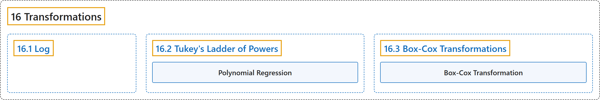

# 16 Transformations

## Classification

## Glossary

| Term | Definition | 中文翻译 | Source |
|---|---|---|---|
| **16 Transformations** 变换 | (No definition) | （无定义） | [Online Statistics Education, n.d., chapter 16](https://onlinestatbook.com/2/transformations/contents.html) |
| **[16.1 Log](16-1-log.md)** 对数 | (No definition) | （无定义） | [Online Statistics Education, n.d., section 16.1](https://onlinestatbook.com/2/transformations/log.html) |
| **[16.2 Tukey's Ladder of Powers](16-2-tukey-s-ladder-of-powers.md)** 图基幂阶梯 | (No definition) | （无定义） | [Online Statistics Education, n.d., section 16.2](https://onlinestatbook.com/2/transformations/tukey.html) |
| **[16.3 Box-Cox Transformations](16-3-box-cox-transformations.md)** Box-Cox 变换 | (No definition) | （无定义） | [Online Statistics Education, n.d., section 16.3](https://onlinestatbook.com/2/transformations/box-cox.html) |

## References

*Online statistics education: An interactive multimedia course of study*. (n.d.). Rice University, University of Houston Clear Lake, and Tufts University. Retrieved October 29, 2026, from <https://onlinestatbook.com/2/>
