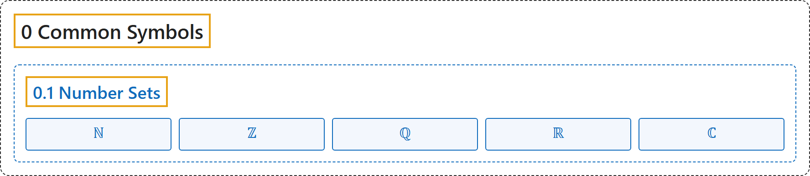

# 0.1 Number Sets

## Classification

## Glossary

| Symbol | Description | 中文翻译 | Source |
|---|---|---|---|
| **[Mathematical Symbols](../index.md)** 数学符号 | (No definition) | （无定义） | [Cohen et al., 2007](https://iupac.org/wp-content/uploads/2019/05/IUPAC-GB3-2012-2ndPrinting-PDFsearchable.pdf) |
| **[0 Common Symbols](index.md)** 常用符号 | (No definition) | （无定义） | (none) |
| **[0.1 Number Sets](0-1-number-sets.md)** 数集 | (No definition) | （无定义） | (none) |
| $\mathbb{N}$ 自然数 | "The term "natural number" refers either to a member of the set of **positive integers 1, 2, 3, ...**" ... "or to a member of the set of **nonnegative integers 0, 1, 2, 3, ...**" | 自然数指**正整数 1, 2, 3, …** 中的数，或指**非负整数 0, 1, 2, 3, …** 中的数。 | [Weisstein, n.d., "natural number" entry](https://mathworld.wolfram.com/NaturalNumber.html) |
| $\mathbb{Z}$ 整数 | "**One of the numbers ..., $-2$, $-1$, 0, 1, 2, ....** The set of integers forms a ring that is denoted $\mathbb{Z}$." | 整数是**数 …, −2, −1, 0, 1, 2, … 中的一个**。整数集构成一个环，记作 $\mathbb{Z}$。 | [Weisstein, n.d., "integer" entry](https://mathworld.wolfram.com/Integer.html) |
| $\mathbb{Q}$ 有理数 | "A rational number is **a number that can be expressed as a fraction $p/q$ where $p$ and $q$ are integers and $q \neq 0$**." | 有理数是**能写成分数 $p/q$ 的数，其中 $p$、$q$ 为整数且 $q \neq 0$**。 | [Weisstein, n.d., "rational number" entry](https://mathworld.wolfram.com/RationalNumber.html) |
| $\mathbb{R}$ 实数 | "A real number is **a member of the field $\mathbb{R}$ containing all rational and irrational numbers**." | 实数是**包含全部有理数和无理数的域 $\mathbb{R}$ 的元素**。 | [Weisstein, n.d., "real number" entry](https://mathworld.wolfram.com/RealNumber.html) |
| $\mathbb{C}$ 复数 | "The complex numbers are **the field $\mathbb{C}$ of numbers of the form $x + iy$, where $x$ and $y$ are real numbers and $i$ is the imaginary unit** equal to the square root of $-1$, $\sqrt{-1}$." | 复数是**形如 $x + iy$ 的数构成的域 $\mathbb{C}$，其中 $x$、$y$ 为实数，$i$ 为虚数单位**，等于 $-1$ 的平方根 $\sqrt{-1}$。 | [Weisstein, n.d., "complex number" entry](https://mathworld.wolfram.com/ComplexNumber.html) |

## References

Weisstein, E. W. (n.d.). *Complex number*. MathWorld. Retrieved November 1, 2026, from <https://mathworld.wolfram.com/ComplexNumber.html>

Weisstein, E. W. (n.d.). *Integer*. MathWorld. Retrieved November 1, 2026, from <https://mathworld.wolfram.com/Integer.html>

Weisstein, E. W. (n.d.). *Natural number*. MathWorld. Retrieved November 1, 2026, from <https://mathworld.wolfram.com/NaturalNumber.html>

Weisstein, E. W. (n.d.). *Rational number*. MathWorld. Retrieved November 1, 2026, from <https://mathworld.wolfram.com/RationalNumber.html>

Weisstein, E. W. (n.d.). *Real number*. MathWorld. Retrieved November 1, 2026, from <https://mathworld.wolfram.com/RealNumber.html>

Cohen, E. R., Cvitaš, T., Frey, J. G., Holmström, B., Kuchitsu, K., Marquardt, R., Mills, I., Pavese, F., Quack, M., Stohner, J., Strauss, H. L., Takami, M., & Thor, A. J. (2007). *Quantities, units and symbols in physical chemistry* (3rd ed., 2nd printing 2012). IUPAC; RSC Publishing. <https://iupac.org/wp-content/uploads/2019/05/IUPAC-GB3-2012-2ndPrinting-PDFsearchable.pdf>
