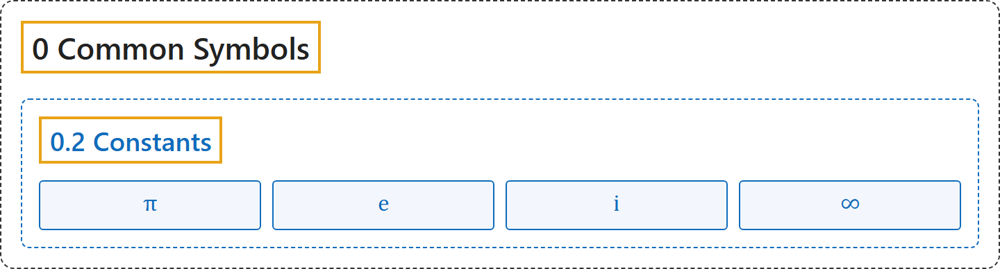

# 0.2 Constants

## Classification

## Glossary

| Symbol | Description | 中文翻译 | Source |
|---|---|---|---|
| **[Mathematical Symbols](../index.md)** 数学符号 | (No definition) | （无定义） | [Cohen et al., 2007](https://iupac.org/wp-content/uploads/2019/05/IUPAC-GB3-2012-2ndPrinting-PDFsearchable.pdf) |
| **[0 Common Symbols](index.md)** 常用符号 | (No definition) | （无定义） | (none) |
| **[0.2 Constants](0-2-constants.md)** 常数 | (No definition) | （无定义） | (none) |
| $\pi$ 圆周率 | "The constant pi, denoted $\pi$, is **a real number defined as the ratio of a circle's circumference $C$ to its diameter $d = 2r$**" | 常数 pi 记作 $\pi$，是**定义为圆的周长 $C$ 与直径 $d = 2r$ 之比的实数**。 | [Weisstein, n.d., "pi" entry](https://mathworld.wolfram.com/Pi.html) |
| $\mathrm{e}$ 自然常数 | "The constant $e$ is **the base of the natural logarithm**. It is sometimes known as Napier's constant." | 常数 $e$ 是**自然对数的底**，有时也称纳皮尔常数。 | [Weisstein, n.d., "e" entry](https://mathworld.wolfram.com/e.html); also in [3 Functions](../3-functions.md) |
| $\mathrm{i}$ 虚数单位 | "The imaginary unit $i$ is defined as **the principal square root of $-1$**, i.e., $i = \sqrt{-1}$." | 虚数单位 $i$ 定义为 **$-1$ 的主平方根**，即 $i = \sqrt{-1}$。 | [Weisstein, n.d., "i" entry](https://mathworld.wolfram.com/i.html); also in [4 Complex Numbers](../4-complex-numbers.md) |
| $\infty$ 无穷大 | "Infinity, most often denoted as $\infty$, is **an unbounded quantity that is greater than every real number**." | 无穷大最常记作 $\infty$，是**大于每个实数的无界的量**。 | [Weisstein, n.d., "infinity" entry](https://mathworld.wolfram.com/Infinity.html); also in [1 Signs and Symbols](../1-signs-and-symbols.md) |

## References

Weisstein, E. W. (n.d.). *Infinity*. MathWorld. Retrieved November 1, 2026, from <https://mathworld.wolfram.com/Infinity.html>

Weisstein, E. W. (n.d.). *Pi*. MathWorld. Retrieved November 1, 2026, from <https://mathworld.wolfram.com/Pi.html>

Weisstein, E. W. (n.d.). *e*. MathWorld. Retrieved November 1, 2026, from <https://mathworld.wolfram.com/e.html>

Weisstein, E. W. (n.d.). *i*. MathWorld. Retrieved November 1, 2026, from <https://mathworld.wolfram.com/i.html>

Cohen, E. R., Cvitaš, T., Frey, J. G., Holmström, B., Kuchitsu, K., Marquardt, R., Mills, I., Pavese, F., Quack, M., Stohner, J., Strauss, H. L., Takami, M., & Thor, A. J. (2007). *Quantities, units and symbols in physical chemistry* (3rd ed., 2nd printing 2012). IUPAC; RSC Publishing. <https://iupac.org/wp-content/uploads/2019/05/IUPAC-GB3-2012-2ndPrinting-PDFsearchable.pdf>
