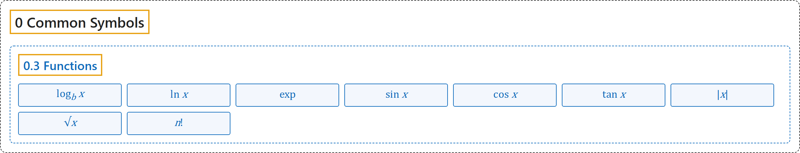

# 0.3 Functions

## Classification

## Glossary

| Symbol | Description | 中文翻译 | Source |
|---|---|---|---|
| **[Mathematical Symbols](../index.md)** 数学符号 | (No definition) | （无定义） | [Cohen et al., 2007](https://iupac.org/wp-content/uploads/2019/05/IUPAC-GB3-2012-2ndPrinting-PDFsearchable.pdf) |
| **[0 Common Symbols](index.md)** 常用符号 | (No definition) | （无定义） | (none) |
| **[0.3 Functions](0-3-functions.md)** 函数 | (No definition) | （无定义） | (none) |
| $\log_b x$ 对数 | "The logarithm $\log_b x$ of a positive real number $x$ to a positive base $b \neq 1$ is **the exponent $y$ for which $b^y = x$**." | 正实数 $x$ 以正数 $b \neq 1$ 为底的对数 $\log_b x$，是**使 $b^y = x$ 成立的指数 $y$**。 | [Weisstein, n.d., "logarithm" entry](https://mathworld.wolfram.com/Logarithm.html); also in [3 Functions](../3-functions.md) |
| $\ln x$ 自然对数 | "The natural logarithm $\ln x$, often shortened to natural log, is **the logarithm having base e**" | 自然对数 $\ln x$（常简称 natural log）是**以 e 为底的对数**。 | [Weisstein, n.d., "natural logarithm" entry](https://mathworld.wolfram.com/NaturalLogarithm.html); also in [3 Functions](../3-functions.md) |
| $f(x) = ab^{cx+d}$ 指数函数 | "An exponential function can be written in the form $f(x) = ab^{cx+d}$, where $a$, $c$, and $d$ are real numbers, **$b$ is a positive real number, and $x$ is a real variable**." | 指数函数可写成 $f(x) = ab^{cx+d}$ 的形式，其中 $a$、$c$、$d$ 为实数，**$b$ 为正实数，$x$ 为实变量**。 | [Weisstein, n.d., "exponential function" entry](https://mathworld.wolfram.com/ExponentialFunction.html); also in [3 Functions](../3-functions.md) |
| $\sin x$ 正弦 | "Let $\theta$ be an angle measured counterclockwise from the x-axis along an arc of the unit circle. Then **$\sin\theta$ is the vertical coordinate of the arc endpoint**" | 设 $\theta$ 是沿单位圆的弧从 x 轴逆时针量出的角，则 **$\sin\theta$ 是弧端点的纵坐标**。 | [Weisstein, n.d., "sine" entry](https://mathworld.wolfram.com/Sine.html); also in [3 Functions](../3-functions.md) |
| $\cos x$ 余弦 | "Let $\theta$ be an angle measured counterclockwise from the x-axis along the arc of the unit circle. Then **$\cos\theta$ is the horizontal coordinate of the arc endpoint**." | 设 $\theta$ 是沿单位圆的弧从 x 轴逆时针量出的角，则 **$\cos\theta$ 是弧端点的横坐标**。 | [Weisstein, n.d., "cosine" entry](https://mathworld.wolfram.com/Cosine.html); also in [3 Functions](../3-functions.md) |
| $\tan x$ 正切 | "The tangent function is defined for real numbers $x$ with $\cos x \neq 0$ by **$\tan x = \frac{\sin x}{\cos x}$**" | 正切函数对 $\cos x \neq 0$ 的实数 $x$ 定义为 **$\tan x = \frac{\sin x}{\cos x}$**。 | [Weisstein, n.d., "tangent" entry](https://mathworld.wolfram.com/Tangent.html); also in [3 Functions](../3-functions.md) |
| $\lvert x \rvert$ 绝对值 | "The absolute value of a real number $x$ is denoted $\lvert x \rvert$ and defined as **the "unsigned" portion of $x$**" | 实数 $x$ 的绝对值记作 $\lvert x \rvert$，定义为 **$x$ 的“无符号”部分**。 | [Weisstein, n.d., "absolute value" entry](https://mathworld.wolfram.com/AbsoluteValue.html); also in [2 Operations](../2-operations.md) |
| $\sqrt{x}$ 平方根 | "A square root of $x$ is **a number $r$ such that $r^2 = x$**." | $x$ 的平方根是**满足 $r^2 = x$ 的数 $r$**。 | [Weisstein, n.d., "square root" entry](https://mathworld.wolfram.com/SquareRoot.html); also in [2 Operations](../2-operations.md) |
| $n!$ 阶乘 | "The factorial $n!$ is defined for a positive integer $n$ as **$n! = n(n-1) \cdots 2 \cdot 1$**." | 正整数 $n$ 的阶乘 $n!$ 定义为 **$n! = n(n-1) \cdots 2 \cdot 1$**。 | [Weisstein, n.d., "factorial" entry](https://mathworld.wolfram.com/Factorial.html); also in [2 Operations](../2-operations.md) |

## References

Weisstein, E. W. (n.d.). *Absolute value*. MathWorld. Retrieved November 1, 2026, from <https://mathworld.wolfram.com/AbsoluteValue.html>

Weisstein, E. W. (n.d.). *Cosine*. MathWorld. Retrieved November 1, 2026, from <https://mathworld.wolfram.com/Cosine.html>

Weisstein, E. W. (n.d.). *Exponential function*. MathWorld. Retrieved November 1, 2026, from <https://mathworld.wolfram.com/ExponentialFunction.html>

Weisstein, E. W. (n.d.). *Factorial*. MathWorld. Retrieved November 1, 2026, from <https://mathworld.wolfram.com/Factorial.html>

Weisstein, E. W. (n.d.). *Logarithm*. MathWorld. Retrieved November 1, 2026, from <https://mathworld.wolfram.com/Logarithm.html>

Weisstein, E. W. (n.d.). *Natural logarithm*. MathWorld. Retrieved November 1, 2026, from <https://mathworld.wolfram.com/NaturalLogarithm.html>

Weisstein, E. W. (n.d.). *Sine*. MathWorld. Retrieved November 1, 2026, from <https://mathworld.wolfram.com/Sine.html>

Weisstein, E. W. (n.d.). *Square root*. MathWorld. Retrieved November 1, 2026, from <https://mathworld.wolfram.com/SquareRoot.html>

Weisstein, E. W. (n.d.). *Tangent*. MathWorld. Retrieved November 1, 2026, from <https://mathworld.wolfram.com/Tangent.html>

Cohen, E. R., Cvitaš, T., Frey, J. G., Holmström, B., Kuchitsu, K., Marquardt, R., Mills, I., Pavese, F., Quack, M., Stohner, J., Strauss, H. L., Takami, M., & Thor, A. J. (2007). *Quantities, units and symbols in physical chemistry* (3rd ed., 2nd printing 2012). IUPAC; RSC Publishing. <https://iupac.org/wp-content/uploads/2019/05/IUPAC-GB3-2012-2ndPrinting-PDFsearchable.pdf>
