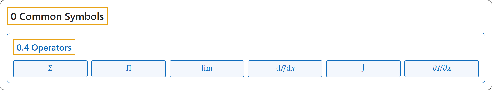

# 0.4 Operators

## Classification

## Glossary

| Symbol | Description | 中文翻译 | Source |
|---|---|---|---|
| **[Mathematical Symbols](../index.md)** 数学符号 | (No definition) | （无定义） | [Cohen et al., 2007](https://iupac.org/wp-content/uploads/2019/05/IUPAC-GB3-2012-2ndPrinting-PDFsearchable.pdf) |
| **[0 Common Symbols](index.md)** 常用符号 | (No definition) | （无定义） | (none) |
| **[0.4 Operators](0-4-operators.md)** 运算符 | (No definition) | （无定义） | (none) |
| $\sum$ 求和 | "**A sum is the result of an addition.**" ... "The summation operation can also be indicated using **a capital sigma** with upper and lower limits written above and below, and the index indicated below." | **和是加法的结果。**……求和运算也可以用**大写 sigma** 表示，上下限写在其上方和下方，下标写在下方。 | [Weisstein, n.d., "sum" entry](https://mathworld.wolfram.com/Sum.html); also in [2 Operations](../2-operations.md) |
| $\prod$ 求积 | "A numerical product is **the result of the multiplication of its factors**." | 数的积是**其各因数相乘的结果**。 | [Weisstein, n.d., "product" entry](https://mathworld.wolfram.com/Product.html); also in [2 Operations](../2-operations.md) |
| $\lim$ 极限 | "A sequence $x_1, x_2, ...$ of elements in a topological space $X$ is said to have limit $x$ provided that **for each neighborhood $U$ of $x$, there exists a natural number $N$ so that $x_n \in U$ for all $n \geq N$**." | 拓扑空间 $X$ 中的元素序列 $x_1, x_2, …$ 称为有极限 $x$，如果**对 $x$ 的每个邻域 $U$，都存在自然数 $N$，使所有 $n \geq N$ 都有 $x_n \in U$**。 | [Weisstein, n.d., "limit" entry](https://mathworld.wolfram.com/Limit.html); also in [3 Functions](../3-functions.md) |
| $\frac{\mathrm{d}f}{\mathrm{d}x}$ 导数 | "The derivative of a function is **its instantaneous rate of change with respect to one of its variables**." | 函数的导数是**它关于某个变量的瞬时变化率**。 | [Weisstein, n.d., "derivative" entry](https://mathworld.wolfram.com/Derivative.html); also in [3 Functions](../3-functions.md) |
| $\int$ 积分 | "The most common meaning is **the fundamental object of calculus corresponding to summing infinitesimal pieces to find the content of a continuous region**." | （积分）最常见的含义是**微积分的基本对象，对应于把无穷小的部分加起来，求连续区域的大小**。 | [Weisstein, n.d., "integral" entry](https://mathworld.wolfram.com/Integral.html); also in [3 Functions](../3-functions.md) |
| $\frac{\partial f}{\partial x}$ 偏导数 | "A partial derivative is **a derivative of a function of several variables with respect to one variable, holding the others fixed**." | 偏导数是**多元函数关于其中一个变量、保持其他变量不变的导数**。 | [Weisstein, n.d., "partial derivative" entry](https://mathworld.wolfram.com/PartialDerivative.html); also in [3 Functions](../3-functions.md) |

## References

Weisstein, E. W. (n.d.). *Derivative*. MathWorld. Retrieved November 1, 2026, from <https://mathworld.wolfram.com/Derivative.html>

Weisstein, E. W. (n.d.). *Integral*. MathWorld. Retrieved November 1, 2026, from <https://mathworld.wolfram.com/Integral.html>

Weisstein, E. W. (n.d.). *Limit*. MathWorld. Retrieved November 1, 2026, from <https://mathworld.wolfram.com/Limit.html>

Weisstein, E. W. (n.d.). *Partial derivative*. MathWorld. Retrieved November 1, 2026, from <https://mathworld.wolfram.com/PartialDerivative.html>

Weisstein, E. W. (n.d.). *Product*. MathWorld. Retrieved November 1, 2026, from <https://mathworld.wolfram.com/Product.html>

Weisstein, E. W. (n.d.). *Sum*. MathWorld. Retrieved November 1, 2026, from <https://mathworld.wolfram.com/Sum.html>

Cohen, E. R., Cvitaš, T., Frey, J. G., Holmström, B., Kuchitsu, K., Marquardt, R., Mills, I., Pavese, F., Quack, M., Stohner, J., Strauss, H. L., Takami, M., & Thor, A. J. (2007). *Quantities, units and symbols in physical chemistry* (3rd ed., 2nd printing 2012). IUPAC; RSC Publishing. <https://iupac.org/wp-content/uploads/2019/05/IUPAC-GB3-2012-2ndPrinting-PDFsearchable.pdf>
