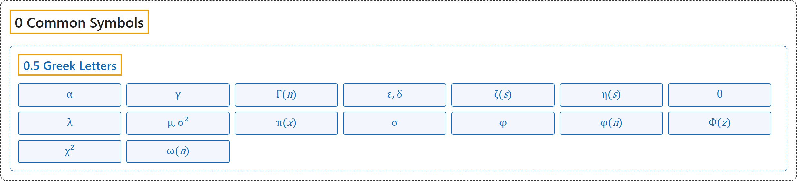

# 0.5 Greek Letters

## Classification

## Glossary

| Symbol | Description | 中文翻译 | Source |
|---|---|---|---|
| **[Mathematical Symbols](../index.md)** 数学符号 | (No definition) | （无定义） | [Cohen et al., 2007](https://iupac.org/wp-content/uploads/2019/05/IUPAC-GB3-2012-2ndPrinting-PDFsearchable.pdf) |
| **[0 Common Symbols](index.md)** 常用符号 | (No definition) | （无定义） | (none) |
| **[0.5 Greek Letters](0-5-greek-letters.md)** 希腊字母 | (No definition) | （无定义） | (none) |
| $\alpha$ 显著性水平 | "The significance level $\alpha$ in hypothesis testing is **the prescribed probability of rejecting the null hypothesis when that hypothesis is true**." | 假设检验中的显著性水平 $\alpha$ 是**在原假设为真时拒绝原假设的规定概率**。 | [Weisstein, n.d., "significance level" entry](https://mathworld.wolfram.com/SignificanceLevel.html) |
| $\gamma$ 欧拉-马斯刻若尼常数 | "The Euler-Mascheroni constant $\gamma$, sometimes also called 'Euler's constant' or 'the Euler constant' (but not to be confused with the constant e, whose value is $2.718281...$), is **defined as the limit of the sequence** $\gamma = \lim_{n \to \infty}\left(\sum_{k=1}^{n} \frac{1}{k} - \ln n\right)$" | 欧拉-马斯刻若尼常数 $\gamma$，有时也称“欧拉常数”（不要与值为 $2.718281…$ 的常数 e 混淆），**定义为数列的极限** $\gamma = \lim_{n \to \infty}\left(\sum_{k=1}^{n} \frac{1}{k} - \ln n\right)$。 | [Weisstein, n.d., "Euler-Mascheroni constant" entry](https://mathworld.wolfram.com/Euler-MascheroniConstant.html) |
| $\Gamma(n)$ 伽马函数 | "The (complete) gamma function $\Gamma(n)$ is defined to be **an extension of the factorial to complex and real number arguments**." | （完全）伽马函数 $\Gamma(n)$ 定义为**阶乘向复数和实数自变量的推广**。 | [Weisstein, n.d., "gamma function" entry](https://mathworld.wolfram.com/GammaFunction.html); also in [3 Functions](../3-functions.md) |
| $\varepsilon,\ \delta$ ε-δ 定义 | ""for all neighborhoods $U$ of $y_0$ there is a neighborhood $V$ of $x_0$ such that, whenever $x \in V$, then $f(x) \in U$" is rephrased as **"for all $\varepsilon > 0$ there is $\delta > 0$ such that, whenever $0 < \lvert x - x_0 \rvert < \delta$, then $\lvert f(x) - y_0 \rvert < \varepsilon$."**" | “对 $y_0$ 的每个邻域 $U$，存在 $x_0$ 的邻域 $V$，使只要 $x \in V$ 就有 $f(x) \in U$”被改写为“**对所有 $\varepsilon > 0$，存在 $\delta > 0$，使只要 $0 < \lvert x - x_0 \rvert < \delta$，就有 $\lvert f(x) - y_0 \rvert < \varepsilon$**。” | [Weisstein, n.d., "epsilon-delta definition" entry](https://mathworld.wolfram.com/Epsilon-DeltaDefinition.html) |
| $\zeta(s)$ 黎曼 ζ 函数 | "**The Riemann zeta function is denoted $\zeta(s)$**" | **黎曼 ζ 函数记作 $\zeta(s)$。** | [Weisstein, n.d., "riemann zeta function" entry](https://mathworld.wolfram.com/RiemannZetaFunction.html) |
| $\eta(s)$ 狄利克雷 η 函数 | "The Dirichlet eta function is **the entire function $\eta(s)$ whose series representation for $\operatorname{Re}[s] > 0$ is** $\eta(s) = \sum_{k=1}^{\infty} \frac{(-1)^{k-1}}{k^s}$" | 狄利克雷 η 函数是**整函数 $\eta(s)$，它在 $\operatorname{Re}[s] > 0$ 时的级数表示为** $\eta(s) = \sum_{k=1}^{\infty} \frac{(-1)^{k-1}}{k^s}$。 | [Weisstein, n.d., "Dirichlet eta function" entry](https://mathworld.wolfram.com/DirichletEtaFunction.html) |
| $\theta$ 角 | "An angle $\theta$ between two intersecting lines or line segments is **the amount of rotation about their point of intersection (the vertex) required to bring one into correspondence with the other**." | 两条相交直线或线段之间的角 $\theta$，是**使其中一条与另一条重合所需绕交点（顶点）旋转的量**。 | [Weisstein, n.d., "angle" entry](https://mathworld.wolfram.com/Angle.html) |
| $\lambda$ 特征值 | "If there is a vector $X \in \mathbb{R}^n \neq 0$ such that $AX = \lambda X$ for some scalar $\lambda$, then **$\lambda$ is called the eigenvalue of $A$** with corresponding (right) eigenvector $X$." | 如果存在向量 $X \in \mathbb{R}^n \neq 0$，对某个标量 $\lambda$ 使 $AX = \lambda X$，则 **$\lambda$ 称为 $A$ 的特征值**，$X$ 为对应的（右）特征向量。 | [Weisstein, n.d., "eigenvalue" entry](https://mathworld.wolfram.com/Eigenvalue.html) |
| $\mu,\ \sigma^2$ 均值与方差 | "A normal distribution in a variate $X$ **with mean $\mu$ and variance $\sigma^2$** is a statistical distribution with probability density function" | 变量 $X$ 的正态分布**以 $\mu$ 为均值、$\sigma^2$ 为方差**，是具有如下概率密度函数的统计分布。 | [Weisstein, n.d., "normal distribution" entry](https://mathworld.wolfram.com/NormalDistribution.html) |
| $\pi(x)$ 素数计数函数 | "The prime counting function is **the function $\pi(x)$ giving the number of primes less than or equal to a given number $x$**" | 素数计数函数是**给出不大于给定数 $x$ 的素数个数的函数 $\pi(x)$**。 | [Weisstein, n.d., "prime counting function" entry](https://mathworld.wolfram.com/PrimeCountingFunction.html) |
| $\sigma$ 标准差 | "The standard deviation $\sigma$ of a probability distribution is defined as **the square root of the variance $\sigma^2$**" | 概率分布的标准差 $\sigma$ 定义为**方差 $\sigma^2$ 的平方根**。 | [Weisstein, n.d., "standard deviation" entry](https://mathworld.wolfram.com/StandardDeviation.html) |
| $\phi$ 黄金比 | "The golden ratio, also known as the divine proportion, golden mean, or golden section, is a number often encountered when taking the ratios of distances in simple geometric figures such as the pentagon, pentagram, decagon and dodecahedron. **It is denoted $\phi$, or sometimes $\tau$.**" | 黄金比，又称神圣比例、黄金均值或黄金分割，是在五边形、五角星、十边形和十二面体等简单几何图形中取距离之比时常遇到的数。**它记作 $\phi$，有时记作 $\tau$。** | [Weisstein, n.d., "golden ratio" entry](https://mathworld.wolfram.com/GoldenRatio.html) |
| $\phi(n)$ 欧拉函数 | "The totient function $\phi(n)$, also called Euler's totient function, is defined for a positive integer $n$ as **the number of positive integers $\leq n$ that are relatively prime to (i.e., share no common divisor other than 1 with) $n$**" | 欧拉函数 $\phi(n)$ 对正整数 $n$ 定义为**不大于 $n$ 且与 $n$ 互素（即除 1 外没有公因数）的正整数的个数**。 | [Weisstein, n.d., "totient function" entry](https://mathworld.wolfram.com/TotientFunction.html) |
| $\Phi(z)$ 正态分布函数 | "**The normal distribution function $\Phi(z)$** is used here in the centered convention" | **正态分布函数 $\Phi(z)$** 在这里采用中心化的约定。 | [Weisstein, n.d., "normal distribution" entry](https://mathworld.wolfram.com/NormalDistribution.html) |
| $\chi^2$ 卡方分布 | "If $Y_i$ have normal independent distributions with mean 0 and variance 1, then $\chi^2 = \sum_{i=1}^r Y_i^2$ **is distributed as $\chi^2$ with $r$ degrees of freedom**." | 若 $Y_i$ 是均值为 0、方差为 1 的独立正态分布，则 $\chi^2 = \sum_{i=1}^r Y_i^2$ **服从自由度为 $r$ 的 $\chi^2$ 分布**。 | [Weisstein, n.d., "chi-squared distribution" entry](https://mathworld.wolfram.com/Chi-SquaredDistribution.html) |
| $\omega(n)$ 不同素因数的个数 | "The distinct prime factors of a positive integer $n \geq 2$ are defined as **the $\omega(n)$ numbers $p_1$, ..., $p_{\omega(n)}$ in the prime factorization**" | 正整数 $n \geq 2$ 的不同素因数定义为**其素因数分解中的 $\omega(n)$ 个数 $p_1, …, p_{\omega(n)}$**。 | [Weisstein, n.d., "distinct prime factors" entry](https://mathworld.wolfram.com/DistinctPrimeFactors.html) |

## References

Weisstein, E. W. (n.d.). *Angle*. MathWorld. Retrieved November 1, 2026, from <https://mathworld.wolfram.com/Angle.html>

Weisstein, E. W. (n.d.). *Chi-squared distribution*. MathWorld. Retrieved November 1, 2026, from <https://mathworld.wolfram.com/Chi-SquaredDistribution.html>

Weisstein, E. W. (n.d.). *Dirichlet eta function*. MathWorld. Retrieved November 1, 2026, from <https://mathworld.wolfram.com/DirichletEtaFunction.html>

Weisstein, E. W. (n.d.). *Distinct prime factors*. MathWorld. Retrieved November 1, 2026, from <https://mathworld.wolfram.com/DistinctPrimeFactors.html>

Weisstein, E. W. (n.d.). *Eigenvalue*. MathWorld. Retrieved November 1, 2026, from <https://mathworld.wolfram.com/Eigenvalue.html>

Weisstein, E. W. (n.d.). *Epsilon-delta definition*. MathWorld. Retrieved November 1, 2026, from <https://mathworld.wolfram.com/Epsilon-DeltaDefinition.html>

Weisstein, E. W. (n.d.). *Euler-Mascheroni constant*. MathWorld. Retrieved November 1, 2026, from <https://mathworld.wolfram.com/Euler-MascheroniConstant.html>

Weisstein, E. W. (n.d.). *Gamma function*. MathWorld. Retrieved November 1, 2026, from <https://mathworld.wolfram.com/GammaFunction.html>

Weisstein, E. W. (n.d.). *Golden ratio*. MathWorld. Retrieved November 1, 2026, from <https://mathworld.wolfram.com/GoldenRatio.html>

Weisstein, E. W. (n.d.). *Normal distribution*. MathWorld. Retrieved November 1, 2026, from <https://mathworld.wolfram.com/NormalDistribution.html>

Weisstein, E. W. (n.d.). *Prime counting function*. MathWorld. Retrieved November 1, 2026, from <https://mathworld.wolfram.com/PrimeCountingFunction.html>

Weisstein, E. W. (n.d.). *Riemann zeta function*. MathWorld. Retrieved November 1, 2026, from <https://mathworld.wolfram.com/RiemannZetaFunction.html>

Weisstein, E. W. (n.d.). *Significance level*. MathWorld. Retrieved November 1, 2026, from <https://mathworld.wolfram.com/SignificanceLevel.html>

Weisstein, E. W. (n.d.). *Standard deviation*. MathWorld. Retrieved November 1, 2026, from <https://mathworld.wolfram.com/StandardDeviation.html>

Weisstein, E. W. (n.d.). *Totient function*. MathWorld. Retrieved November 1, 2026, from <https://mathworld.wolfram.com/TotientFunction.html>

Cohen, E. R., Cvitaš, T., Frey, J. G., Holmström, B., Kuchitsu, K., Marquardt, R., Mills, I., Pavese, F., Quack, M., Stohner, J., Strauss, H. L., Takami, M., & Thor, A. J. (2007). *Quantities, units and symbols in physical chemistry* (3rd ed., 2nd printing 2012). IUPAC; RSC Publishing. <https://iupac.org/wp-content/uploads/2019/05/IUPAC-GB3-2012-2ndPrinting-PDFsearchable.pdf>
