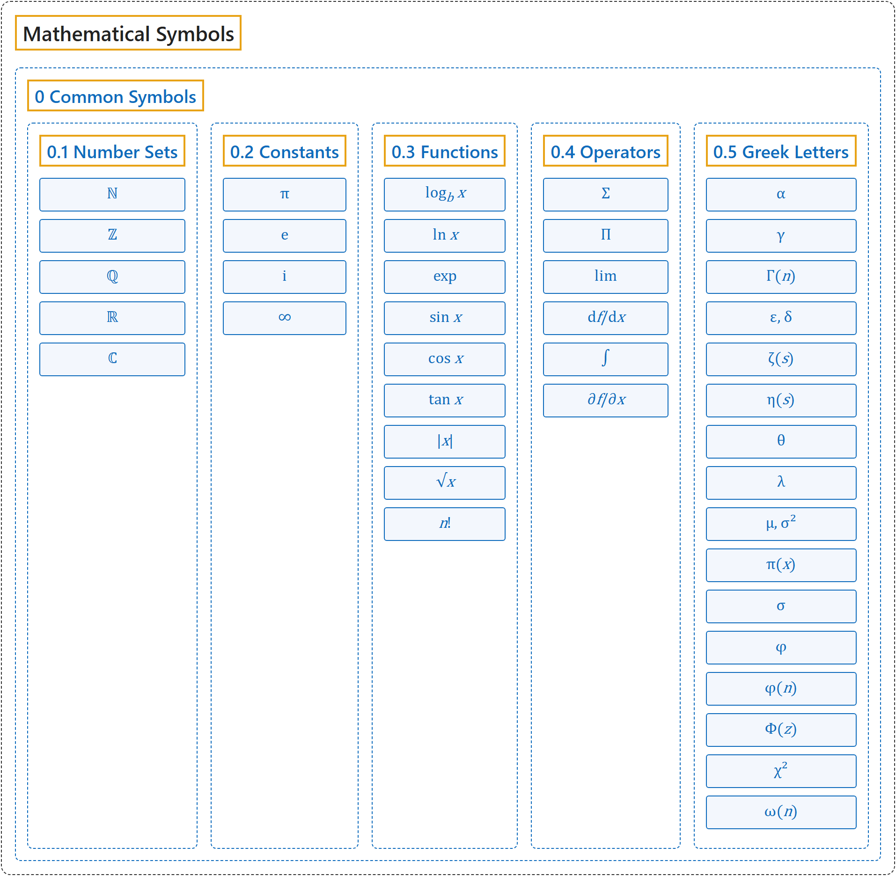

# 0 Common Symbols

## Classification

## Glossary

| Term | Definition | 中文翻译 | Source |
|---|---|---|---|
| **[Mathematical Symbols](../index.md)** 数学符号 | (No definition) | （无定义） | [Cohen et al., 2007](https://iupac.org/wp-content/uploads/2019/05/IUPAC-GB3-2012-2ndPrinting-PDFsearchable.pdf) |
| **0 Common Symbols** 常用符号 | (No definition) | （无定义） | (none) |
| **[0.1 Number Sets](0-1-number-sets.md)** 数集 | (No definition) | （无定义） | (none) |
| **[0.2 Constants](0-2-constants.md)** 常数 | (No definition) | （无定义） | (none) |
| **[0.3 Functions](0-3-functions.md)** 函数 | (No definition) | （无定义） | (none) |
| **[0.4 Operators](0-4-operators.md)** 运算符 | (No definition) | （无定义） | (none) |
| **[0.5 Greek Letters](0-5-greek-letters.md)** 希腊字母 | (No definition) | （无定义） | (none) |

## References

Cohen, E. R., Cvitaš, T., Frey, J. G., Holmström, B., Kuchitsu, K., Marquardt, R., Mills, I., Pavese, F., Quack, M., Stohner, J., Strauss, H. L., Takami, M., & Thor, A. J. (2007). *Quantities, units and symbols in physical chemistry* (3rd ed., 2nd printing 2012). IUPAC; RSC Publishing. <https://iupac.org/wp-content/uploads/2019/05/IUPAC-GB3-2012-2ndPrinting-PDFsearchable.pdf>
