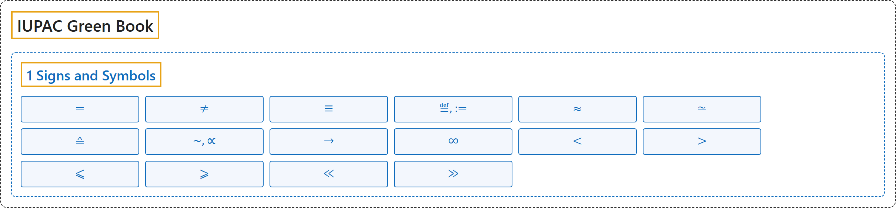

# 1 Signs and Symbols

## Classification

## Glossary

| Symbol | Description | 中文翻译 | Source |
|---|---|---|---|
| **[IUPAC Green Book](index.md)** IUPAC 绿皮书 | "The purpose of this manual is **to improve the exchange of scientific information** among the readers in different disciplines and across different nations." | 本手册的目的是**促进科学信息的交流**，使不同学科、不同国家的读者能够互相沟通。 | [Cohen et al., 2007, Preface, para. 1](https://iupac.org/wp-content/uploads/2019/05/IUPAC-GB3-2012-2ndPrinting-PDFsearchable.pdf#page=9) |
| **[1 Signs and Symbols](1-signs-and-symbols.md)** 符号与记号 | (No definition) | （无定义） | [Cohen et al., 2007, section 4.2, p. 105](https://iupac.org/wp-content/uploads/2019/05/IUPAC-GB3-2012-2ndPrinting-PDFsearchable.pdf#page=119) |
| $=$ | "equal to" | 等于 | [Cohen et al., 2007, section 4.2, p. 105](https://iupac.org/wp-content/uploads/2019/05/IUPAC-GB3-2012-2ndPrinting-PDFsearchable.pdf#page=119) |
| $\neq$ | "not equal to" | 不等于 | [Cohen et al., 2007, section 4.2, p. 105](https://iupac.org/wp-content/uploads/2019/05/IUPAC-GB3-2012-2ndPrinting-PDFsearchable.pdf#page=119) |
| $\equiv$ | "identically equal to" | 恒等于 | [Cohen et al., 2007, section 4.2, p. 105](https://iupac.org/wp-content/uploads/2019/05/IUPAC-GB3-2012-2ndPrinting-PDFsearchable.pdf#page=119) |
| $\overset{\mathrm{def}}{=},\ :=$ | "equal by definition to" | 按定义等于 | [Cohen et al., 2007, section 4.2, p. 105](https://iupac.org/wp-content/uploads/2019/05/IUPAC-GB3-2012-2ndPrinting-PDFsearchable.pdf#page=119) |
| $\approx$ | "approximately equal to" | 约等于 | [Cohen et al., 2007, section 4.2, p. 105](https://iupac.org/wp-content/uploads/2019/05/IUPAC-GB3-2012-2ndPrinting-PDFsearchable.pdf#page=119) |
| $\simeq$ | "asymptotically equal to" | 渐近等于 | [Cohen et al., 2007, section 4.2, p. 105](https://iupac.org/wp-content/uploads/2019/05/IUPAC-GB3-2012-2ndPrinting-PDFsearchable.pdf#page=119) |
| $\mathrel{\hat{=}}$ | "corresponds to" | 相当于 | [Cohen et al., 2007, section 4.2, p. 105](https://iupac.org/wp-content/uploads/2019/05/IUPAC-GB3-2012-2ndPrinting-PDFsearchable.pdf#page=119) |
| $\sim,\ \propto$ | "proportional to" | 正比于 | [Cohen et al., 2007, section 4.2, p. 105](https://iupac.org/wp-content/uploads/2019/05/IUPAC-GB3-2012-2ndPrinting-PDFsearchable.pdf#page=119) |
| $\to$ | "tends to, approaches" | 趋于，趋近 | [Cohen et al., 2007, section 4.2, p. 105](https://iupac.org/wp-content/uploads/2019/05/IUPAC-GB3-2012-2ndPrinting-PDFsearchable.pdf#page=119) |
| $\infty$ | "infinity" | 无穷大 | [Cohen et al., 2007, section 4.2, p. 105](https://iupac.org/wp-content/uploads/2019/05/IUPAC-GB3-2012-2ndPrinting-PDFsearchable.pdf#page=119) |
| $<$ | "less than" | 小于 | [Cohen et al., 2007, section 4.2, p. 105](https://iupac.org/wp-content/uploads/2019/05/IUPAC-GB3-2012-2ndPrinting-PDFsearchable.pdf#page=119) |
| $>$ | "greater than" | 大于 | [Cohen et al., 2007, section 4.2, p. 105](https://iupac.org/wp-content/uploads/2019/05/IUPAC-GB3-2012-2ndPrinting-PDFsearchable.pdf#page=119) |
| $\leqslant$ | "less than or equal to" | 小于或等于 | [Cohen et al., 2007, section 4.2, p. 105](https://iupac.org/wp-content/uploads/2019/05/IUPAC-GB3-2012-2ndPrinting-PDFsearchable.pdf#page=119) |
| $\geqslant$ | "greater than or equal to" | 大于或等于 | [Cohen et al., 2007, section 4.2, p. 105](https://iupac.org/wp-content/uploads/2019/05/IUPAC-GB3-2012-2ndPrinting-PDFsearchable.pdf#page=119) |
| $\ll$ | "much less than" | 远小于 | [Cohen et al., 2007, section 4.2, p. 105](https://iupac.org/wp-content/uploads/2019/05/IUPAC-GB3-2012-2ndPrinting-PDFsearchable.pdf#page=119) |
| $\gg$ | "much greater than" | 远大于 | [Cohen et al., 2007, section 4.2, p. 105](https://iupac.org/wp-content/uploads/2019/05/IUPAC-GB3-2012-2ndPrinting-PDFsearchable.pdf#page=119) |

## References

Cohen, E. R., Cvitaš, T., Frey, J. G., Holmström, B., Kuchitsu, K., Marquardt, R., Mills, I., Pavese, F., Quack, M., Stohner, J., Strauss, H. L., Takami, M., & Thor, A. J. (2007). *Quantities, units and symbols in physical chemistry* (3rd ed., 2nd printing 2012). IUPAC; RSC Publishing. <https://iupac.org/wp-content/uploads/2019/05/IUPAC-GB3-2012-2ndPrinting-PDFsearchable.pdf>
