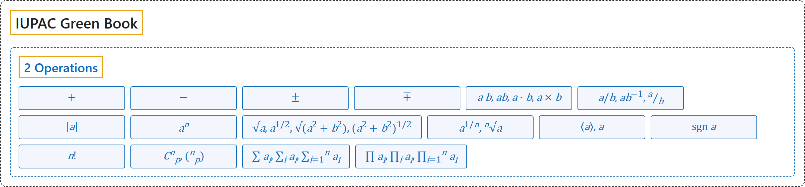

# 2 Operations

## Classification

## Glossary

| Symbol | Description | 中文翻译 | Source |
|---|---|---|---|
| **[IUPAC Green Book](index.md)** IUPAC 绿皮书 | "The purpose of this manual is **to improve the exchange of scientific information** among the readers in different disciplines and across different nations." | 本手册的目的是**促进科学信息的交流**，使不同学科、不同国家的读者能够互相沟通。 | [Cohen et al., 2007, Preface, para. 1](https://iupac.org/wp-content/uploads/2019/05/IUPAC-GB3-2012-2ndPrinting-PDFsearchable.pdf#page=9) |
| **[2 Operations](2-operations.md)** 运算 | (No definition) | （无定义） | [Cohen et al., 2007, section 4.2, p. 105](https://iupac.org/wp-content/uploads/2019/05/IUPAC-GB3-2012-2ndPrinting-PDFsearchable.pdf#page=119) |
| $+$ | "plus" | 加 | [Cohen et al., 2007, section 4.2, p. 105](https://iupac.org/wp-content/uploads/2019/05/IUPAC-GB3-2012-2ndPrinting-PDFsearchable.pdf#page=119) |
| $-$ | "minus" | 减 | [Cohen et al., 2007, section 4.2, p. 105](https://iupac.org/wp-content/uploads/2019/05/IUPAC-GB3-2012-2ndPrinting-PDFsearchable.pdf#page=119) |
| $\pm$ | "plus or minus" | 加或减 | [Cohen et al., 2007, section 4.2, p. 105](https://iupac.org/wp-content/uploads/2019/05/IUPAC-GB3-2012-2ndPrinting-PDFsearchable.pdf#page=119) |
| $\mp$ | "minus or plus" | 减或加 | [Cohen et al., 2007, section 4.2, p. 105](https://iupac.org/wp-content/uploads/2019/05/IUPAC-GB3-2012-2ndPrinting-PDFsearchable.pdf#page=119) |
| $a\,b,\ ab,\ a \cdot b,\ a \times b$ | "$a$ multiplied by $b$" Note 1: "When multiplication is indicated by a dot, the dot shall be half high: $a \cdot b$." | $a$ 乘以 $b$ 注 1：用点表示乘法时，点应位于半高处：$a \cdot b$。 | [Cohen et al., 2007, section 4.2, p. 105](https://iupac.org/wp-content/uploads/2019/05/IUPAC-GB3-2012-2ndPrinting-PDFsearchable.pdf#page=119) |
| $a/b,\ ab^{-1},\ \frac{a}{b}$ | "$a$ divided by $b$" Note 2: "$a : b$ is as well used for “divided by”. However, this symbol is mainly used to express ratios such as length scales in maps." | $a$ 除以 $b$ 注 2：$a : b$ 也用来表示“除以”。不过这个符号主要用于表示比例，例如地图的比例尺。 | [Cohen et al., 2007, section 4.2, p. 105](https://iupac.org/wp-content/uploads/2019/05/IUPAC-GB3-2012-2ndPrinting-PDFsearchable.pdf#page=119) |
| $\lvert a \rvert$ | "magnitude of $a$" | $a$ 的大小（绝对值） | [Cohen et al., 2007, section 4.2, p. 105](https://iupac.org/wp-content/uploads/2019/05/IUPAC-GB3-2012-2ndPrinting-PDFsearchable.pdf#page=119) |
| $a^n$ | "$a$ to the power $n$" | $a$ 的 $n$ 次方 | [Cohen et al., 2007, section 4.2, p. 105](https://iupac.org/wp-content/uploads/2019/05/IUPAC-GB3-2012-2ndPrinting-PDFsearchable.pdf#page=119) |
| $\sqrt{a},\ a^{1/2},\ \sqrt{a^2+b^2},\ (a^2+b^2)^{1/2}$ | "square root of $a$, and of $a^2 + b^2$" | $a$ 的平方根，以及 $a^2 + b^2$ 的平方根 | [Cohen et al., 2007, section 4.2, p. 105](https://iupac.org/wp-content/uploads/2019/05/IUPAC-GB3-2012-2ndPrinting-PDFsearchable.pdf#page=119) |
| $a^{1/n},\ \sqrt[n]{a}$ | "$n$th root of $a$" | $a$ 的 $n$ 次方根 | [Cohen et al., 2007, section 4.2, p. 105](https://iupac.org/wp-content/uploads/2019/05/IUPAC-GB3-2012-2ndPrinting-PDFsearchable.pdf#page=119) |
| $\langle a \rangle,\ \bar{a}$ | "mean value of $a$" | $a$ 的平均值 | [Cohen et al., 2007, section 4.2, p. 105](https://iupac.org/wp-content/uploads/2019/05/IUPAC-GB3-2012-2ndPrinting-PDFsearchable.pdf#page=119) |
| $\operatorname{sgn} a$ | "sign of $a$ (equal to $a/\lvert a \rvert$ if $a \neq 0$, 0 if $a = 0$)" | $a$ 的符号（$a \neq 0$ 时等于 $a/\lvert a \rvert$，$a = 0$ 时为 0） | [Cohen et al., 2007, section 4.2, p. 105](https://iupac.org/wp-content/uploads/2019/05/IUPAC-GB3-2012-2ndPrinting-PDFsearchable.pdf#page=119) |
| $n!$ | "$n$ factorial" | $n$ 的阶乘 | [Cohen et al., 2007, section 4.2, p. 105](https://iupac.org/wp-content/uploads/2019/05/IUPAC-GB3-2012-2ndPrinting-PDFsearchable.pdf#page=119) |
| $C^n_p,\ \binom{n}{p}$ | "binominal coefficient, $n!/p!(n-p)!$" | 二项式系数，$n!/p!(n-p)!$ | [Cohen et al., 2007, section 4.2, p. 105](https://iupac.org/wp-content/uploads/2019/05/IUPAC-GB3-2012-2ndPrinting-PDFsearchable.pdf#page=119) |
| $\sum a_i,\ \sum_i a_i,\ \sum_{i=1}^{n} a_i$ | "sum of $a_i$" | $a_i$ 的和 | [Cohen et al., 2007, section 4.2, p. 105](https://iupac.org/wp-content/uploads/2019/05/IUPAC-GB3-2012-2ndPrinting-PDFsearchable.pdf#page=119) |
| $\prod a_i,\ \prod_i a_i,\ \prod_{i=1}^{n} a_i$ | "product of $a_i$" | $a_i$ 的积 | [Cohen et al., 2007, section 4.2, p. 105](https://iupac.org/wp-content/uploads/2019/05/IUPAC-GB3-2012-2ndPrinting-PDFsearchable.pdf#page=119) |

## References

Cohen, E. R., Cvitaš, T., Frey, J. G., Holmström, B., Kuchitsu, K., Marquardt, R., Mills, I., Pavese, F., Quack, M., Stohner, J., Strauss, H. L., Takami, M., & Thor, A. J. (2007). *Quantities, units and symbols in physical chemistry* (3rd ed., 2nd printing 2012). IUPAC; RSC Publishing. <https://iupac.org/wp-content/uploads/2019/05/IUPAC-GB3-2012-2ndPrinting-PDFsearchable.pdf>
