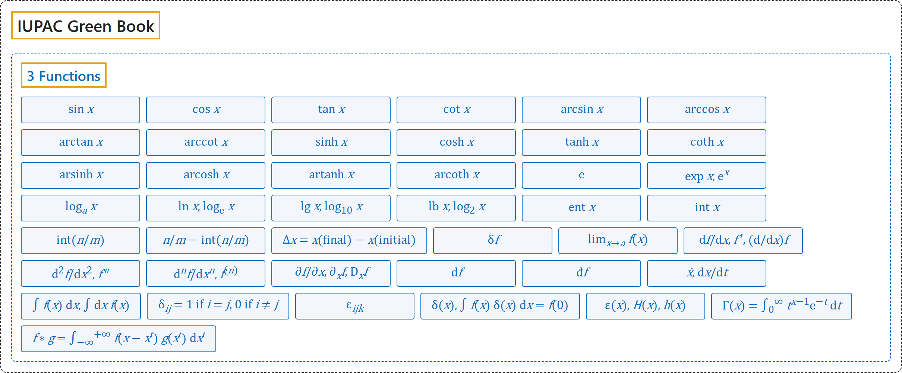

# 3 Functions

## Classification

## Glossary

| Symbol | Description | 中文翻译 | Source |
|---|---|---|---|
| **[IUPAC Green Book](index.md)** IUPAC 绿皮书 | "The purpose of this manual is **to improve the exchange of scientific information** among the readers in different disciplines and across different nations." | 本手册的目的是**促进科学信息的交流**，使不同学科、不同国家的读者能够互相沟通。 | [Cohen et al., 2007, Preface, para. 1](https://iupac.org/wp-content/uploads/2019/05/IUPAC-GB3-2012-2ndPrinting-PDFsearchable.pdf#page=9) |
| **[3 Functions](3-functions.md)** 函数 | (No definition) | （无定义） | [Cohen et al., 2007, section 4.2, p. 105](https://iupac.org/wp-content/uploads/2019/05/IUPAC-GB3-2012-2ndPrinting-PDFsearchable.pdf#page=119) |
| $\sin x$ | "sine of $x$" | $x$ 的正弦 | [Cohen et al., 2007, section 4.2, p. 105](https://iupac.org/wp-content/uploads/2019/05/IUPAC-GB3-2012-2ndPrinting-PDFsearchable.pdf#page=119) |
| $\cos x$ | "cosine of $x$" | $x$ 的余弦 | [Cohen et al., 2007, section 4.2, p. 105](https://iupac.org/wp-content/uploads/2019/05/IUPAC-GB3-2012-2ndPrinting-PDFsearchable.pdf#page=119) |
| $\tan x$ | "tangent of $x$" | $x$ 的正切 | [Cohen et al., 2007, section 4.2, p. 105](https://iupac.org/wp-content/uploads/2019/05/IUPAC-GB3-2012-2ndPrinting-PDFsearchable.pdf#page=119) |
| $\cot x$ | "cotangent of $x$" | $x$ 的余切 | [Cohen et al., 2007, section 4.2, p. 105](https://iupac.org/wp-content/uploads/2019/05/IUPAC-GB3-2012-2ndPrinting-PDFsearchable.pdf#page=119) |
| $\arcsin x$ | "arc sine of $x$" Note 3: "These are the inverse of the parent function, i.e. $\arcsin x$ is the operator inverse of $\sin x$." | $x$ 的反正弦 注 3：它们是原函数的反函数，即 $\arcsin x$ 是 $\sin x$ 的算子逆。 | [Cohen et al., 2007, section 4.2, p. 106](https://iupac.org/wp-content/uploads/2019/05/IUPAC-GB3-2012-2ndPrinting-PDFsearchable.pdf#page=120) |
| $\arccos x$ | "arc cosine of $x$" Note 3: "These are the inverse of the parent function, i.e. $\arcsin x$ is the operator inverse of $\sin x$." | $x$ 的反余弦 注 3：它们是原函数的反函数，即 $\arcsin x$ 是 $\sin x$ 的算子逆。 | [Cohen et al., 2007, section 4.2, p. 106](https://iupac.org/wp-content/uploads/2019/05/IUPAC-GB3-2012-2ndPrinting-PDFsearchable.pdf#page=120) |
| $\arctan x$ | "arc tangent of $x$" Note 3: "These are the inverse of the parent function, i.e. $\arcsin x$ is the operator inverse of $\sin x$." | $x$ 的反正切 注 3：它们是原函数的反函数，即 $\arcsin x$ 是 $\sin x$ 的算子逆。 | [Cohen et al., 2007, section 4.2, p. 106](https://iupac.org/wp-content/uploads/2019/05/IUPAC-GB3-2012-2ndPrinting-PDFsearchable.pdf#page=120) |
| $\operatorname{arccot} x$ | "arc cotangent of $x$" Note 3: "These are the inverse of the parent function, i.e. $\arcsin x$ is the operator inverse of $\sin x$." | $x$ 的反余切 注 3：它们是原函数的反函数，即 $\arcsin x$ 是 $\sin x$ 的算子逆。 | [Cohen et al., 2007, section 4.2, p. 106](https://iupac.org/wp-content/uploads/2019/05/IUPAC-GB3-2012-2ndPrinting-PDFsearchable.pdf#page=120) |
| $\sinh x$ | "hyperbolic sine of $x$" | $x$ 的双曲正弦 | [Cohen et al., 2007, section 4.2, p. 106](https://iupac.org/wp-content/uploads/2019/05/IUPAC-GB3-2012-2ndPrinting-PDFsearchable.pdf#page=120) |
| $\cosh x$ | "hyperbolic cosine of $x$" | $x$ 的双曲余弦 | [Cohen et al., 2007, section 4.2, p. 106](https://iupac.org/wp-content/uploads/2019/05/IUPAC-GB3-2012-2ndPrinting-PDFsearchable.pdf#page=120) |
| $\tanh x$ | "hyperbolic tangent of $x$" | $x$ 的双曲正切 | [Cohen et al., 2007, section 4.2, p. 106](https://iupac.org/wp-content/uploads/2019/05/IUPAC-GB3-2012-2ndPrinting-PDFsearchable.pdf#page=120) |
| $\coth x$ | "hyperbolic cotangent of $x$" | $x$ 的双曲余切 | [Cohen et al., 2007, section 4.2, p. 106](https://iupac.org/wp-content/uploads/2019/05/IUPAC-GB3-2012-2ndPrinting-PDFsearchable.pdf#page=120) |
| $\operatorname{arsinh} x$ | "area hyperbolic sine of $x$" Note 3: "These are the inverse of the parent function, i.e. $\arcsin x$ is the operator inverse of $\sin x$." | $x$ 的反双曲正弦 注 3：它们是原函数的反函数，即 $\arcsin x$ 是 $\sin x$ 的算子逆。 | [Cohen et al., 2007, section 4.2, p. 106](https://iupac.org/wp-content/uploads/2019/05/IUPAC-GB3-2012-2ndPrinting-PDFsearchable.pdf#page=120) |
| $\operatorname{arcosh} x$ | "area hyperbolic cosine of $x$" Note 3: "These are the inverse of the parent function, i.e. $\arcsin x$ is the operator inverse of $\sin x$." | $x$ 的反双曲余弦 注 3：它们是原函数的反函数，即 $\arcsin x$ 是 $\sin x$ 的算子逆。 | [Cohen et al., 2007, section 4.2, p. 106](https://iupac.org/wp-content/uploads/2019/05/IUPAC-GB3-2012-2ndPrinting-PDFsearchable.pdf#page=120) |
| $\operatorname{artanh} x$ | "area hyperbolic tangent of $x$" Note 3: "These are the inverse of the parent function, i.e. $\arcsin x$ is the operator inverse of $\sin x$." | $x$ 的反双曲正切 注 3：它们是原函数的反函数，即 $\arcsin x$ 是 $\sin x$ 的算子逆。 | [Cohen et al., 2007, section 4.2, p. 106](https://iupac.org/wp-content/uploads/2019/05/IUPAC-GB3-2012-2ndPrinting-PDFsearchable.pdf#page=120) |
| $\operatorname{arcoth} x$ | "area hyperbolic cotangent of $x$" Note 3: "These are the inverse of the parent function, i.e. $\arcsin x$ is the operator inverse of $\sin x$." | $x$ 的反双曲余切 注 3：它们是原函数的反函数，即 $\arcsin x$ 是 $\sin x$ 的算子逆。 | [Cohen et al., 2007, section 4.2, p. 106](https://iupac.org/wp-content/uploads/2019/05/IUPAC-GB3-2012-2ndPrinting-PDFsearchable.pdf#page=120) |
| $\mathrm{e}$ | "base of natural logarithms" | 自然对数的底 | [Cohen et al., 2007, section 4.2, p. 106](https://iupac.org/wp-content/uploads/2019/05/IUPAC-GB3-2012-2ndPrinting-PDFsearchable.pdf#page=120) |
| $\exp x,\ \mathrm{e}^x$ | "exponential of $x$" | $x$ 的指数函数 | [Cohen et al., 2007, section 4.2, p. 106](https://iupac.org/wp-content/uploads/2019/05/IUPAC-GB3-2012-2ndPrinting-PDFsearchable.pdf#page=120) |
| $\log_a x$ | "logarithm to the base $a$ of $x$" Note 4: "For positive $x$." | 以 $a$ 为底 $x$ 的对数 注 4：$x$ 为正数。 | [Cohen et al., 2007, section 4.2, p. 106](https://iupac.org/wp-content/uploads/2019/05/IUPAC-GB3-2012-2ndPrinting-PDFsearchable.pdf#page=120) |
| $\ln x,\ \log_{\mathrm{e}} x$ | "natural logarithm of $x$" Note 4: "For positive $x$." | $x$ 的自然对数 注 4：$x$ 为正数。 | [Cohen et al., 2007, section 4.2, p. 106](https://iupac.org/wp-content/uploads/2019/05/IUPAC-GB3-2012-2ndPrinting-PDFsearchable.pdf#page=120) |
| $\lg x,\ \log_{10} x$ | "logarithm to the base 10 of $x$" Note 4: "For positive $x$." | 以 10 为底 $x$ 的对数 注 4：$x$ 为正数。 | [Cohen et al., 2007, section 4.2, p. 106](https://iupac.org/wp-content/uploads/2019/05/IUPAC-GB3-2012-2ndPrinting-PDFsearchable.pdf#page=120) |
| $\operatorname{lb} x,\ \log_2 x$ | "logarithm to the base 2 of $x$" Note 4: "For positive $x$." | 以 2 为底 $x$ 的对数 注 4：$x$ 为正数。 | [Cohen et al., 2007, section 4.2, p. 106](https://iupac.org/wp-content/uploads/2019/05/IUPAC-GB3-2012-2ndPrinting-PDFsearchable.pdf#page=120) |
| $\operatorname{ent} x$ | "greatest integer $\leqslant x$" | 不大于 $x$ 的最大整数 | [Cohen et al., 2007, section 4.2, p. 106](https://iupac.org/wp-content/uploads/2019/05/IUPAC-GB3-2012-2ndPrinting-PDFsearchable.pdf#page=120) |
| $\operatorname{int} x$ | "integer part of $x$" | $x$ 的整数部分 | [Cohen et al., 2007, section 4.2, p. 106](https://iupac.org/wp-content/uploads/2019/05/IUPAC-GB3-2012-2ndPrinting-PDFsearchable.pdf#page=120) |
| $\operatorname{int}(n/m)$ | "integer division" | 整数除法 | [Cohen et al., 2007, section 4.2, p. 106](https://iupac.org/wp-content/uploads/2019/05/IUPAC-GB3-2012-2ndPrinting-PDFsearchable.pdf#page=120) |
| $n/m - \operatorname{int}(n/m)$ | "remainder after integer division" | 整数除法的余数 | [Cohen et al., 2007, section 4.2, p. 106](https://iupac.org/wp-content/uploads/2019/05/IUPAC-GB3-2012-2ndPrinting-PDFsearchable.pdf#page=120) |
| $\Delta x = x(\text{final}) - x(\text{initial})$ | "change in $x$" | $x$ 的变化量 | [Cohen et al., 2007, section 4.2, p. 106](https://iupac.org/wp-content/uploads/2019/05/IUPAC-GB3-2012-2ndPrinting-PDFsearchable.pdf#page=120) |
| $\delta f$ | "infinitesimal variation of $f$" | $f$ 的无穷小变分 | [Cohen et al., 2007, section 4.2, p. 106](https://iupac.org/wp-content/uploads/2019/05/IUPAC-GB3-2012-2ndPrinting-PDFsearchable.pdf#page=120) |
| $\lim_{x \to a} f(x)$ | "limit of $f(x)$ as $x$ tends to $a$" | $x$ 趋于 $a$ 时 $f(x)$ 的极限 | [Cohen et al., 2007, section 4.2, p. 106](https://iupac.org/wp-content/uploads/2019/05/IUPAC-GB3-2012-2ndPrinting-PDFsearchable.pdf#page=120) |
| $\mathrm{d}f/\mathrm{d}x,\ f',\ (\mathrm{d}/\mathrm{d}x)f$ | "1st derivative of $f$" | $f$ 的一阶导数 | [Cohen et al., 2007, section 4.2, p. 106](https://iupac.org/wp-content/uploads/2019/05/IUPAC-GB3-2012-2ndPrinting-PDFsearchable.pdf#page=120) |
| $\mathrm{d}^2 f/\mathrm{d}x^2,\ f''$ | "2nd derivative of $f$" | $f$ 的二阶导数 | [Cohen et al., 2007, section 4.2, p. 106](https://iupac.org/wp-content/uploads/2019/05/IUPAC-GB3-2012-2ndPrinting-PDFsearchable.pdf#page=120) |
| $\mathrm{d}^n f/\mathrm{d}x^n,\ f^{(n)}$ | "$n$th derivative of $f$" | $f$ 的 $n$ 阶导数 | [Cohen et al., 2007, section 4.2, p. 106](https://iupac.org/wp-content/uploads/2019/05/IUPAC-GB3-2012-2ndPrinting-PDFsearchable.pdf#page=120) |
| $\partial f/\partial x,\ \partial_x f,\ D_x f$ | "partial derivative of $f$" | $f$ 的偏导数 | [Cohen et al., 2007, section 4.2, p. 106](https://iupac.org/wp-content/uploads/2019/05/IUPAC-GB3-2012-2ndPrinting-PDFsearchable.pdf#page=120) |
| $\mathrm{d}f$ | "total differential of $f$" | $f$ 的全微分 | [Cohen et al., 2007, section 4.2, p. 106](https://iupac.org/wp-content/uploads/2019/05/IUPAC-GB3-2012-2ndPrinting-PDFsearchable.pdf#page=120) |
| $\text{đ}f$ | "inexact differential of $f$" Note 5: "Notation used in thermodynamics, see Section 2.11, note 1, p. 56." | $f$ 的不恰当微分 注 5：热力学中使用的记法，见第 2.11 节注 1，第 56 页。 | [Cohen et al., 2007, section 4.2, p. 106](https://iupac.org/wp-content/uploads/2019/05/IUPAC-GB3-2012-2ndPrinting-PDFsearchable.pdf#page=120) |
| $\dot{x},\ \mathrm{d}x/\mathrm{d}t$ | "first derivative of $x$ with respect to time" | $x$ 对时间的一阶导数 | [Cohen et al., 2007, section 4.2, p. 106](https://iupac.org/wp-content/uploads/2019/05/IUPAC-GB3-2012-2ndPrinting-PDFsearchable.pdf#page=120) |
| $\int f(x)\,\mathrm{d}x,\ \int \mathrm{d}x\, f(x)$ | "integral of $f(x)$" | $f(x)$ 的积分 | [Cohen et al., 2007, section 4.2, p. 106](https://iupac.org/wp-content/uploads/2019/05/IUPAC-GB3-2012-2ndPrinting-PDFsearchable.pdf#page=120) |
| $\delta_{ij} = \begin{cases} 1 & \text{if } i = j \\ 0 & \text{if } i \neq j \end{cases}$ | "Kronecker delta" | 克罗内克 δ | [Cohen et al., 2007, section 4.2, p. 106](https://iupac.org/wp-content/uploads/2019/05/IUPAC-GB3-2012-2ndPrinting-PDFsearchable.pdf#page=120) |
| $\varepsilon_{ijk}$ | "Levi-Civita symbol" | 列维-奇维塔符号 | [Cohen et al., 2007, section 4.2, p. 106](https://iupac.org/wp-content/uploads/2019/05/IUPAC-GB3-2012-2ndPrinting-PDFsearchable.pdf#page=120) |
| $\delta(x),\ \int f(x)\,\delta(x)\,\mathrm{d}x = f(0)$ | "Dirac delta function (distribution)" | 狄拉克 δ 函数（分布） | [Cohen et al., 2007, section 4.2, p. 106](https://iupac.org/wp-content/uploads/2019/05/IUPAC-GB3-2012-2ndPrinting-PDFsearchable.pdf#page=120) |
| $\varepsilon(x),\ H(x),\ h(x)$ | "unit step function, Heaviside function" | 单位阶跃函数，赫维赛德函数 | [Cohen et al., 2007, section 4.2, p. 107](https://iupac.org/wp-content/uploads/2019/05/IUPAC-GB3-2012-2ndPrinting-PDFsearchable.pdf#page=121) |
| $\Gamma(x) = \int_0^\infty t^{x-1}\mathrm{e}^{-t}\,\mathrm{d}t$ | "gamma function" | 伽马函数 | [Cohen et al., 2007, section 4.2, p. 107](https://iupac.org/wp-content/uploads/2019/05/IUPAC-GB3-2012-2ndPrinting-PDFsearchable.pdf#page=121) |
| $f * g = \int_{-\infty}^{+\infty} f(x - x')\,g(x')\,\mathrm{d}x'$ | "convolution of functions $f$ and $g$" | 函数 $f$ 与 $g$ 的卷积 | [Cohen et al., 2007, section 4.2, p. 107](https://iupac.org/wp-content/uploads/2019/05/IUPAC-GB3-2012-2ndPrinting-PDFsearchable.pdf#page=121) |

## References

Cohen, E. R., Cvitaš, T., Frey, J. G., Holmström, B., Kuchitsu, K., Marquardt, R., Mills, I., Pavese, F., Quack, M., Stohner, J., Strauss, H. L., Takami, M., & Thor, A. J. (2007). *Quantities, units and symbols in physical chemistry* (3rd ed., 2nd printing 2012). IUPAC; RSC Publishing. <https://iupac.org/wp-content/uploads/2019/05/IUPAC-GB3-2012-2ndPrinting-PDFsearchable.pdf>
