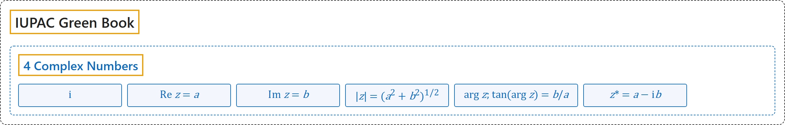

# 4 Complex Numbers

## Classification

## Glossary

| Symbol | Description | 中文翻译 | Source |
|---|---|---|---|
| $\mathrm{i}$ | "square root of $-1$, $\sqrt{-1}$" | $-1$ 的平方根，$\sqrt{-1}$ | [Cohen et al., 2007, section 4.2, p. 107](https://iupac.org/wp-content/uploads/2019/05/IUPAC-GB3-2012-2ndPrinting-PDFsearchable.pdf#page=121) |
| $\operatorname{Re} z = a$ | "real part of $z = a + \mathrm{i}b$" | $z = a + \mathrm{i}b$ 的实部 | [Cohen et al., 2007, section 4.2, p. 107](https://iupac.org/wp-content/uploads/2019/05/IUPAC-GB3-2012-2ndPrinting-PDFsearchable.pdf#page=121) |
| $\operatorname{Im} z = b$ | "imaginary part of $z = a + \mathrm{i}b$" | $z = a + \mathrm{i}b$ 的虚部 | [Cohen et al., 2007, section 4.2, p. 107](https://iupac.org/wp-content/uploads/2019/05/IUPAC-GB3-2012-2ndPrinting-PDFsearchable.pdf#page=121) |
| $\lvert z \rvert = (a^2+b^2)^{1/2}$ | "modulus of $z = a + \mathrm{i}b$, absolute value of $z = a + \mathrm{i}b$" | $z = a + \mathrm{i}b$ 的模，$z = a + \mathrm{i}b$ 的绝对值 | [Cohen et al., 2007, section 4.2, p. 107](https://iupac.org/wp-content/uploads/2019/05/IUPAC-GB3-2012-2ndPrinting-PDFsearchable.pdf#page=121) |
| $\arg z;\ \tan(\arg z) = b/a$ | "argument of $z = a + \mathrm{i}b$" | $z = a + \mathrm{i}b$ 的辐角 | [Cohen et al., 2007, section 4.2, p. 107](https://iupac.org/wp-content/uploads/2019/05/IUPAC-GB3-2012-2ndPrinting-PDFsearchable.pdf#page=121) |
| $z^* = a - \mathrm{i}b$ | "complex conjugate of $z = a + \mathrm{i}b$" | $z = a + \mathrm{i}b$ 的复共轭 | [Cohen et al., 2007, section 4.2, p. 107](https://iupac.org/wp-content/uploads/2019/05/IUPAC-GB3-2012-2ndPrinting-PDFsearchable.pdf#page=121) |

## References

Cohen, E. R., Cvitaš, T., Frey, J. G., Holmström, B., Kuchitsu, K., Marquardt, R., Mills, I., Pavese, F., Quack, M., Stohner, J., Strauss, H. L., Takami, M., & Thor, A. J. (2007). *Quantities, units and symbols in physical chemistry* (3rd ed., 2nd printing 2012). IUPAC; RSC Publishing. <https://iupac.org/wp-content/uploads/2019/05/IUPAC-GB3-2012-2ndPrinting-PDFsearchable.pdf>
