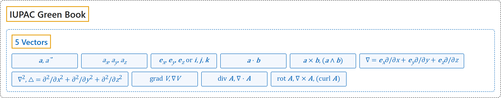

# 5 Vectors

## Classification

## Glossary

| Symbol | Description | 中文翻译 | Source |
|---|---|---|---|
| **[IUPAC Green Book](index.md)** IUPAC 绿皮书 | "The purpose of this manual is **to improve the exchange of scientific information** among the readers in different disciplines and across different nations." | 本手册的目的是**促进科学信息的交流**，使不同学科、不同国家的读者能够互相沟通。 | [Cohen et al., 2007, Preface, para. 1](https://iupac.org/wp-content/uploads/2019/05/IUPAC-GB3-2012-2ndPrinting-PDFsearchable.pdf#page=9) |
| **[5 Vectors](5-vectors.md)** 向量 | (No definition) | （无定义） | [Cohen et al., 2007, section 4.2, p. 107](https://iupac.org/wp-content/uploads/2019/05/IUPAC-GB3-2012-2ndPrinting-PDFsearchable.pdf#page=121) |
| $\boldsymbol{a},\ \vec{a}$ | "vector $\boldsymbol{a}$" | 向量 $\boldsymbol{a}$ | [Cohen et al., 2007, section 4.2, p. 107](https://iupac.org/wp-content/uploads/2019/05/IUPAC-GB3-2012-2ndPrinting-PDFsearchable.pdf#page=121) |
| $a_x,\ a_y,\ a_z$ | "cartesian components of $\boldsymbol{a}$" | $\boldsymbol{a}$ 的笛卡儿分量 | [Cohen et al., 2007, section 4.2, p. 107](https://iupac.org/wp-content/uploads/2019/05/IUPAC-GB3-2012-2ndPrinting-PDFsearchable.pdf#page=121) |
| $\boldsymbol{e}_x,\ \boldsymbol{e}_y,\ \boldsymbol{e}_z \text{ or } \boldsymbol{i},\ \boldsymbol{j},\ \boldsymbol{k}$ | "unit vectors in cartesian coordinate system" | 笛卡儿坐标系中的单位向量 | [Cohen et al., 2007, section 4.2, p. 107](https://iupac.org/wp-content/uploads/2019/05/IUPAC-GB3-2012-2ndPrinting-PDFsearchable.pdf#page=121) |
| $\boldsymbol{a} \cdot \boldsymbol{b}$ | "scalar product" | 标量积 | [Cohen et al., 2007, section 4.2, p. 107](https://iupac.org/wp-content/uploads/2019/05/IUPAC-GB3-2012-2ndPrinting-PDFsearchable.pdf#page=121) |
| $\boldsymbol{a} \times \boldsymbol{b},\ (\boldsymbol{a} \wedge \boldsymbol{b})$ | "vector or cross product" | 向量积或叉积 | [Cohen et al., 2007, section 4.2, p. 107](https://iupac.org/wp-content/uploads/2019/05/IUPAC-GB3-2012-2ndPrinting-PDFsearchable.pdf#page=121) |
| $\nabla = \boldsymbol{e}_x \partial/\partial x + \boldsymbol{e}_y \partial/\partial y + \boldsymbol{e}_z \partial/\partial z$ | "nabla operator, del operator" | 那勃勒算子，del 算子 | [Cohen et al., 2007, section 4.2, p. 107](https://iupac.org/wp-content/uploads/2019/05/IUPAC-GB3-2012-2ndPrinting-PDFsearchable.pdf#page=121) |
| $\nabla^2,\ \triangle = \partial^2/\partial x^2 + \partial^2/\partial y^2 + \partial^2/\partial z^2$ | "Laplacian operator" | 拉普拉斯算子 | [Cohen et al., 2007, section 4.2, p. 107](https://iupac.org/wp-content/uploads/2019/05/IUPAC-GB3-2012-2ndPrinting-PDFsearchable.pdf#page=121) |
| $\operatorname{grad} V,\ \nabla V$ | "gradient of a scalar field $V$" | 标量场 $V$ 的梯度 | [Cohen et al., 2007, section 4.2, p. 107](https://iupac.org/wp-content/uploads/2019/05/IUPAC-GB3-2012-2ndPrinting-PDFsearchable.pdf#page=121) |
| $\operatorname{div} \boldsymbol{A},\ \nabla \cdot \boldsymbol{A}$ | "divergence of a vector field $\boldsymbol{A}$" | 向量场 $\boldsymbol{A}$ 的散度 | [Cohen et al., 2007, section 4.2, p. 107](https://iupac.org/wp-content/uploads/2019/05/IUPAC-GB3-2012-2ndPrinting-PDFsearchable.pdf#page=121) |
| $\operatorname{rot} \boldsymbol{A},\ \nabla \times \boldsymbol{A},\ (\operatorname{curl} \boldsymbol{A})$ | "rotation of a vector field $\boldsymbol{A}$" | 向量场 $\boldsymbol{A}$ 的旋度 | [Cohen et al., 2007, section 4.2, p. 107](https://iupac.org/wp-content/uploads/2019/05/IUPAC-GB3-2012-2ndPrinting-PDFsearchable.pdf#page=121) |

## References

Cohen, E. R., Cvitaš, T., Frey, J. G., Holmström, B., Kuchitsu, K., Marquardt, R., Mills, I., Pavese, F., Quack, M., Stohner, J., Strauss, H. L., Takami, M., & Thor, A. J. (2007). *Quantities, units and symbols in physical chemistry* (3rd ed., 2nd printing 2012). IUPAC; RSC Publishing. <https://iupac.org/wp-content/uploads/2019/05/IUPAC-GB3-2012-2ndPrinting-PDFsearchable.pdf>
