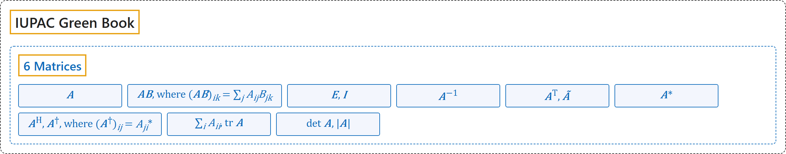

# 6 Matrices

## Classification

## Glossary

| Symbol | Description | 中文翻译 | Source |
|---|---|---|---|
| $\boldsymbol{A}$ | "matrix of element $A_{ij}$" | 元素为 $A_{ij}$ 的矩阵 | [Cohen et al., 2007, section 4.2, p. 107](https://iupac.org/wp-content/uploads/2019/05/IUPAC-GB3-2012-2ndPrinting-PDFsearchable.pdf#page=121) |
| $\boldsymbol{AB},\ \text{where } (\boldsymbol{AB})_{ik} = \sum_j A_{ij} B_{jk}$ | "product of matrices $\boldsymbol{A}$ and $\boldsymbol{B}$" | 矩阵 $\boldsymbol{A}$ 与 $\boldsymbol{B}$ 的积 | [Cohen et al., 2007, section 4.2, p. 107](https://iupac.org/wp-content/uploads/2019/05/IUPAC-GB3-2012-2ndPrinting-PDFsearchable.pdf#page=121) |
| $\boldsymbol{E},\ \boldsymbol{I}$ | "unit matrix" | 单位矩阵 | [Cohen et al., 2007, section 4.2, p. 107](https://iupac.org/wp-content/uploads/2019/05/IUPAC-GB3-2012-2ndPrinting-PDFsearchable.pdf#page=121) |
| $\boldsymbol{A}^{-1}$ | "inverse of a square matrix $\boldsymbol{A}$" | 方阵 $\boldsymbol{A}$ 的逆 | [Cohen et al., 2007, section 4.2, p. 107](https://iupac.org/wp-content/uploads/2019/05/IUPAC-GB3-2012-2ndPrinting-PDFsearchable.pdf#page=121) |
| $\boldsymbol{A}^{\mathrm{T}},\ \tilde{\boldsymbol{A}}$ | "transpose of matrix $\boldsymbol{A}$" | 矩阵 $\boldsymbol{A}$ 的转置 | [Cohen et al., 2007, section 4.2, p. 107](https://iupac.org/wp-content/uploads/2019/05/IUPAC-GB3-2012-2ndPrinting-PDFsearchable.pdf#page=121) |
| $\boldsymbol{A}^*$ | "complex conjugate of matrix $\boldsymbol{A}$" | 矩阵 $\boldsymbol{A}$ 的复共轭 | [Cohen et al., 2007, section 4.2, p. 107](https://iupac.org/wp-content/uploads/2019/05/IUPAC-GB3-2012-2ndPrinting-PDFsearchable.pdf#page=121) |
| $\boldsymbol{A}^{\mathrm{H}},\ \boldsymbol{A}^\dagger,\ \text{where } (\boldsymbol{A}^\dagger)_{ij} = A_{ji}^*$ | "conjugate transpose (adjoint) of $\boldsymbol{A}$ (hermitian conjugate of $\boldsymbol{A}$)" | $\boldsymbol{A}$ 的共轭转置（伴随）（$\boldsymbol{A}$ 的厄米共轭） | [Cohen et al., 2007, section 4.2, p. 107](https://iupac.org/wp-content/uploads/2019/05/IUPAC-GB3-2012-2ndPrinting-PDFsearchable.pdf#page=121) |
| $\sum_i A_{ii},\ \operatorname{tr} \boldsymbol{A}$ | "trace of a square matrix $\boldsymbol{A}$" | 方阵 $\boldsymbol{A}$ 的迹 | [Cohen et al., 2007, section 4.2, p. 107](https://iupac.org/wp-content/uploads/2019/05/IUPAC-GB3-2012-2ndPrinting-PDFsearchable.pdf#page=121) |
| $\det \boldsymbol{A},\ \lvert \boldsymbol{A} \rvert$ | "determinant of a square matrix $\boldsymbol{A}$" | 方阵 $\boldsymbol{A}$ 的行列式 | [Cohen et al., 2007, section 4.2, p. 107](https://iupac.org/wp-content/uploads/2019/05/IUPAC-GB3-2012-2ndPrinting-PDFsearchable.pdf#page=121) |

## References

Cohen, E. R., Cvitaš, T., Frey, J. G., Holmström, B., Kuchitsu, K., Marquardt, R., Mills, I., Pavese, F., Quack, M., Stohner, J., Strauss, H. L., Takami, M., & Thor, A. J. (2007). *Quantities, units and symbols in physical chemistry* (3rd ed., 2nd printing 2012). IUPAC; RSC Publishing. <https://iupac.org/wp-content/uploads/2019/05/IUPAC-GB3-2012-2ndPrinting-PDFsearchable.pdf>
