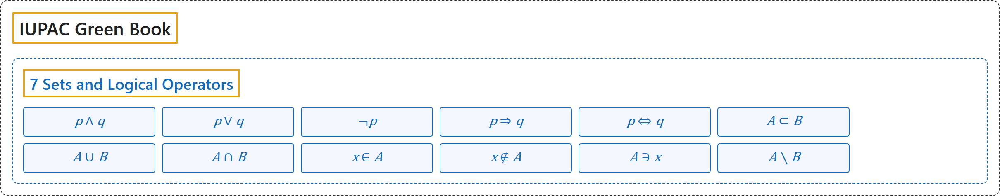

# 7 Sets and Logical Operators

## Classification

## Glossary

| Symbol | Description | 中文翻译 | Source |
|---|---|---|---|
| $p \wedge q$ | "$p$ and $q$ (conjunction sign)" | $p$ 且 $q$（合取号） | [Cohen et al., 2007, section 4.2, p. 107](https://iupac.org/wp-content/uploads/2019/05/IUPAC-GB3-2012-2ndPrinting-PDFsearchable.pdf#page=121) |
| $p \vee q$ | "$p$ or $q$ or both (disjunction sign)" | $p$ 或 $q$ 或两者（析取号） | [Cohen et al., 2007, section 4.2, p. 107](https://iupac.org/wp-content/uploads/2019/05/IUPAC-GB3-2012-2ndPrinting-PDFsearchable.pdf#page=121) |
| $\neg p$ | "negation of $p$, not $p$" | $p$ 的否定，非 $p$ | [Cohen et al., 2007, section 4.2, p. 107](https://iupac.org/wp-content/uploads/2019/05/IUPAC-GB3-2012-2ndPrinting-PDFsearchable.pdf#page=121) |
| $p \Rightarrow q$ | "$p$ implies $q$" | $p$ 蕴涵 $q$ | [Cohen et al., 2007, section 4.2, p. 107](https://iupac.org/wp-content/uploads/2019/05/IUPAC-GB3-2012-2ndPrinting-PDFsearchable.pdf#page=121) |
| $p \Leftrightarrow q$ | "$p$ is equivalent to $q$" | $p$ 等价于 $q$ | [Cohen et al., 2007, section 4.2, p. 107](https://iupac.org/wp-content/uploads/2019/05/IUPAC-GB3-2012-2ndPrinting-PDFsearchable.pdf#page=121) |
| $A \subset B$ | "$A$ is contained in $B$" | $A$ 包含于 $B$ | [Cohen et al., 2007, section 4.2, p. 108](https://iupac.org/wp-content/uploads/2019/05/IUPAC-GB3-2012-2ndPrinting-PDFsearchable.pdf#page=122) |
| $A \cup B$ | "union of $A$ and $B$" | $A$ 与 $B$ 的并集 | [Cohen et al., 2007, section 4.2, p. 108](https://iupac.org/wp-content/uploads/2019/05/IUPAC-GB3-2012-2ndPrinting-PDFsearchable.pdf#page=122) |
| $A \cap B$ | "intersection of $A$ and $B$" | $A$ 与 $B$ 的交集 | [Cohen et al., 2007, section 4.2, p. 108](https://iupac.org/wp-content/uploads/2019/05/IUPAC-GB3-2012-2ndPrinting-PDFsearchable.pdf#page=122) |
| $x \in A$ | "$x$ belongs to $A$" | $x$ 属于 $A$ | [Cohen et al., 2007, section 4.2, p. 108](https://iupac.org/wp-content/uploads/2019/05/IUPAC-GB3-2012-2ndPrinting-PDFsearchable.pdf#page=122) |
| $x \notin A$ | "$x$ does not belong to $A$" | $x$ 不属于 $A$ | [Cohen et al., 2007, section 4.2, p. 108](https://iupac.org/wp-content/uploads/2019/05/IUPAC-GB3-2012-2ndPrinting-PDFsearchable.pdf#page=122) |
| $A \ni x$ | "the set $A$ contains $x$" | 集合 $A$ 包含 $x$ | [Cohen et al., 2007, section 4.2, p. 108](https://iupac.org/wp-content/uploads/2019/05/IUPAC-GB3-2012-2ndPrinting-PDFsearchable.pdf#page=122) |
| $A \setminus B$ | "$A$ but not $B$" | $A$ 但不属于 $B$ | [Cohen et al., 2007, section 4.2, p. 108](https://iupac.org/wp-content/uploads/2019/05/IUPAC-GB3-2012-2ndPrinting-PDFsearchable.pdf#page=122) |

## References

Cohen, E. R., Cvitaš, T., Frey, J. G., Holmström, B., Kuchitsu, K., Marquardt, R., Mills, I., Pavese, F., Quack, M., Stohner, J., Strauss, H. L., Takami, M., & Thor, A. J. (2007). *Quantities, units and symbols in physical chemistry* (3rd ed., 2nd printing 2012). IUPAC; RSC Publishing. <https://iupac.org/wp-content/uploads/2019/05/IUPAC-GB3-2012-2ndPrinting-PDFsearchable.pdf>
