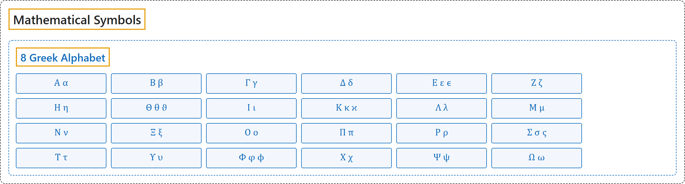

# 8 Greek Alphabet

## Classification

## Glossary

| Symbol | Description | 中文翻译 | Source |
|---|---|---|---|
| **[Mathematical Symbols](index.md)** 数学符号 | (No definition) | （无定义） | [Cohen et al., 2007](https://iupac.org/wp-content/uploads/2019/05/IUPAC-GB3-2012-2ndPrinting-PDFsearchable.pdf) |
| **[8 Greek Alphabet](8-greek-alphabet.md)** 希腊字母表 | (No definition) | （无定义） | [Cohen et al., 2007, chapter 11, p. 179](https://iupac.org/wp-content/uploads/2019/05/IUPAC-GB3-2012-2ndPrinting-PDFsearchable.pdf#page=193) |
| Α α | "**alpha**", Latin equivalent "A" | **阿尔法**（alpha），拉丁对应 A | [Cohen et al., 2007, chapter 11, p. 179](https://iupac.org/wp-content/uploads/2019/05/IUPAC-GB3-2012-2ndPrinting-PDFsearchable.pdf#page=193) |
| Β β | "**beta**", Latin equivalent "B" | **贝塔**（beta），拉丁对应 B | [Cohen et al., 2007, chapter 11, p. 179](https://iupac.org/wp-content/uploads/2019/05/IUPAC-GB3-2012-2ndPrinting-PDFsearchable.pdf#page=193) |
| Γ γ | "**gamma**", Latin equivalent "G" | **伽马**（gamma），拉丁对应 G | [Cohen et al., 2007, chapter 11, p. 179](https://iupac.org/wp-content/uploads/2019/05/IUPAC-GB3-2012-2ndPrinting-PDFsearchable.pdf#page=193) |
| Δ δ | "**delta**", Latin equivalent "D" | **德尔塔**（delta），拉丁对应 D | [Cohen et al., 2007, chapter 11, p. 179](https://iupac.org/wp-content/uploads/2019/05/IUPAC-GB3-2012-2ndPrinting-PDFsearchable.pdf#page=193) |
| Ε ε ϵ | "**epsilon**", Latin equivalent "E" | **艾普西隆**（epsilon），拉丁对应 E | [Cohen et al., 2007, chapter 11, p. 179](https://iupac.org/wp-content/uploads/2019/05/IUPAC-GB3-2012-2ndPrinting-PDFsearchable.pdf#page=193) |
| Ζ ζ | "**zeta**", Latin equivalent "Z" | **泽塔**（zeta），拉丁对应 Z | [Cohen et al., 2007, chapter 11, p. 179](https://iupac.org/wp-content/uploads/2019/05/IUPAC-GB3-2012-2ndPrinting-PDFsearchable.pdf#page=193) |
| Η η | "**eta**", Latin equivalent "Ae, Ä, Ee" | **伊塔**（eta），拉丁对应 Ae, Ä, Ee | [Cohen et al., 2007, chapter 11, p. 179](https://iupac.org/wp-content/uploads/2019/05/IUPAC-GB3-2012-2ndPrinting-PDFsearchable.pdf#page=193) |
| Θ θ ϑ | "**theta**", Latin equivalent "Th" | **西塔**（theta），拉丁对应 Th | [Cohen et al., 2007, chapter 11, p. 179](https://iupac.org/wp-content/uploads/2019/05/IUPAC-GB3-2012-2ndPrinting-PDFsearchable.pdf#page=193) |
| Ι ι | "**iota**", Latin equivalent "I" | **约塔**（iota），拉丁对应 I | [Cohen et al., 2007, chapter 11, p. 179](https://iupac.org/wp-content/uploads/2019/05/IUPAC-GB3-2012-2ndPrinting-PDFsearchable.pdf#page=193) |
| Κ κ ϰ | "**kappa**", Latin equivalent "K" | **卡帕**（kappa），拉丁对应 K | [Cohen et al., 2007, chapter 11, p. 179](https://iupac.org/wp-content/uploads/2019/05/IUPAC-GB3-2012-2ndPrinting-PDFsearchable.pdf#page=193) |
| Λ λ | "**lambda**", Latin equivalent "L" | **兰姆达**（lambda），拉丁对应 L | [Cohen et al., 2007, chapter 11, p. 179](https://iupac.org/wp-content/uploads/2019/05/IUPAC-GB3-2012-2ndPrinting-PDFsearchable.pdf#page=193) |
| Μ μ | "**mu, (my)**", Latin equivalent "M" | **缪**（mu, (my)），拉丁对应 M | [Cohen et al., 2007, chapter 11, p. 179](https://iupac.org/wp-content/uploads/2019/05/IUPAC-GB3-2012-2ndPrinting-PDFsearchable.pdf#page=193) |
| Ν ν | "**nu, (ny)**", Latin equivalent "N" | **纽**（nu, (ny)），拉丁对应 N | [Cohen et al., 2007, chapter 11, p. 179](https://iupac.org/wp-content/uploads/2019/05/IUPAC-GB3-2012-2ndPrinting-PDFsearchable.pdf#page=193) |
| Ξ ξ | "**xi**", Latin equivalent "X" | **克西**（xi），拉丁对应 X | [Cohen et al., 2007, chapter 11, p. 179](https://iupac.org/wp-content/uploads/2019/05/IUPAC-GB3-2012-2ndPrinting-PDFsearchable.pdf#page=193) |
| Ο ο | "**omikron**", Latin equivalent "O" | **奥米克戎**（omikron），拉丁对应 O | [Cohen et al., 2007, chapter 11, p. 179](https://iupac.org/wp-content/uploads/2019/05/IUPAC-GB3-2012-2ndPrinting-PDFsearchable.pdf#page=193) |
| Π π | "**pi**", Latin equivalent "P" | **派**（pi），拉丁对应 P | [Cohen et al., 2007, chapter 11, p. 179](https://iupac.org/wp-content/uploads/2019/05/IUPAC-GB3-2012-2ndPrinting-PDFsearchable.pdf#page=193) |
| Ρ ρ | "**rho**", Latin equivalent "R" | **柔**（rho），拉丁对应 R | [Cohen et al., 2007, chapter 11, p. 179](https://iupac.org/wp-content/uploads/2019/05/IUPAC-GB3-2012-2ndPrinting-PDFsearchable.pdf#page=193) |
| Σ σ ς | "**sigma**", Latin equivalent "S" | **西格玛**（sigma），拉丁对应 S | [Cohen et al., 2007, chapter 11, p. 179](https://iupac.org/wp-content/uploads/2019/05/IUPAC-GB3-2012-2ndPrinting-PDFsearchable.pdf#page=193) |
| Τ τ | "**tau**", Latin equivalent "T" | **陶**（tau），拉丁对应 T | [Cohen et al., 2007, chapter 11, p. 179](https://iupac.org/wp-content/uploads/2019/05/IUPAC-GB3-2012-2ndPrinting-PDFsearchable.pdf#page=193) |
| Υ υ | "**upsilon, ypsilon**", Latin equivalent "U, Y" | **宇普西隆**（upsilon, ypsilon），拉丁对应 U, Y | [Cohen et al., 2007, chapter 11, p. 179](https://iupac.org/wp-content/uploads/2019/05/IUPAC-GB3-2012-2ndPrinting-PDFsearchable.pdf#page=193) |
| Φ φ ϕ | "**phi**", Latin equivalent "Ph" | **斐**（phi），拉丁对应 Ph | [Cohen et al., 2007, chapter 11, p. 179](https://iupac.org/wp-content/uploads/2019/05/IUPAC-GB3-2012-2ndPrinting-PDFsearchable.pdf#page=193) |
| Χ χ | "**chi**", Latin equivalent "Ch" | **希**（chi），拉丁对应 Ch | [Cohen et al., 2007, chapter 11, p. 179](https://iupac.org/wp-content/uploads/2019/05/IUPAC-GB3-2012-2ndPrinting-PDFsearchable.pdf#page=193) |
| Ψ ψ | "**psi**", Latin equivalent "Ps" | **普西**（psi），拉丁对应 Ps | [Cohen et al., 2007, chapter 11, p. 179](https://iupac.org/wp-content/uploads/2019/05/IUPAC-GB3-2012-2ndPrinting-PDFsearchable.pdf#page=193) |
| Ω ω | "**omega**", Latin equivalent "Oo" | **欧米伽**（omega），拉丁对应 Oo | [Cohen et al., 2007, chapter 11, p. 179](https://iupac.org/wp-content/uploads/2019/05/IUPAC-GB3-2012-2ndPrinting-PDFsearchable.pdf#page=193) |

## References

Cohen, E. R., Cvitaš, T., Frey, J. G., Holmström, B., Kuchitsu, K., Marquardt, R., Mills, I., Pavese, F., Quack, M., Stohner, J., Strauss, H. L., Takami, M., & Thor, A. J. (2007). *Quantities, units and symbols in physical chemistry* (3rd ed., 2nd printing 2012). IUPAC; RSC Publishing. <https://iupac.org/wp-content/uploads/2019/05/IUPAC-GB3-2012-2ndPrinting-PDFsearchable.pdf>
