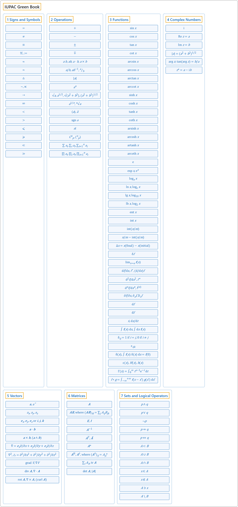

# IUPAC Green Book

## Classification

## Glossary

| Term | Definition | 中文翻译 | Source |
|---|---|---|---|
| **IUPAC Green Book** IUPAC 绿皮书 | "The purpose of this manual is **to improve the exchange of scientific information** among the readers in different disciplines and across different nations." | 本手册的目的是**促进科学信息的交流**，使不同学科、不同国家的读者能够互相沟通。 | [Cohen et al., 2007, Preface, para. 1](https://iupac.org/wp-content/uploads/2019/05/IUPAC-GB3-2012-2ndPrinting-PDFsearchable.pdf#page=9) |
| **[1 Signs and Symbols](1-signs-and-symbols.md)** 符号与记号 | (No definition) | （无定义） | [Cohen et al., 2007, section 4.2, p. 105](https://iupac.org/wp-content/uploads/2019/05/IUPAC-GB3-2012-2ndPrinting-PDFsearchable.pdf#page=119) |
| **[2 Operations](2-operations.md)** 运算 | (No definition) | （无定义） | [Cohen et al., 2007, section 4.2, p. 105](https://iupac.org/wp-content/uploads/2019/05/IUPAC-GB3-2012-2ndPrinting-PDFsearchable.pdf#page=119) |
| **[3 Functions](3-functions.md)** 函数 | (No definition) | （无定义） | [Cohen et al., 2007, section 4.2, p. 105](https://iupac.org/wp-content/uploads/2019/05/IUPAC-GB3-2012-2ndPrinting-PDFsearchable.pdf#page=119) |
| **[4 Complex Numbers](4-complex-numbers.md)** 复数 | (No definition) | （无定义） | [Cohen et al., 2007, section 4.2, p. 107](https://iupac.org/wp-content/uploads/2019/05/IUPAC-GB3-2012-2ndPrinting-PDFsearchable.pdf#page=121) |
| **[5 Vectors](5-vectors.md)** 向量 | (No definition) | （无定义） | [Cohen et al., 2007, section 4.2, p. 107](https://iupac.org/wp-content/uploads/2019/05/IUPAC-GB3-2012-2ndPrinting-PDFsearchable.pdf#page=121) |
| **[6 Matrices](6-matrices.md)** 矩阵 | (No definition) | （无定义） | [Cohen et al., 2007, section 4.2, p. 107](https://iupac.org/wp-content/uploads/2019/05/IUPAC-GB3-2012-2ndPrinting-PDFsearchable.pdf#page=121) |
| **[7 Sets and Logical Operators](7-sets-and-logical-operators.md)** 集合与逻辑运算符 | (No definition) | （无定义） | [Cohen et al., 2007, section 4.2, p. 107](https://iupac.org/wp-content/uploads/2019/05/IUPAC-GB3-2012-2ndPrinting-PDFsearchable.pdf#page=121) |

## References

Cohen, E. R., Cvitaš, T., Frey, J. G., Holmström, B., Kuchitsu, K., Marquardt, R., Mills, I., Pavese, F., Quack, M., Stohner, J., Strauss, H. L., Takami, M., & Thor, A. J. (2007). *Quantities, units and symbols in physical chemistry* (3rd ed., 2nd printing 2012). IUPAC; RSC Publishing. <https://iupac.org/wp-content/uploads/2019/05/IUPAC-GB3-2012-2ndPrinting-PDFsearchable.pdf>
