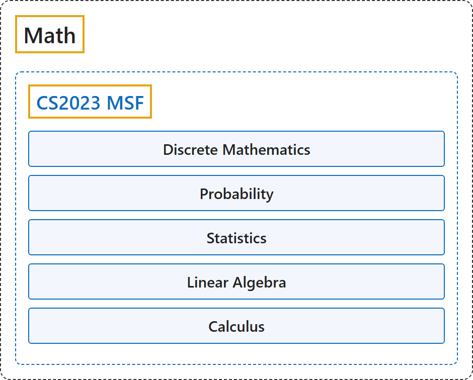

# Math

## Classification

## Glossary

| Term | Definition | 中文翻译 | Source |
|---|---|---|---|
| **Math** 数学 | "A strong **mathematical foundation** remains a **bedrock of computer science education** and infuses the practice of computing whether in **developing algorithms**, **designing systems**, **modeling real-world phenomena**, or **computing with data**." | 扎实的**数学基础**依然是**计算机科学教育的基石**，并贯穿计算实践的方方面面，无论是**开发算法**、**设计系统**、**为现实世界的现象建模**，还是**用数据进行计算**。 | [Joint Task Force on Computing Curricula, 2024, MSF "Preamble" section, para. 1](https://csed.acm.org/wp-content/uploads/2024/04/3.1-Body-of-Knowledge-1.pdf#page=123) |
| **CS2023 MSF** CS2023 MSF | "This Mathematical and Statistical Foundations (MSF) knowledge area – the successor to the ACM CS2013 curriculum's 'Discrete Structures' area – seeks to identify the **mathematical and statistical material** that **undergirds modern computer science**." | 数学与统计基础（MSF）这一知识领域是 ACM CS2013 课程体系中"离散结构"领域的继任者，旨在找出**数学和统计内容**，它们**支撑着现代计算机科学**。 | [Joint Task Force on Computing Curricula, 2024, MSF "Preamble" section, para. 1](https://csed.acm.org/wp-content/uploads/2024/04/3.1-Body-of-Knowledge-1.pdf#page=123) |

## References

Joint Task Force on Computing Curricula. (2024). *Computer science curricula 2023*. Association for Computing Machinery. <https://doi.org/10.1145/3664191>
