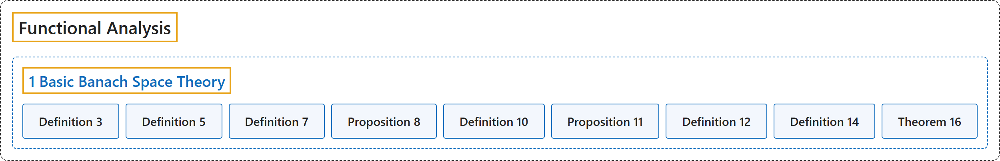

# 1 Basic Banach Space Theory

## Classification

## Glossary

| Term | Definition | 中文翻译 | Source |
|---|---|---|---|
| **1 Basic Banach Space Theory** 巴拿赫空间基本理论 | (No definition) | （无定义） | [Rodriguez, 2021, lecture 1](https://ocw.mit.edu/courses/18-102-introduction-to-functional-analysis-spring-2021/4ae9a5af8622dba3aa37461b71d08407_MIT18_102s21_lec1.pdf) |
| **Definition 3** 定义 3 | (pending) | （待补） | [Rodriguez, 2021, lecture 1, Definition 3](https://ocw.mit.edu/courses/18-102-introduction-to-functional-analysis-spring-2021/4ae9a5af8622dba3aa37461b71d08407_MIT18_102s21_lec1.pdf) |
| **Definition 5** 定义 5 | (pending) | （待补） | [Rodriguez, 2021, lecture 1, Definition 5](https://ocw.mit.edu/courses/18-102-introduction-to-functional-analysis-spring-2021/4ae9a5af8622dba3aa37461b71d08407_MIT18_102s21_lec1.pdf) |
| **Definition 7** 定义 7 | (pending) | （待补） | [Rodriguez, 2021, lecture 1, Definition 7](https://ocw.mit.edu/courses/18-102-introduction-to-functional-analysis-spring-2021/4ae9a5af8622dba3aa37461b71d08407_MIT18_102s21_lec1.pdf) |
| **Proposition 8** 命题 8 | (pending) | （待补） | [Rodriguez, 2021, lecture 1, Proposition 8](https://ocw.mit.edu/courses/18-102-introduction-to-functional-analysis-spring-2021/4ae9a5af8622dba3aa37461b71d08407_MIT18_102s21_lec1.pdf) |
| **Definition 10** 定义 10 | (pending) | （待补） | [Rodriguez, 2021, lecture 1, Definition 10](https://ocw.mit.edu/courses/18-102-introduction-to-functional-analysis-spring-2021/4ae9a5af8622dba3aa37461b71d08407_MIT18_102s21_lec1.pdf) |
| **Proposition 11** 命题 11 | (pending) | （待补） | [Rodriguez, 2021, lecture 1, Proposition 11](https://ocw.mit.edu/courses/18-102-introduction-to-functional-analysis-spring-2021/4ae9a5af8622dba3aa37461b71d08407_MIT18_102s21_lec1.pdf) |
| **Definition 12** 定义 12 | (pending) | （待补） | [Rodriguez, 2021, lecture 1, Definition 12](https://ocw.mit.edu/courses/18-102-introduction-to-functional-analysis-spring-2021/4ae9a5af8622dba3aa37461b71d08407_MIT18_102s21_lec1.pdf) |
| **Definition 14** 定义 14 | (pending) | （待补） | [Rodriguez, 2021, lecture 1, Definition 14](https://ocw.mit.edu/courses/18-102-introduction-to-functional-analysis-spring-2021/4ae9a5af8622dba3aa37461b71d08407_MIT18_102s21_lec1.pdf) |
| **Theorem 16** 定理 16 | (pending) | （待补） | [Rodriguez, 2021, lecture 1, Theorem 16](https://ocw.mit.edu/courses/18-102-introduction-to-functional-analysis-spring-2021/4ae9a5af8622dba3aa37461b71d08407_MIT18_102s21_lec1.pdf) |

## References

Rodriguez, C. (2021). *18.102 Introduction to functional analysis: Lecture notes* (Spring 2021). MIT OpenCourseWare. Retrieved October 31, 2026, from <https://ocw.mit.edu/courses/18-102-introduction-to-functional-analysis-spring-2021/>
