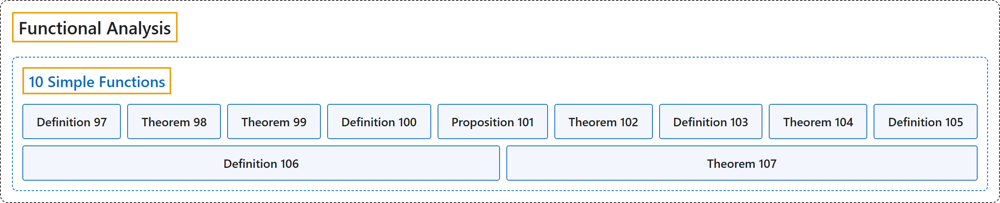

# 10 Simple Functions

## Classification

## Glossary

| Term | Definition | 中文翻译 | Source |
|---|---|---|---|
| **10 Simple Functions** 简单函数 | (No definition) | （无定义） | [Rodriguez, 2021, lecture 10](https://ocw.mit.edu/courses/18-102-introduction-to-functional-analysis-spring-2021/ebbbc59aa40252dff3d4ec766c057451_MIT18_102s21_lec10.pdf) |
| **Definition 97** 定义 97 | (pending) | （待补） | [Rodriguez, 2021, lecture 10, Definition 97](https://ocw.mit.edu/courses/18-102-introduction-to-functional-analysis-spring-2021/ebbbc59aa40252dff3d4ec766c057451_MIT18_102s21_lec10.pdf) |
| **Theorem 98** 定理 98 | (pending) | （待补） | [Rodriguez, 2021, lecture 10, Theorem 98](https://ocw.mit.edu/courses/18-102-introduction-to-functional-analysis-spring-2021/ebbbc59aa40252dff3d4ec766c057451_MIT18_102s21_lec10.pdf) |
| **Theorem 99** 定理 99 | (pending) | （待补） | [Rodriguez, 2021, lecture 10, Theorem 99](https://ocw.mit.edu/courses/18-102-introduction-to-functional-analysis-spring-2021/ebbbc59aa40252dff3d4ec766c057451_MIT18_102s21_lec10.pdf) |
| **Definition 100** 定义 100 | (pending) | （待补） | [Rodriguez, 2021, lecture 10, Definition 100](https://ocw.mit.edu/courses/18-102-introduction-to-functional-analysis-spring-2021/ebbbc59aa40252dff3d4ec766c057451_MIT18_102s21_lec10.pdf) |
| **Proposition 101** 命题 101 | (pending) | （待补） | [Rodriguez, 2021, lecture 10, Proposition 101](https://ocw.mit.edu/courses/18-102-introduction-to-functional-analysis-spring-2021/ebbbc59aa40252dff3d4ec766c057451_MIT18_102s21_lec10.pdf) |
| **Theorem 102** 定理 102 | (pending) | （待补） | [Rodriguez, 2021, lecture 10, Theorem 102](https://ocw.mit.edu/courses/18-102-introduction-to-functional-analysis-spring-2021/ebbbc59aa40252dff3d4ec766c057451_MIT18_102s21_lec10.pdf) |
| **Definition 103** 定义 103 | (pending) | （待补） | [Rodriguez, 2021, lecture 10, Definition 103](https://ocw.mit.edu/courses/18-102-introduction-to-functional-analysis-spring-2021/ebbbc59aa40252dff3d4ec766c057451_MIT18_102s21_lec10.pdf) |
| **Theorem 104** 定理 104 | (pending) | （待补） | [Rodriguez, 2021, lecture 10, Theorem 104](https://ocw.mit.edu/courses/18-102-introduction-to-functional-analysis-spring-2021/ebbbc59aa40252dff3d4ec766c057451_MIT18_102s21_lec10.pdf) |
| **Definition 105** 定义 105 | (pending) | （待补） | [Rodriguez, 2021, lecture 10, Definition 105](https://ocw.mit.edu/courses/18-102-introduction-to-functional-analysis-spring-2021/ebbbc59aa40252dff3d4ec766c057451_MIT18_102s21_lec10.pdf) |
| **Definition 106** 定义 106 | (pending) | （待补） | [Rodriguez, 2021, lecture 10, Definition 106](https://ocw.mit.edu/courses/18-102-introduction-to-functional-analysis-spring-2021/ebbbc59aa40252dff3d4ec766c057451_MIT18_102s21_lec10.pdf) |
| **Theorem 107** 定理 107 | (pending) | （待补） | [Rodriguez, 2021, lecture 10, Theorem 107](https://ocw.mit.edu/courses/18-102-introduction-to-functional-analysis-spring-2021/ebbbc59aa40252dff3d4ec766c057451_MIT18_102s21_lec10.pdf) |

## References

Rodriguez, C. (2021). *18.102 Introduction to functional analysis: Lecture notes* (Spring 2021). MIT OpenCourseWare. Retrieved October 31, 2026, from <https://ocw.mit.edu/courses/18-102-introduction-to-functional-analysis-spring-2021/>
