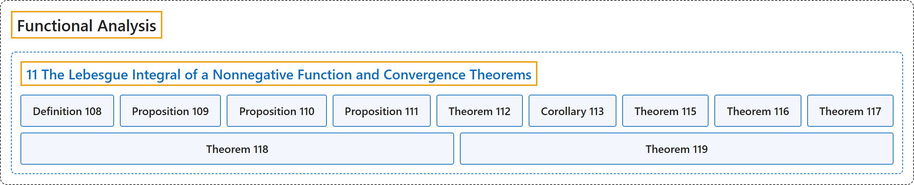

# 11 The Lebesgue Integral of a Nonnegative Function and Convergence Theorems

## Classification

## Glossary

| Term | Definition | 中文翻译 | Source |
|---|---|---|---|
| **11 The Lebesgue Integral of a Nonnegative Function and Convergence Theorems** 非负函数的勒贝格积分与收敛定理 | (No definition) | （无定义） | [Rodriguez, 2021, lecture 11](https://ocw.mit.edu/courses/18-102-introduction-to-functional-analysis-spring-2021/615c26170233747c081d6dab928f7d91_MIT18_102s21_lec11.pdf) |
| **Definition 108** 定义 108 | (pending) | （待补） | [Rodriguez, 2021, lecture 11, Definition 108](https://ocw.mit.edu/courses/18-102-introduction-to-functional-analysis-spring-2021/615c26170233747c081d6dab928f7d91_MIT18_102s21_lec11.pdf) |
| **Proposition 109** 命题 109 | (pending) | （待补） | [Rodriguez, 2021, lecture 11, Proposition 109](https://ocw.mit.edu/courses/18-102-introduction-to-functional-analysis-spring-2021/615c26170233747c081d6dab928f7d91_MIT18_102s21_lec11.pdf) |
| **Proposition 110** 命题 110 | (pending) | （待补） | [Rodriguez, 2021, lecture 11, Proposition 110](https://ocw.mit.edu/courses/18-102-introduction-to-functional-analysis-spring-2021/615c26170233747c081d6dab928f7d91_MIT18_102s21_lec11.pdf) |
| **Proposition 111** 命题 111 | (pending) | （待补） | [Rodriguez, 2021, lecture 11, Proposition 111](https://ocw.mit.edu/courses/18-102-introduction-to-functional-analysis-spring-2021/615c26170233747c081d6dab928f7d91_MIT18_102s21_lec11.pdf) |
| **Theorem 112** 定理 112 | (pending) | （待补） | [Rodriguez, 2021, lecture 11, Theorem 112](https://ocw.mit.edu/courses/18-102-introduction-to-functional-analysis-spring-2021/615c26170233747c081d6dab928f7d91_MIT18_102s21_lec11.pdf) |
| **Corollary 113** 推论 113 | (pending) | （待补） | [Rodriguez, 2021, lecture 11, Corollary 113](https://ocw.mit.edu/courses/18-102-introduction-to-functional-analysis-spring-2021/615c26170233747c081d6dab928f7d91_MIT18_102s21_lec11.pdf) |
| **Theorem 115** 定理 115 | (pending) | （待补） | [Rodriguez, 2021, lecture 11, Theorem 115](https://ocw.mit.edu/courses/18-102-introduction-to-functional-analysis-spring-2021/615c26170233747c081d6dab928f7d91_MIT18_102s21_lec11.pdf) |
| **Theorem 116** 定理 116 | (pending) | （待补） | [Rodriguez, 2021, lecture 11, Theorem 116](https://ocw.mit.edu/courses/18-102-introduction-to-functional-analysis-spring-2021/615c26170233747c081d6dab928f7d91_MIT18_102s21_lec11.pdf) |
| **Theorem 117** 定理 117 | (pending) | （待补） | [Rodriguez, 2021, lecture 11, Theorem 117](https://ocw.mit.edu/courses/18-102-introduction-to-functional-analysis-spring-2021/615c26170233747c081d6dab928f7d91_MIT18_102s21_lec11.pdf) |
| **Theorem 118** 定理 118 | (pending) | （待补） | [Rodriguez, 2021, lecture 11, Theorem 118](https://ocw.mit.edu/courses/18-102-introduction-to-functional-analysis-spring-2021/615c26170233747c081d6dab928f7d91_MIT18_102s21_lec11.pdf) |
| **Theorem 119** 定理 119 | (pending) | （待补） | [Rodriguez, 2021, lecture 11, Theorem 119](https://ocw.mit.edu/courses/18-102-introduction-to-functional-analysis-spring-2021/615c26170233747c081d6dab928f7d91_MIT18_102s21_lec11.pdf) |

## References

Rodriguez, C. (2021). *18.102 Introduction to functional analysis: Lecture notes* (Spring 2021). MIT OpenCourseWare. Retrieved October 31, 2026, from <https://ocw.mit.edu/courses/18-102-introduction-to-functional-analysis-spring-2021/>
