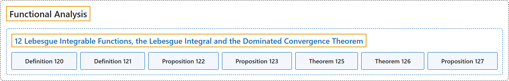

# 12 Lebesgue Integrable Functions, the Lebesgue Integral and the Dominated Convergence Theorem

## Classification

## Glossary

| Term | Definition | 中文翻译 | Source |
|---|---|---|---|
| **12 Lebesgue Integrable Functions, the Lebesgue Integral and the Dominated Convergence Theorem** 勒贝格可积函数、勒贝格积分与控制收敛定理 | (No definition) | （无定义） | [Rodriguez, 2021, lecture 12](https://ocw.mit.edu/courses/18-102-introduction-to-functional-analysis-spring-2021/e407e57ea631a29148ee94afecef7d33_MIT18_102s21_lec12.pdf) |
| **Definition 120** 定义 120 | (pending) | （待补） | [Rodriguez, 2021, lecture 12, Definition 120](https://ocw.mit.edu/courses/18-102-introduction-to-functional-analysis-spring-2021/e407e57ea631a29148ee94afecef7d33_MIT18_102s21_lec12.pdf) |
| **Definition 121** 定义 121 | (pending) | （待补） | [Rodriguez, 2021, lecture 12, Definition 121](https://ocw.mit.edu/courses/18-102-introduction-to-functional-analysis-spring-2021/e407e57ea631a29148ee94afecef7d33_MIT18_102s21_lec12.pdf) |
| **Proposition 122** 命题 122 | (pending) | （待补） | [Rodriguez, 2021, lecture 12, Proposition 122](https://ocw.mit.edu/courses/18-102-introduction-to-functional-analysis-spring-2021/e407e57ea631a29148ee94afecef7d33_MIT18_102s21_lec12.pdf) |
| **Proposition 123** 命题 123 | (pending) | （待补） | [Rodriguez, 2021, lecture 12, Proposition 123](https://ocw.mit.edu/courses/18-102-introduction-to-functional-analysis-spring-2021/e407e57ea631a29148ee94afecef7d33_MIT18_102s21_lec12.pdf) |
| **Theorem 125** 定理 125 | (pending) | （待补） | [Rodriguez, 2021, lecture 12, Theorem 125](https://ocw.mit.edu/courses/18-102-introduction-to-functional-analysis-spring-2021/e407e57ea631a29148ee94afecef7d33_MIT18_102s21_lec12.pdf) |
| **Theorem 126** 定理 126 | (pending) | （待补） | [Rodriguez, 2021, lecture 12, Theorem 126](https://ocw.mit.edu/courses/18-102-introduction-to-functional-analysis-spring-2021/e407e57ea631a29148ee94afecef7d33_MIT18_102s21_lec12.pdf) |
| **Proposition 127** 命题 127 | (pending) | （待补） | [Rodriguez, 2021, lecture 12, Proposition 127](https://ocw.mit.edu/courses/18-102-introduction-to-functional-analysis-spring-2021/e407e57ea631a29148ee94afecef7d33_MIT18_102s21_lec12.pdf) |

## References

Rodriguez, C. (2021). *18.102 Introduction to functional analysis: Lecture notes* (Spring 2021). MIT OpenCourseWare. Retrieved October 31, 2026, from <https://ocw.mit.edu/courses/18-102-introduction-to-functional-analysis-spring-2021/>
