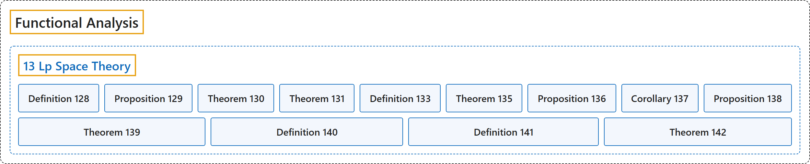

# 13 Lp Space Theory

## Classification

## Glossary

| Term | Definition | 中文翻译 | Source |
|---|---|---|---|
| **13 Lp Space Theory** Lp 空间理论 | (No definition) | （无定义） | [Rodriguez, 2021, lecture 13](https://ocw.mit.edu/courses/18-102-introduction-to-functional-analysis-spring-2021/aad5fcf3b0f85788519a0324258dd296_MIT18_102s21_lec13.pdf) |
| **Definition 128** 定义 128 | (pending) | （待补） | [Rodriguez, 2021, lecture 13, Definition 128](https://ocw.mit.edu/courses/18-102-introduction-to-functional-analysis-spring-2021/aad5fcf3b0f85788519a0324258dd296_MIT18_102s21_lec13.pdf) |
| **Proposition 129** 命题 129 | (pending) | （待补） | [Rodriguez, 2021, lecture 13, Proposition 129](https://ocw.mit.edu/courses/18-102-introduction-to-functional-analysis-spring-2021/aad5fcf3b0f85788519a0324258dd296_MIT18_102s21_lec13.pdf) |
| **Theorem 130** 定理 130 | (pending) | （待补） | [Rodriguez, 2021, lecture 13, Theorem 130](https://ocw.mit.edu/courses/18-102-introduction-to-functional-analysis-spring-2021/aad5fcf3b0f85788519a0324258dd296_MIT18_102s21_lec13.pdf) |
| **Theorem 131** 定理 131 | (pending) | （待补） | [Rodriguez, 2021, lecture 13, Theorem 131](https://ocw.mit.edu/courses/18-102-introduction-to-functional-analysis-spring-2021/aad5fcf3b0f85788519a0324258dd296_MIT18_102s21_lec13.pdf) |
| **Definition 133** 定义 133 | (pending) | （待补） | [Rodriguez, 2021, lecture 13, Definition 133](https://ocw.mit.edu/courses/18-102-introduction-to-functional-analysis-spring-2021/aad5fcf3b0f85788519a0324258dd296_MIT18_102s21_lec13.pdf) |
| **Theorem 135** 定理 135 | (pending) | （待补） | [Rodriguez, 2021, lecture 13, Theorem 135](https://ocw.mit.edu/courses/18-102-introduction-to-functional-analysis-spring-2021/aad5fcf3b0f85788519a0324258dd296_MIT18_102s21_lec13.pdf) |
| **Proposition 136** 命题 136 | (pending) | （待补） | [Rodriguez, 2021, lecture 13, Proposition 136](https://ocw.mit.edu/courses/18-102-introduction-to-functional-analysis-spring-2021/aad5fcf3b0f85788519a0324258dd296_MIT18_102s21_lec13.pdf) |
| **Corollary 137** 推论 137 | (pending) | （待补） | [Rodriguez, 2021, lecture 13, Corollary 137](https://ocw.mit.edu/courses/18-102-introduction-to-functional-analysis-spring-2021/aad5fcf3b0f85788519a0324258dd296_MIT18_102s21_lec13.pdf) |
| **Proposition 138** 命题 138 | (pending) | （待补） | [Rodriguez, 2021, lecture 13, Proposition 138](https://ocw.mit.edu/courses/18-102-introduction-to-functional-analysis-spring-2021/aad5fcf3b0f85788519a0324258dd296_MIT18_102s21_lec13.pdf) |
| **Theorem 139** 定理 139 | (pending) | （待补） | [Rodriguez, 2021, lecture 13, Theorem 139](https://ocw.mit.edu/courses/18-102-introduction-to-functional-analysis-spring-2021/aad5fcf3b0f85788519a0324258dd296_MIT18_102s21_lec13.pdf) |
| **Definition 140** 定义 140 | (pending) | （待补） | [Rodriguez, 2021, lecture 13, Definition 140](https://ocw.mit.edu/courses/18-102-introduction-to-functional-analysis-spring-2021/aad5fcf3b0f85788519a0324258dd296_MIT18_102s21_lec13.pdf) |
| **Definition 141** 定义 141 | (pending) | （待补） | [Rodriguez, 2021, lecture 13, Definition 141](https://ocw.mit.edu/courses/18-102-introduction-to-functional-analysis-spring-2021/aad5fcf3b0f85788519a0324258dd296_MIT18_102s21_lec13.pdf) |
| **Theorem 142** 定理 142 | (pending) | （待补） | [Rodriguez, 2021, lecture 13, Theorem 142](https://ocw.mit.edu/courses/18-102-introduction-to-functional-analysis-spring-2021/aad5fcf3b0f85788519a0324258dd296_MIT18_102s21_lec13.pdf) |

## References

Rodriguez, C. (2021). *18.102 Introduction to functional analysis: Lecture notes* (Spring 2021). MIT OpenCourseWare. Retrieved October 31, 2026, from <https://ocw.mit.edu/courses/18-102-introduction-to-functional-analysis-spring-2021/>
