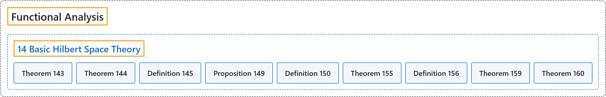

# 14 Basic Hilbert Space Theory

## Classification

## Glossary

| Term | Definition | 中文翻译 | Source |
|---|---|---|---|
| **14 Basic Hilbert Space Theory** 希尔伯特空间基本理论 | (No definition) | （无定义） | [Rodriguez, 2021, lecture 14](https://ocw.mit.edu/courses/18-102-introduction-to-functional-analysis-spring-2021/721d74b7fa9b3b5427779b6905df95ec_MIT18_102s21_lec14.pdf) |
| **Theorem 143** 定理 143 | (pending) | （待补） | [Rodriguez, 2021, lecture 14, Theorem 143](https://ocw.mit.edu/courses/18-102-introduction-to-functional-analysis-spring-2021/721d74b7fa9b3b5427779b6905df95ec_MIT18_102s21_lec14.pdf) |
| **Theorem 144** 定理 144 | (pending) | （待补） | [Rodriguez, 2021, lecture 14, Theorem 144](https://ocw.mit.edu/courses/18-102-introduction-to-functional-analysis-spring-2021/721d74b7fa9b3b5427779b6905df95ec_MIT18_102s21_lec14.pdf) |
| **Definition 145** 定义 145 | (pending) | （待补） | [Rodriguez, 2021, lecture 14, Definition 145](https://ocw.mit.edu/courses/18-102-introduction-to-functional-analysis-spring-2021/721d74b7fa9b3b5427779b6905df95ec_MIT18_102s21_lec14.pdf) |
| **Proposition 149** 命题 149 | (pending) | （待补） | [Rodriguez, 2021, lecture 14, Proposition 149](https://ocw.mit.edu/courses/18-102-introduction-to-functional-analysis-spring-2021/721d74b7fa9b3b5427779b6905df95ec_MIT18_102s21_lec14.pdf) |
| **Definition 150** 定义 150 | (pending) | （待补） | [Rodriguez, 2021, lecture 14, Definition 150](https://ocw.mit.edu/courses/18-102-introduction-to-functional-analysis-spring-2021/721d74b7fa9b3b5427779b6905df95ec_MIT18_102s21_lec14.pdf) |
| **Theorem 155** 定理 155 | (pending) | （待补） | [Rodriguez, 2021, lecture 14, Theorem 155](https://ocw.mit.edu/courses/18-102-introduction-to-functional-analysis-spring-2021/721d74b7fa9b3b5427779b6905df95ec_MIT18_102s21_lec14.pdf) |
| **Definition 156** 定义 156 | (pending) | （待补） | [Rodriguez, 2021, lecture 14, Definition 156](https://ocw.mit.edu/courses/18-102-introduction-to-functional-analysis-spring-2021/721d74b7fa9b3b5427779b6905df95ec_MIT18_102s21_lec14.pdf) |
| **Theorem 159** 定理 159 | (pending) | （待补） | [Rodriguez, 2021, lecture 14, Theorem 159](https://ocw.mit.edu/courses/18-102-introduction-to-functional-analysis-spring-2021/721d74b7fa9b3b5427779b6905df95ec_MIT18_102s21_lec14.pdf) |
| **Theorem 160** 定理 160 | (pending) | （待补） | [Rodriguez, 2021, lecture 14, Theorem 160](https://ocw.mit.edu/courses/18-102-introduction-to-functional-analysis-spring-2021/721d74b7fa9b3b5427779b6905df95ec_MIT18_102s21_lec14.pdf) |

## References

Rodriguez, C. (2021). *18.102 Introduction to functional analysis: Lecture notes* (Spring 2021). MIT OpenCourseWare. Retrieved October 31, 2026, from <https://ocw.mit.edu/courses/18-102-introduction-to-functional-analysis-spring-2021/>
