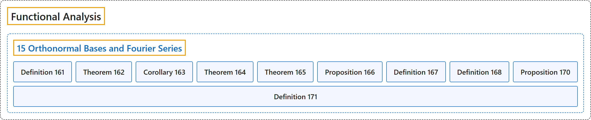

# 15 Orthonormal Bases and Fourier Series

## Classification

## Glossary

| Term | Definition | 中文翻译 | Source |
|---|---|---|---|
| **15 Orthonormal Bases and Fourier Series** 标准正交基与傅里叶级数 | (No definition) | （无定义） | [Rodriguez, 2021, lecture 15](https://ocw.mit.edu/courses/18-102-introduction-to-functional-analysis-spring-2021/859833f65ee4aec6b0fea35a300d10cd_MIT18_102s21_lec15.pdf) |
| **Definition 161** 定义 161 | (pending) | （待补） | [Rodriguez, 2021, lecture 15, Definition 161](https://ocw.mit.edu/courses/18-102-introduction-to-functional-analysis-spring-2021/859833f65ee4aec6b0fea35a300d10cd_MIT18_102s21_lec15.pdf) |
| **Theorem 162** 定理 162 | (pending) | （待补） | [Rodriguez, 2021, lecture 15, Theorem 162](https://ocw.mit.edu/courses/18-102-introduction-to-functional-analysis-spring-2021/859833f65ee4aec6b0fea35a300d10cd_MIT18_102s21_lec15.pdf) |
| **Corollary 163** 推论 163 | (pending) | （待补） | [Rodriguez, 2021, lecture 15, Corollary 163](https://ocw.mit.edu/courses/18-102-introduction-to-functional-analysis-spring-2021/859833f65ee4aec6b0fea35a300d10cd_MIT18_102s21_lec15.pdf) |
| **Theorem 164** 定理 164 | (pending) | （待补） | [Rodriguez, 2021, lecture 15, Theorem 164](https://ocw.mit.edu/courses/18-102-introduction-to-functional-analysis-spring-2021/859833f65ee4aec6b0fea35a300d10cd_MIT18_102s21_lec15.pdf) |
| **Theorem 165** 定理 165 | (pending) | （待补） | [Rodriguez, 2021, lecture 15, Theorem 165](https://ocw.mit.edu/courses/18-102-introduction-to-functional-analysis-spring-2021/859833f65ee4aec6b0fea35a300d10cd_MIT18_102s21_lec15.pdf) |
| **Proposition 166** 命题 166 | (pending) | （待补） | [Rodriguez, 2021, lecture 15, Proposition 166](https://ocw.mit.edu/courses/18-102-introduction-to-functional-analysis-spring-2021/859833f65ee4aec6b0fea35a300d10cd_MIT18_102s21_lec15.pdf) |
| **Definition 167** 定义 167 | (pending) | （待补） | [Rodriguez, 2021, lecture 15, Definition 167](https://ocw.mit.edu/courses/18-102-introduction-to-functional-analysis-spring-2021/859833f65ee4aec6b0fea35a300d10cd_MIT18_102s21_lec15.pdf) |
| **Definition 168** 定义 168 | (pending) | （待补） | [Rodriguez, 2021, lecture 15, Definition 168](https://ocw.mit.edu/courses/18-102-introduction-to-functional-analysis-spring-2021/859833f65ee4aec6b0fea35a300d10cd_MIT18_102s21_lec15.pdf) |
| **Proposition 170** 命题 170 | (pending) | （待补） | [Rodriguez, 2021, lecture 15, Proposition 170](https://ocw.mit.edu/courses/18-102-introduction-to-functional-analysis-spring-2021/859833f65ee4aec6b0fea35a300d10cd_MIT18_102s21_lec15.pdf) |
| **Definition 171** 定义 171 | (pending) | （待补） | [Rodriguez, 2021, lecture 15, Definition 171](https://ocw.mit.edu/courses/18-102-introduction-to-functional-analysis-spring-2021/859833f65ee4aec6b0fea35a300d10cd_MIT18_102s21_lec15.pdf) |

## References

Rodriguez, C. (2021). *18.102 Introduction to functional analysis: Lecture notes* (Spring 2021). MIT OpenCourseWare. Retrieved October 31, 2026, from <https://ocw.mit.edu/courses/18-102-introduction-to-functional-analysis-spring-2021/>
