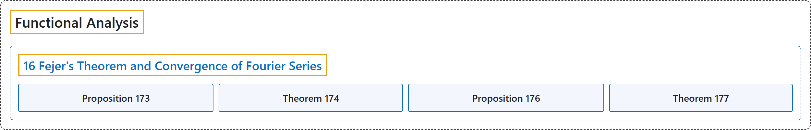

# 16 Fejer's Theorem and Convergence of Fourier Series

## Classification

## Glossary

| Term | Definition | 中文翻译 | Source |
|---|---|---|---|
| **16 Fejer's Theorem and Convergence of Fourier Series** 费耶尔定理与傅里叶级数的收敛 | (No definition) | （无定义） | [Rodriguez, 2021, lecture 16](https://ocw.mit.edu/courses/18-102-introduction-to-functional-analysis-spring-2021/eb44436072623f60f8f416875d4b2c11_MIT18_102s21_lec16.pdf) |
| **Proposition 173** 命题 173 | (pending) | （待补） | [Rodriguez, 2021, lecture 16, Proposition 173](https://ocw.mit.edu/courses/18-102-introduction-to-functional-analysis-spring-2021/eb44436072623f60f8f416875d4b2c11_MIT18_102s21_lec16.pdf) |
| **Theorem 174** 定理 174 | (pending) | （待补） | [Rodriguez, 2021, lecture 16, Theorem 174](https://ocw.mit.edu/courses/18-102-introduction-to-functional-analysis-spring-2021/eb44436072623f60f8f416875d4b2c11_MIT18_102s21_lec16.pdf) |
| **Proposition 176** 命题 176 | (pending) | （待补） | [Rodriguez, 2021, lecture 16, Proposition 176](https://ocw.mit.edu/courses/18-102-introduction-to-functional-analysis-spring-2021/eb44436072623f60f8f416875d4b2c11_MIT18_102s21_lec16.pdf) |
| **Theorem 177** 定理 177 | (pending) | （待补） | [Rodriguez, 2021, lecture 16, Theorem 177](https://ocw.mit.edu/courses/18-102-introduction-to-functional-analysis-spring-2021/eb44436072623f60f8f416875d4b2c11_MIT18_102s21_lec16.pdf) |

## References

Rodriguez, C. (2021). *18.102 Introduction to functional analysis: Lecture notes* (Spring 2021). MIT OpenCourseWare. Retrieved October 31, 2026, from <https://ocw.mit.edu/courses/18-102-introduction-to-functional-analysis-spring-2021/>
