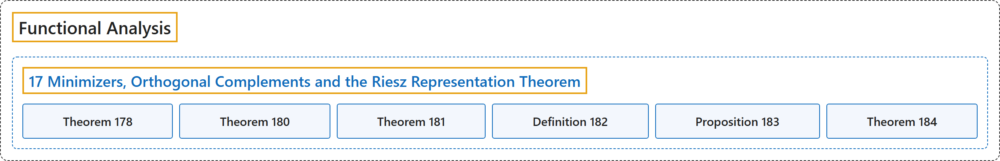

# 17 Minimizers, Orthogonal Complements and the Riesz Representation Theorem

## Classification

## Glossary

| Term | Definition | 中文翻译 | Source |
|---|---|---|---|
| **17 Minimizers, Orthogonal Complements and the Riesz Representation Theorem** 极小元、正交补与里斯表示定理 | (No definition) | （无定义） | [Rodriguez, 2021, lecture 17](https://ocw.mit.edu/courses/18-102-introduction-to-functional-analysis-spring-2021/c97549663746d6bc4a379077e067c55b_MIT18_102s21_lec17.pdf) |
| **Theorem 178** 定理 178 | (pending) | （待补） | [Rodriguez, 2021, lecture 17, Theorem 178](https://ocw.mit.edu/courses/18-102-introduction-to-functional-analysis-spring-2021/c97549663746d6bc4a379077e067c55b_MIT18_102s21_lec17.pdf) |
| **Theorem 180** 定理 180 | (pending) | （待补） | [Rodriguez, 2021, lecture 17, Theorem 180](https://ocw.mit.edu/courses/18-102-introduction-to-functional-analysis-spring-2021/c97549663746d6bc4a379077e067c55b_MIT18_102s21_lec17.pdf) |
| **Theorem 181** 定理 181 | (pending) | （待补） | [Rodriguez, 2021, lecture 17, Theorem 181](https://ocw.mit.edu/courses/18-102-introduction-to-functional-analysis-spring-2021/c97549663746d6bc4a379077e067c55b_MIT18_102s21_lec17.pdf) |
| **Definition 182** 定义 182 | (pending) | （待补） | [Rodriguez, 2021, lecture 17, Definition 182](https://ocw.mit.edu/courses/18-102-introduction-to-functional-analysis-spring-2021/c97549663746d6bc4a379077e067c55b_MIT18_102s21_lec17.pdf) |
| **Proposition 183** 命题 183 | (pending) | （待补） | [Rodriguez, 2021, lecture 17, Proposition 183](https://ocw.mit.edu/courses/18-102-introduction-to-functional-analysis-spring-2021/c97549663746d6bc4a379077e067c55b_MIT18_102s21_lec17.pdf) |
| **Theorem 184** 定理 184 | (pending) | （待补） | [Rodriguez, 2021, lecture 17, Theorem 184](https://ocw.mit.edu/courses/18-102-introduction-to-functional-analysis-spring-2021/c97549663746d6bc4a379077e067c55b_MIT18_102s21_lec17.pdf) |

## References

Rodriguez, C. (2021). *18.102 Introduction to functional analysis: Lecture notes* (Spring 2021). MIT OpenCourseWare. Retrieved October 31, 2026, from <https://ocw.mit.edu/courses/18-102-introduction-to-functional-analysis-spring-2021/>
