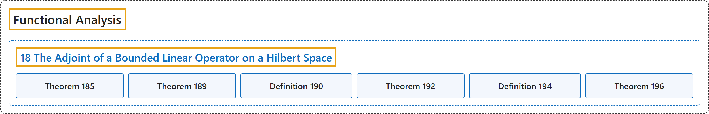

# 18 The Adjoint of a Bounded Linear Operator on a Hilbert Space

## Classification

## Glossary

| Term | Definition | 中文翻译 | Source |
|---|---|---|---|
| **18 The Adjoint of a Bounded Linear Operator on a Hilbert Space** 希尔伯特空间上有界线性算子的伴随 | (No definition) | （无定义） | [Rodriguez, 2021, lecture 18](https://ocw.mit.edu/courses/18-102-introduction-to-functional-analysis-spring-2021/7f23bfc43ee2e1efd238a5384e5b9d51_MIT18_102s21_lec18.pdf) |
| **Theorem 185** 定理 185 | (pending) | （待补） | [Rodriguez, 2021, lecture 18, Theorem 185](https://ocw.mit.edu/courses/18-102-introduction-to-functional-analysis-spring-2021/7f23bfc43ee2e1efd238a5384e5b9d51_MIT18_102s21_lec18.pdf) |
| **Theorem 189** 定理 189 | (pending) | （待补） | [Rodriguez, 2021, lecture 18, Theorem 189](https://ocw.mit.edu/courses/18-102-introduction-to-functional-analysis-spring-2021/7f23bfc43ee2e1efd238a5384e5b9d51_MIT18_102s21_lec18.pdf) |
| **Definition 190** 定义 190 | (pending) | （待补） | [Rodriguez, 2021, lecture 18, Definition 190](https://ocw.mit.edu/courses/18-102-introduction-to-functional-analysis-spring-2021/7f23bfc43ee2e1efd238a5384e5b9d51_MIT18_102s21_lec18.pdf) |
| **Theorem 192** 定理 192 | (pending) | （待补） | [Rodriguez, 2021, lecture 18, Theorem 192](https://ocw.mit.edu/courses/18-102-introduction-to-functional-analysis-spring-2021/7f23bfc43ee2e1efd238a5384e5b9d51_MIT18_102s21_lec18.pdf) |
| **Definition 194** 定义 194 | (pending) | （待补） | [Rodriguez, 2021, lecture 18, Definition 194](https://ocw.mit.edu/courses/18-102-introduction-to-functional-analysis-spring-2021/7f23bfc43ee2e1efd238a5384e5b9d51_MIT18_102s21_lec18.pdf) |
| **Theorem 196** 定理 196 | (pending) | （待补） | [Rodriguez, 2021, lecture 18, Theorem 196](https://ocw.mit.edu/courses/18-102-introduction-to-functional-analysis-spring-2021/7f23bfc43ee2e1efd238a5384e5b9d51_MIT18_102s21_lec18.pdf) |

## References

Rodriguez, C. (2021). *18.102 Introduction to functional analysis: Lecture notes* (Spring 2021). MIT OpenCourseWare. Retrieved October 31, 2026, from <https://ocw.mit.edu/courses/18-102-introduction-to-functional-analysis-spring-2021/>
