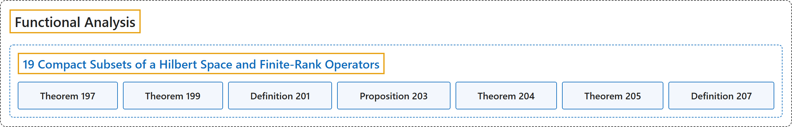

# 19 Compact Subsets of a Hilbert Space and Finite-Rank Operators

## Classification

## Glossary

| Term | Definition | 中文翻译 | Source |
|---|---|---|---|
| **19 Compact Subsets of a Hilbert Space and Finite-Rank Operators** 希尔伯特空间的紧子集与有限秩算子 | (No definition) | （无定义） | [Rodriguez, 2021, lecture 19](https://ocw.mit.edu/courses/18-102-introduction-to-functional-analysis-spring-2021/39ac233d5d7cbfffcdce8086143688f6_MIT18_102s21_lec19.pdf) |
| **Theorem 197** 定理 197 | (pending) | （待补） | [Rodriguez, 2021, lecture 19, Theorem 197](https://ocw.mit.edu/courses/18-102-introduction-to-functional-analysis-spring-2021/39ac233d5d7cbfffcdce8086143688f6_MIT18_102s21_lec19.pdf) |
| **Theorem 199** 定理 199 | (pending) | （待补） | [Rodriguez, 2021, lecture 19, Theorem 199](https://ocw.mit.edu/courses/18-102-introduction-to-functional-analysis-spring-2021/39ac233d5d7cbfffcdce8086143688f6_MIT18_102s21_lec19.pdf) |
| **Definition 201** 定义 201 | (pending) | （待补） | [Rodriguez, 2021, lecture 19, Definition 201](https://ocw.mit.edu/courses/18-102-introduction-to-functional-analysis-spring-2021/39ac233d5d7cbfffcdce8086143688f6_MIT18_102s21_lec19.pdf) |
| **Proposition 203** 命题 203 | (pending) | （待补） | [Rodriguez, 2021, lecture 19, Proposition 203](https://ocw.mit.edu/courses/18-102-introduction-to-functional-analysis-spring-2021/39ac233d5d7cbfffcdce8086143688f6_MIT18_102s21_lec19.pdf) |
| **Theorem 204** 定理 204 | (pending) | （待补） | [Rodriguez, 2021, lecture 19, Theorem 204](https://ocw.mit.edu/courses/18-102-introduction-to-functional-analysis-spring-2021/39ac233d5d7cbfffcdce8086143688f6_MIT18_102s21_lec19.pdf) |
| **Theorem 205** 定理 205 | (pending) | （待补） | [Rodriguez, 2021, lecture 19, Theorem 205](https://ocw.mit.edu/courses/18-102-introduction-to-functional-analysis-spring-2021/39ac233d5d7cbfffcdce8086143688f6_MIT18_102s21_lec19.pdf) |
| **Definition 207** 定义 207 | (pending) | （待补） | [Rodriguez, 2021, lecture 19, Definition 207](https://ocw.mit.edu/courses/18-102-introduction-to-functional-analysis-spring-2021/39ac233d5d7cbfffcdce8086143688f6_MIT18_102s21_lec19.pdf) |

## References

Rodriguez, C. (2021). *18.102 Introduction to functional analysis: Lecture notes* (Spring 2021). MIT OpenCourseWare. Retrieved October 31, 2026, from <https://ocw.mit.edu/courses/18-102-introduction-to-functional-analysis-spring-2021/>
