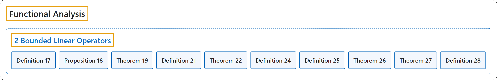

# 2 Bounded Linear Operators

## Classification

## Glossary

| Term | Definition | 中文翻译 | Source |
|---|---|---|---|
| **2 Bounded Linear Operators** 有界线性算子 | (No definition) | （无定义） | [Rodriguez, 2021, lecture 2](https://ocw.mit.edu/courses/18-102-introduction-to-functional-analysis-spring-2021/22bf2f774fb161776032491568148707_MIT18_102s21_lec2.pdf) |
| **Definition 17** 定义 17 | (pending) | （待补） | [Rodriguez, 2021, lecture 2, Definition 17](https://ocw.mit.edu/courses/18-102-introduction-to-functional-analysis-spring-2021/22bf2f774fb161776032491568148707_MIT18_102s21_lec2.pdf) |
| **Proposition 18** 命题 18 | (pending) | （待补） | [Rodriguez, 2021, lecture 2, Proposition 18](https://ocw.mit.edu/courses/18-102-introduction-to-functional-analysis-spring-2021/22bf2f774fb161776032491568148707_MIT18_102s21_lec2.pdf) |
| **Theorem 19** 定理 19 | (pending) | （待补） | [Rodriguez, 2021, lecture 2, Theorem 19](https://ocw.mit.edu/courses/18-102-introduction-to-functional-analysis-spring-2021/22bf2f774fb161776032491568148707_MIT18_102s21_lec2.pdf) |
| **Definition 21** 定义 21 | (pending) | （待补） | [Rodriguez, 2021, lecture 2, Definition 21](https://ocw.mit.edu/courses/18-102-introduction-to-functional-analysis-spring-2021/22bf2f774fb161776032491568148707_MIT18_102s21_lec2.pdf) |
| **Theorem 22** 定理 22 | (pending) | （待补） | [Rodriguez, 2021, lecture 2, Theorem 22](https://ocw.mit.edu/courses/18-102-introduction-to-functional-analysis-spring-2021/22bf2f774fb161776032491568148707_MIT18_102s21_lec2.pdf) |
| **Definition 24** 定义 24 | (pending) | （待补） | [Rodriguez, 2021, lecture 2, Definition 24](https://ocw.mit.edu/courses/18-102-introduction-to-functional-analysis-spring-2021/22bf2f774fb161776032491568148707_MIT18_102s21_lec2.pdf) |
| **Definition 25** 定义 25 | (pending) | （待补） | [Rodriguez, 2021, lecture 2, Definition 25](https://ocw.mit.edu/courses/18-102-introduction-to-functional-analysis-spring-2021/22bf2f774fb161776032491568148707_MIT18_102s21_lec2.pdf) |
| **Theorem 26** 定理 26 | (pending) | （待补） | [Rodriguez, 2021, lecture 2, Theorem 26](https://ocw.mit.edu/courses/18-102-introduction-to-functional-analysis-spring-2021/22bf2f774fb161776032491568148707_MIT18_102s21_lec2.pdf) |
| **Theorem 27** 定理 27 | (pending) | （待补） | [Rodriguez, 2021, lecture 2, Theorem 27](https://ocw.mit.edu/courses/18-102-introduction-to-functional-analysis-spring-2021/22bf2f774fb161776032491568148707_MIT18_102s21_lec2.pdf) |
| **Definition 28** 定义 28 | (pending) | （待补） | [Rodriguez, 2021, lecture 2, Definition 28](https://ocw.mit.edu/courses/18-102-introduction-to-functional-analysis-spring-2021/22bf2f774fb161776032491568148707_MIT18_102s21_lec2.pdf) |

## References

Rodriguez, C. (2021). *18.102 Introduction to functional analysis: Lecture notes* (Spring 2021). MIT OpenCourseWare. Retrieved October 31, 2026, from <https://ocw.mit.edu/courses/18-102-introduction-to-functional-analysis-spring-2021/>
