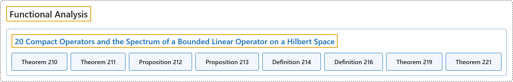

# 20 Compact Operators and the Spectrum of a Bounded Linear Operator on a Hilbert Space

## Classification

## Glossary

| Term | Definition | 中文翻译 | Source |
|---|---|---|---|
| **20 Compact Operators and the Spectrum of a Bounded Linear Operator on a Hilbert Space** 紧算子与希尔伯特空间上有界线性算子的谱 | (No definition) | （无定义） | [Rodriguez, 2021, lecture 20](https://ocw.mit.edu/courses/18-102-introduction-to-functional-analysis-spring-2021/9eaaf363541d01d53c330ee7931fc715_MIT18_102s21_lec20.pdf) |
| **Theorem 210** 定理 210 | (pending) | （待补） | [Rodriguez, 2021, lecture 20, Theorem 210](https://ocw.mit.edu/courses/18-102-introduction-to-functional-analysis-spring-2021/9eaaf363541d01d53c330ee7931fc715_MIT18_102s21_lec20.pdf) |
| **Theorem 211** 定理 211 | (pending) | （待补） | [Rodriguez, 2021, lecture 20, Theorem 211](https://ocw.mit.edu/courses/18-102-introduction-to-functional-analysis-spring-2021/9eaaf363541d01d53c330ee7931fc715_MIT18_102s21_lec20.pdf) |
| **Proposition 212** 命题 212 | (pending) | （待补） | [Rodriguez, 2021, lecture 20, Proposition 212](https://ocw.mit.edu/courses/18-102-introduction-to-functional-analysis-spring-2021/9eaaf363541d01d53c330ee7931fc715_MIT18_102s21_lec20.pdf) |
| **Proposition 213** 命题 213 | (pending) | （待补） | [Rodriguez, 2021, lecture 20, Proposition 213](https://ocw.mit.edu/courses/18-102-introduction-to-functional-analysis-spring-2021/9eaaf363541d01d53c330ee7931fc715_MIT18_102s21_lec20.pdf) |
| **Definition 214** 定义 214 | (pending) | （待补） | [Rodriguez, 2021, lecture 20, Definition 214](https://ocw.mit.edu/courses/18-102-introduction-to-functional-analysis-spring-2021/9eaaf363541d01d53c330ee7931fc715_MIT18_102s21_lec20.pdf) |
| **Definition 216** 定义 216 | (pending) | （待补） | [Rodriguez, 2021, lecture 20, Definition 216](https://ocw.mit.edu/courses/18-102-introduction-to-functional-analysis-spring-2021/9eaaf363541d01d53c330ee7931fc715_MIT18_102s21_lec20.pdf) |
| **Theorem 219** 定理 219 | (pending) | （待补） | [Rodriguez, 2021, lecture 20, Theorem 219](https://ocw.mit.edu/courses/18-102-introduction-to-functional-analysis-spring-2021/9eaaf363541d01d53c330ee7931fc715_MIT18_102s21_lec20.pdf) |
| **Theorem 221** 定理 221 | (pending) | （待补） | [Rodriguez, 2021, lecture 20, Theorem 221](https://ocw.mit.edu/courses/18-102-introduction-to-functional-analysis-spring-2021/9eaaf363541d01d53c330ee7931fc715_MIT18_102s21_lec20.pdf) |

## References

Rodriguez, C. (2021). *18.102 Introduction to functional analysis: Lecture notes* (Spring 2021). MIT OpenCourseWare. Retrieved October 31, 2026, from <https://ocw.mit.edu/courses/18-102-introduction-to-functional-analysis-spring-2021/>
