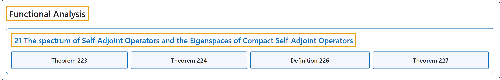

# 21 The spectrum of Self-Adjoint Operators and the Eigenspaces of Compact Self-Adjoint Operators

## Classification

## Glossary

| Term | Definition | 中文翻译 | Source |
|---|---|---|---|
| **21 The spectrum of Self-Adjoint Operators and the Eigenspaces of Compact Self-Adjoint Operators** 自伴算子的谱与紧自伴算子的特征空间 | (No definition) | （无定义） | [Rodriguez, 2021, lecture 21](https://ocw.mit.edu/courses/18-102-introduction-to-functional-analysis-spring-2021/345c4a5141559a4069aeb3105acd8ef3_MIT18_102s21_lec21.pdf) |
| **Theorem 223** 定理 223 | (pending) | （待补） | [Rodriguez, 2021, lecture 21, Theorem 223](https://ocw.mit.edu/courses/18-102-introduction-to-functional-analysis-spring-2021/345c4a5141559a4069aeb3105acd8ef3_MIT18_102s21_lec21.pdf) |
| **Theorem 224** 定理 224 | (pending) | （待补） | [Rodriguez, 2021, lecture 21, Theorem 224](https://ocw.mit.edu/courses/18-102-introduction-to-functional-analysis-spring-2021/345c4a5141559a4069aeb3105acd8ef3_MIT18_102s21_lec21.pdf) |
| **Definition 226** 定义 226 | (pending) | （待补） | [Rodriguez, 2021, lecture 21, Definition 226](https://ocw.mit.edu/courses/18-102-introduction-to-functional-analysis-spring-2021/345c4a5141559a4069aeb3105acd8ef3_MIT18_102s21_lec21.pdf) |
| **Theorem 227** 定理 227 | (pending) | （待补） | [Rodriguez, 2021, lecture 21, Theorem 227](https://ocw.mit.edu/courses/18-102-introduction-to-functional-analysis-spring-2021/345c4a5141559a4069aeb3105acd8ef3_MIT18_102s21_lec21.pdf) |

## References

Rodriguez, C. (2021). *18.102 Introduction to functional analysis: Lecture notes* (Spring 2021). MIT OpenCourseWare. Retrieved October 31, 2026, from <https://ocw.mit.edu/courses/18-102-introduction-to-functional-analysis-spring-2021/>
