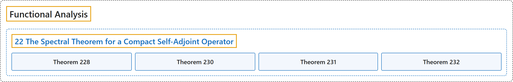

# 22 The Spectral Theorem for a Compact Self-Adjoint Operator

## Classification

## Glossary

| Term | Definition | 中文翻译 | Source |
|---|---|---|---|
| **22 The Spectral Theorem for a Compact Self-Adjoint Operator** 紧自伴算子的谱定理 | (No definition) | （无定义） | [Rodriguez, 2021, lecture 22](https://ocw.mit.edu/courses/18-102-introduction-to-functional-analysis-spring-2021/57596554e180e442c9487f580303147b_MIT18_102s21_lec22.pdf) |
| **Theorem 228** 定理 228 | (pending) | （待补） | [Rodriguez, 2021, lecture 22, Theorem 228](https://ocw.mit.edu/courses/18-102-introduction-to-functional-analysis-spring-2021/57596554e180e442c9487f580303147b_MIT18_102s21_lec22.pdf) |
| **Theorem 230** 定理 230 | (pending) | （待补） | [Rodriguez, 2021, lecture 22, Theorem 230](https://ocw.mit.edu/courses/18-102-introduction-to-functional-analysis-spring-2021/57596554e180e442c9487f580303147b_MIT18_102s21_lec22.pdf) |
| **Theorem 231** 定理 231 | (pending) | （待补） | [Rodriguez, 2021, lecture 22, Theorem 231](https://ocw.mit.edu/courses/18-102-introduction-to-functional-analysis-spring-2021/57596554e180e442c9487f580303147b_MIT18_102s21_lec22.pdf) |
| **Theorem 232** 定理 232 | (pending) | （待补） | [Rodriguez, 2021, lecture 22, Theorem 232](https://ocw.mit.edu/courses/18-102-introduction-to-functional-analysis-spring-2021/57596554e180e442c9487f580303147b_MIT18_102s21_lec22.pdf) |

## References

Rodriguez, C. (2021). *18.102 Introduction to functional analysis: Lecture notes* (Spring 2021). MIT OpenCourseWare. Retrieved October 31, 2026, from <https://ocw.mit.edu/courses/18-102-introduction-to-functional-analysis-spring-2021/>
