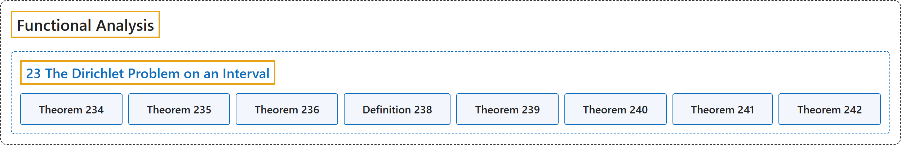

# 23 The Dirichlet Problem on an Interval

## Classification

## Glossary

| Term | Definition | 中文翻译 | Source |
|---|---|---|---|
| **23 The Dirichlet Problem on an Interval** 区间上的狄利克雷问题 | (No definition) | （无定义） | [Rodriguez, 2021, lecture 23](https://ocw.mit.edu/courses/18-102-introduction-to-functional-analysis-spring-2021/9f0f59147c3235d57eacca9157faf834_MIT18_102s21_lec23.pdf) |
| **Theorem 234** 定理 234 | (pending) | （待补） | [Rodriguez, 2021, lecture 23, Theorem 234](https://ocw.mit.edu/courses/18-102-introduction-to-functional-analysis-spring-2021/9f0f59147c3235d57eacca9157faf834_MIT18_102s21_lec23.pdf) |
| **Theorem 235** 定理 235 | (pending) | （待补） | [Rodriguez, 2021, lecture 23, Theorem 235](https://ocw.mit.edu/courses/18-102-introduction-to-functional-analysis-spring-2021/9f0f59147c3235d57eacca9157faf834_MIT18_102s21_lec23.pdf) |
| **Theorem 236** 定理 236 | (pending) | （待补） | [Rodriguez, 2021, lecture 23, Theorem 236](https://ocw.mit.edu/courses/18-102-introduction-to-functional-analysis-spring-2021/9f0f59147c3235d57eacca9157faf834_MIT18_102s21_lec23.pdf) |
| **Definition 238** 定义 238 | (pending) | （待补） | [Rodriguez, 2021, lecture 23, Definition 238](https://ocw.mit.edu/courses/18-102-introduction-to-functional-analysis-spring-2021/9f0f59147c3235d57eacca9157faf834_MIT18_102s21_lec23.pdf) |
| **Theorem 239** 定理 239 | (pending) | （待补） | [Rodriguez, 2021, lecture 23, Theorem 239](https://ocw.mit.edu/courses/18-102-introduction-to-functional-analysis-spring-2021/9f0f59147c3235d57eacca9157faf834_MIT18_102s21_lec23.pdf) |
| **Theorem 240** 定理 240 | (pending) | （待补） | [Rodriguez, 2021, lecture 23, Theorem 240](https://ocw.mit.edu/courses/18-102-introduction-to-functional-analysis-spring-2021/9f0f59147c3235d57eacca9157faf834_MIT18_102s21_lec23.pdf) |
| **Theorem 241** 定理 241 | (pending) | （待补） | [Rodriguez, 2021, lecture 23, Theorem 241](https://ocw.mit.edu/courses/18-102-introduction-to-functional-analysis-spring-2021/9f0f59147c3235d57eacca9157faf834_MIT18_102s21_lec23.pdf) |
| **Theorem 242** 定理 242 | (pending) | （待补） | [Rodriguez, 2021, lecture 23, Theorem 242](https://ocw.mit.edu/courses/18-102-introduction-to-functional-analysis-spring-2021/9f0f59147c3235d57eacca9157faf834_MIT18_102s21_lec23.pdf) |

## References

Rodriguez, C. (2021). *18.102 Introduction to functional analysis: Lecture notes* (Spring 2021). MIT OpenCourseWare. Retrieved October 31, 2026, from <https://ocw.mit.edu/courses/18-102-introduction-to-functional-analysis-spring-2021/>
