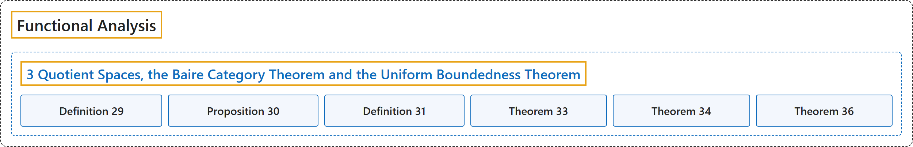

# 3 Quotient Spaces, the Baire Category Theorem and the Uniform Boundedness Theorem

## Classification

## Glossary

| Term | Definition | 中文翻译 | Source |
|---|---|---|---|
| **3 Quotient Spaces, the Baire Category Theorem and the Uniform Boundedness Theorem** 商空间、贝尔纲定理与一致有界性定理 | (No definition) | （无定义） | [Rodriguez, 2021, lecture 3](https://ocw.mit.edu/courses/18-102-introduction-to-functional-analysis-spring-2021/f168e97ce4839083e546555a6a994697_MIT18_102s21_lec3.pdf) |
| **Definition 29** 定义 29 | (pending) | （待补） | [Rodriguez, 2021, lecture 3, Definition 29](https://ocw.mit.edu/courses/18-102-introduction-to-functional-analysis-spring-2021/f168e97ce4839083e546555a6a994697_MIT18_102s21_lec3.pdf) |
| **Proposition 30** 命题 30 | (pending) | （待补） | [Rodriguez, 2021, lecture 3, Proposition 30](https://ocw.mit.edu/courses/18-102-introduction-to-functional-analysis-spring-2021/f168e97ce4839083e546555a6a994697_MIT18_102s21_lec3.pdf) |
| **Definition 31** 定义 31 | (pending) | （待补） | [Rodriguez, 2021, lecture 3, Definition 31](https://ocw.mit.edu/courses/18-102-introduction-to-functional-analysis-spring-2021/f168e97ce4839083e546555a6a994697_MIT18_102s21_lec3.pdf) |
| **Theorem 33** 定理 33 | (pending) | （待补） | [Rodriguez, 2021, lecture 3, Theorem 33](https://ocw.mit.edu/courses/18-102-introduction-to-functional-analysis-spring-2021/f168e97ce4839083e546555a6a994697_MIT18_102s21_lec3.pdf) |
| **Theorem 34** 定理 34 | (pending) | （待补） | [Rodriguez, 2021, lecture 3, Theorem 34](https://ocw.mit.edu/courses/18-102-introduction-to-functional-analysis-spring-2021/f168e97ce4839083e546555a6a994697_MIT18_102s21_lec3.pdf) |
| **Theorem 36** 定理 36 | (pending) | （待补） | [Rodriguez, 2021, lecture 3, Theorem 36](https://ocw.mit.edu/courses/18-102-introduction-to-functional-analysis-spring-2021/f168e97ce4839083e546555a6a994697_MIT18_102s21_lec3.pdf) |

## References

Rodriguez, C. (2021). *18.102 Introduction to functional analysis: Lecture notes* (Spring 2021). MIT OpenCourseWare. Retrieved October 31, 2026, from <https://ocw.mit.edu/courses/18-102-introduction-to-functional-analysis-spring-2021/>
