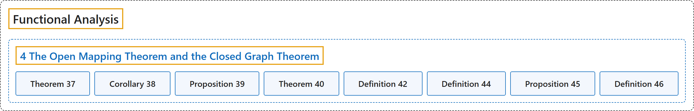

# 4 The Open Mapping Theorem and the Closed Graph Theorem

## Classification

## Glossary

| Term | Definition | 中文翻译 | Source |
|---|---|---|---|
| **4 The Open Mapping Theorem and the Closed Graph Theorem** 开映射定理与闭图像定理 | (No definition) | （无定义） | [Rodriguez, 2021, lecture 4](https://ocw.mit.edu/courses/18-102-introduction-to-functional-analysis-spring-2021/038fc32ab9c1bb63a4f29bd9d7c97961_MIT18_102s21_lec4.pdf) |
| **Theorem 37** 定理 37 | (pending) | （待补） | [Rodriguez, 2021, lecture 4, Theorem 37](https://ocw.mit.edu/courses/18-102-introduction-to-functional-analysis-spring-2021/038fc32ab9c1bb63a4f29bd9d7c97961_MIT18_102s21_lec4.pdf) |
| **Corollary 38** 推论 38 | (pending) | （待补） | [Rodriguez, 2021, lecture 4, Corollary 38](https://ocw.mit.edu/courses/18-102-introduction-to-functional-analysis-spring-2021/038fc32ab9c1bb63a4f29bd9d7c97961_MIT18_102s21_lec4.pdf) |
| **Proposition 39** 命题 39 | (pending) | （待补） | [Rodriguez, 2021, lecture 4, Proposition 39](https://ocw.mit.edu/courses/18-102-introduction-to-functional-analysis-spring-2021/038fc32ab9c1bb63a4f29bd9d7c97961_MIT18_102s21_lec4.pdf) |
| **Theorem 40** 定理 40 | (pending) | （待补） | [Rodriguez, 2021, lecture 4, Theorem 40](https://ocw.mit.edu/courses/18-102-introduction-to-functional-analysis-spring-2021/038fc32ab9c1bb63a4f29bd9d7c97961_MIT18_102s21_lec4.pdf) |
| **Definition 42** 定义 42 | (pending) | （待补） | [Rodriguez, 2021, lecture 4, Definition 42](https://ocw.mit.edu/courses/18-102-introduction-to-functional-analysis-spring-2021/038fc32ab9c1bb63a4f29bd9d7c97961_MIT18_102s21_lec4.pdf) |
| **Definition 44** 定义 44 | (pending) | （待补） | [Rodriguez, 2021, lecture 4, Definition 44](https://ocw.mit.edu/courses/18-102-introduction-to-functional-analysis-spring-2021/038fc32ab9c1bb63a4f29bd9d7c97961_MIT18_102s21_lec4.pdf) |
| **Proposition 45** 命题 45 | (pending) | （待补） | [Rodriguez, 2021, lecture 4, Proposition 45](https://ocw.mit.edu/courses/18-102-introduction-to-functional-analysis-spring-2021/038fc32ab9c1bb63a4f29bd9d7c97961_MIT18_102s21_lec4.pdf) |
| **Definition 46** 定义 46 | (pending) | （待补） | [Rodriguez, 2021, lecture 4, Definition 46](https://ocw.mit.edu/courses/18-102-introduction-to-functional-analysis-spring-2021/038fc32ab9c1bb63a4f29bd9d7c97961_MIT18_102s21_lec4.pdf) |

## References

Rodriguez, C. (2021). *18.102 Introduction to functional analysis: Lecture notes* (Spring 2021). MIT OpenCourseWare. Retrieved October 31, 2026, from <https://ocw.mit.edu/courses/18-102-introduction-to-functional-analysis-spring-2021/>
